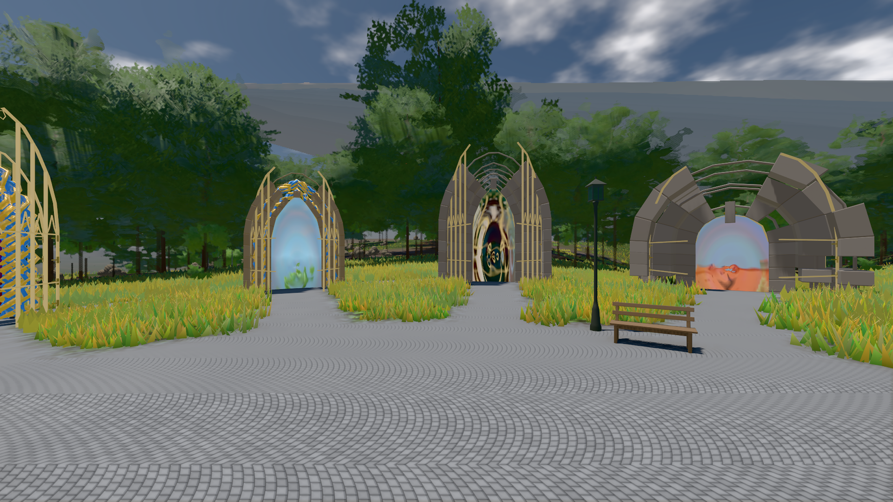

# GPU-PROBE 66f7d36e — GRÜN

Zweig `w28-nexus-uhr` · Kopf 66f7d36e2772ee1f837e3a7d59e05038983fe20a · Läufer gtx1050-desktop · 14.11. 05:43 · Wanduhr ab Push 1068 s · Lauf https://github.com/MiguellD/AnazhRealm/actions/runs/43556604358

Ruf: `gate:kamera-leib:echt bild:genesis@0.5`

## Läufer gtx1050-desktop — GRÜN

GPU NVIDIA GeForce GTX 1050 · npm ci 38 s (package-lock ba467c8f)
Schloss /c/Users/User/AppData/Local/Temp/claude/gpu-schloss hält „ci-runner 43556604358/1 probe“
- Hook 2026-11-14 05:34:50 start ci-runner 43556604358/1 probe: Schloss genommen (refs/heads/w28-nexus-uhr 66f7d36e2772ee1f837e3a7d59e05038983fe20a ws=C:\actions-runner\_work\AnazhRealm\AnazhRealm)

### gate:kamera-leib:echt — GRÜN · 129 s · Läufer gtx1050-desktop

Adapter: [linse-gpu] nvidia/pascal

```text
  ✅ K6 Strafe am Prüfplatz — A0 Kopf 1.0 % Leib 1.6 % (2425 px),A1 Kopf 0.0 % Leib 1.8 % (2442 px),A2 Kopf 1.1 % Leib 1.7 % (2474 px),A3 Kopf 0.0 % Leib 1.1 % (2485 px),D0 Kopf 0.0 % Leib 2.5 % (2480 px),D1 Kopf 0.0 % Leib 1.1 % (2426 px),D2 Kopf 0.0 % Leib 1.0 % (2482 px),D3 Kopf 0.0 % Leib 1.2 % (2531 px) · Rückstrahl 0.1 %
✅ GRÜN — die Kamera steckt nie in Laub, Strauch, Fels oder Boden.
```

### bild:genesis@0.5 — GRÜN · 76 s · Läufer gtx1050-desktop

Adapter: [linse-gpu] nvidia/pascal

```text
Kamera des Spiels → Blick (10.0 m): 0.00 92.40 0.00 -10.00 92.40 0.00
 "abnahme": "ABNAHME GRÜN · beweis · Sicht 0.0 % · Ziel Blickziel im Bild frei 10 m · Luma 108.3 σ 40.7 schwarz 0.0 % weiß 0.0 % · Stand 18.546.278 · Bühne summer sunny 0.50 Tiere gehalten · Gerät WebGPU nvidia pascal · Inhalt bodenSatz 36.2 % (≥ 15.0 %) Luma 140, portal-membran 2.8 % (≥ 0.3 %) Luma 139",
```


