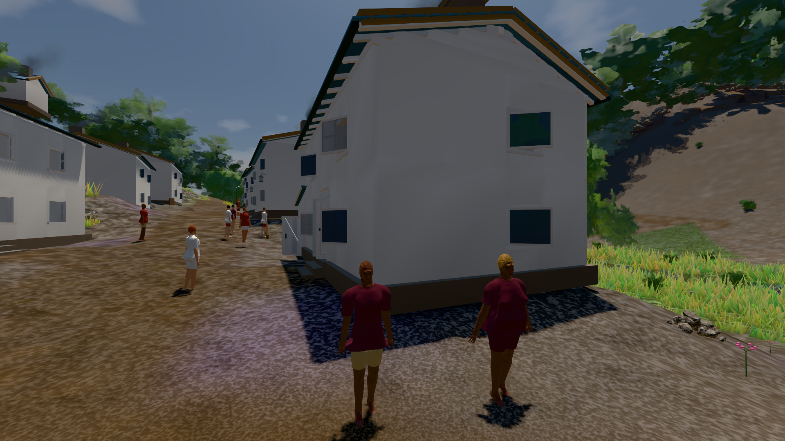
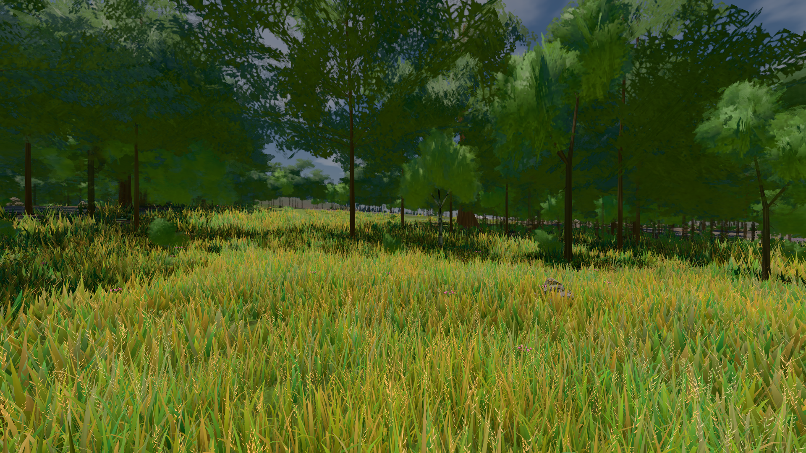
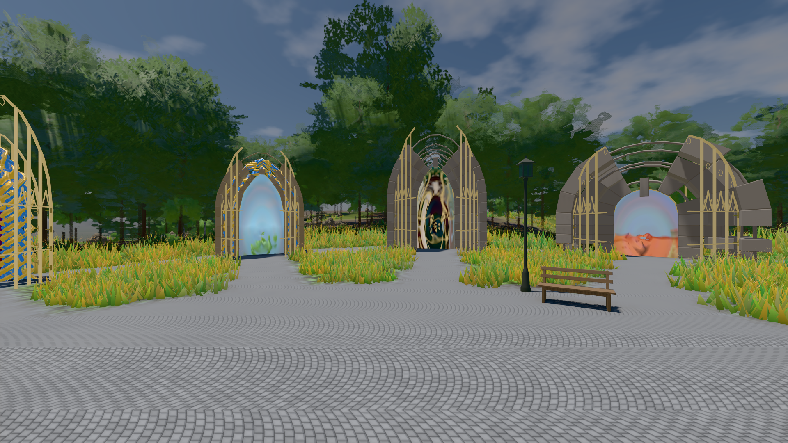

# GPU-PROBE ecba91ae — GRÜN

Zweig `w28-planet-kern` · Kopf ecba91aea0561eb9f6757686e4b00474d4553c42 · Läufer radeon-890m · 15.11. 17:23 · Wanduhr ab Push 1056 s · Lauf https://github.com/MiguellD/AnazhRealm/actions/runs/43733529285

Ruf: `bild:dorf@0.5 bild:wiese@0.5 bild:genesis@0.5`

## Läufer radeon-890m — GRÜN

GPU AMD Radeon(TM) 890M Graphics · npm ci 90 s (package-lock 604b0b39)
Schloss /c/Users/micha/AppData/Local/Temp/claude/gpu-schloss hält „ci-runner 43733529285/1 probe“
- Hook 2026-11-15 17:10:05 start ci-runner 43733529285/1 probe: wartet auf Schloss von 'w28-bild-preis 2026-11-15T17:09:32+01:00 pid=29704'
- Hook 2026-11-15 17:16:55 start ci-runner 43733529285/1 probe: Schloss genommen (refs/heads/w28-planet-kern ecba91aea0561eb9f6757686e4b00474d4553c42 ws=C:\actions-runner\_work\AnazhRealm\AnazhRealm)

### bild:dorf@0.5 — GRÜN · 75 s · Läufer radeon-890m

Adapter: [linse-gpu] amd/rdna-3

```text
Kamera des Spiels → Blick (5.2 m): -704.22 39.69 -880.02 -703.03 39.69 -874.96
 "abnahme": "ABNAHME GRÜN · beweis · Sicht 0.0 % · Ziel Blickziel im Bild frei 5.2 m · Luma 77.9 σ 30.9 schwarz 0.3 % weiß 0.0 % · Stand 18.546.294 · Bühne summer sunny 0.50 Tiere gehalten · Gerät WebGPU amd rdna-3 · Inhalt bauSatz 28.7 % (≥ 2.0 %) Luma 80",
```



### bild:wiese@0.5 — GRÜN · 62 s · Läufer radeon-890m

Adapter: [linse-gpu] amd/rdna-3

```text
Kamera des Spiels → Blick (10.0 m): -280.40 29.71 -1045.60 -289.61 29.71 -1049.50
 "abnahme": "ABNAHME GRÜN · beweis · Sicht 0.0 % · Ziel Blickziel im Bild frei 10 m · Luma 81.5 σ 39.3 schwarz 0.0 % weiß 0.0 % · Stand 18.546.294 · Bühne summer sunny 0.50 Tiere gehalten · Gerät WebGPU amd rdna-3 · Inhalt nahWiese 48.2 % (≥ 15.0 %) h 107° Luma 117",
```



### bild:genesis@0.5 — GRÜN · 48 s · Läufer radeon-890m

Adapter: [linse-gpu] amd/rdna-3

```text
Kamera des Spiels → Blick (10.0 m): 0.00 92.40 0.00 -10.00 92.40 0.00
 "abnahme": "ABNAHME GRÜN · beweis · Sicht 0.0 % · Ziel Blickziel im Bild frei 10 m · Luma 108 σ 39 schwarz 0.0 % weiß 0.0 % · Stand 18.546.294 · Bühne summer sunny 0.50 Tiere gehalten · Gerät WebGPU amd rdna-3 · Inhalt bodenSatz 36.4 % (≥ 15.0 %) Luma 140, portal-membran 2.7 % (≥ 0.3 %) Luma 140",
```


