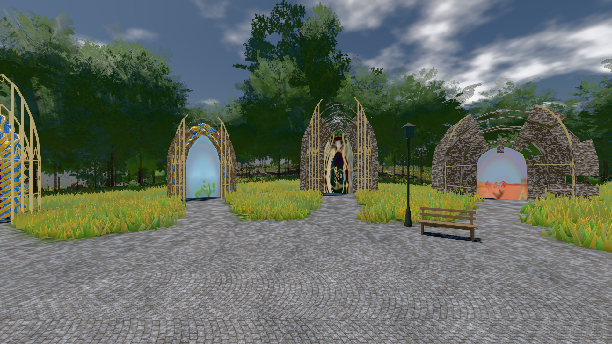

# GPU-PROBE 02c27132 — GRÜN

Zweig `w28-platte-fein` · Kopf 02c271329c280ebfbdff96a94aeeb80c44364900 · Läufer radeon-890m + omen-gtx1060 (Band-Gerät) · 13.11. 17:41 · Wanduhr ab Push 725 s · Lauf https://github.com/MiguellD/AnazhRealm/actions/runs/43463128151

Ruf: `gate:boot-stage bild:genesis@0.5 zeit:gate:ankunft`

## Läufer radeon-890m — GRÜN

GPU AMD Radeon(TM) 890M Graphics · npm ci 183 s (package-lock 57368c8e)
Schloss /c/Users/micha/AppData/Local/Temp/claude/gpu-schloss hält „ci-runner 43463128151/1 probe“
- Hook 2026-11-13 17:29:37 start ci-runner 43463128151/1 probe: Schloss genommen (refs/heads/w28-platte-fein 02c271329c280ebfbdff96a94aeeb80c44364900 ws=C:\actions-runner\_work\AnazhRealm\AnazhRealm)

### gate:boot-stage — GRÜN · 82 s · Läufer radeon-890m

Adapter: ungenannt (die Probe nannte keinen Browser-Adapter)

```text
  ✅ SELBST-TEST: das Buch, das sich noch öffnet, hält die Welt offen (`_weltOffen`) — ohne Rezepte ein Offenes mehr, mit ihnen wie zuvor
  ✅ SELBST-TEST: die verschluckte Lieferung ist ROT — LIEFERUNG kalt: 0 von 131 von der Platte (0.0 %) · Werk 115 · Haupt-Faden 6 · leer 10 · verschluckt 1
  ✅ SELBST-TEST: der Kern-Wechsel urteilt (fremder Neubau, alter Leser ROT)
  ✅ SELBST-TEST: synchron nach dem Bild ROT
  ✅ SELBST-TEST: der Abdruck urteilt — ein Körper der Platte mit den Bytes des alten Gesetzes ist GEFANGEN beim Namen (ALT UNTER NEUEM GESETZ), ein Treffer mit anderen Bytes, der den gewechselten Kern nie las, heißt NICHT BYTE-STABIL, ohne Messung fällt die Zeile
  ✅ SELBST-TEST: die Programm-Zeile urteilt (gleiche Bytes GRÜN, eine fremde Pipeline ROT beim Namen, ohne Messung ROT)
  ✅ SELBST-TEST: die Lücke je Kachel — der fehlende Busch reißt Kachel 0/0 (18.75 %), das Bildmittel (main, 0.39 %) hielte ihn
  ✅ SELBST-TEST: am Bild gezeichnet — ein wartender Bürger ist ROT beim Namen (Hauptbild und Wurf), ohne Messung ROT
  ✅ SELBST-TEST: die Ankunft bricht nicht — jeder Eintrag des Bruch-Buchs vor dem Bild ist ROT beim Wort, ohne Messung ROT, der EINE Sammler sah ihn
✅ „Volle Bühne" ist ein Prädikat — Kriterium 2 ist messbar.
```

### bild:genesis@0.5 — GRÜN · 111 s · Läufer radeon-890m

Adapter: [linse-gpu] amd/rdna-3

```text
Kamera des Spiels → Blick (10.0 m): 0.00 92.40 0.00 -10.00 92.40 0.00
 "abnahme": "ABNAHME GRÜN · beweis · Sicht 0.0 % · Ziel Blickziel im Bild frei 10 m · Luma 105.7 σ 41 schwarz 0.0 % weiß 0.0 % · Stand 18.546.272 · Bühne summer sunny 0.50 Tiere gehalten · Gerät WebGPU amd rdna-3 · Inhalt bodenSatz 35.4 % (≥ 15.0 %) Luma 129, portal-membran 2.8 % (≥ 0.3 %) Luma 139",
```



## Läufer omen-gtx1060 (Band-Gerät) — GRÜN

GPU NVIDIA GeForce GTX 1060 · node_modules bleiben (package-lock 57368c8e)
Schloss /c/Users/micha/AppData/Local/Temp/claude/gpu-schloss hält „ci-runner 43463128151/1 probe“
- Hook 2026-11-13 17:29:15 start ci-runner 43463128151/1 probe: wartet auf Schloss von 'omen-sg-mp-delta'
- Hook 2026-11-13 17:29:30 start ci-runner 43463128151/1 probe: Schloss genommen (refs/heads/w28-platte-fein 02c271329c280ebfbdff96a94aeeb80c44364900 ws=C:\actions-runner\_work\AnazhRealm\AnazhRealm)

### zeit:gate:ankunft — GRÜN · 111 s · Läufer omen-gtx1060 (Band-Gerät)

Adapter: ungenannt (die Probe nannte keinen Browser-Adapter)

```text
  ✅ LH was das Bild nicht liest, hält es nicht: die Hülle am Leib, der Ring außer Bild im Leerlauf — Hülle 0,0,0,1,0 · Ring [hinten ohne Leerlauf, vorn, Ruf, hinten mit] false,true,true,true · Kacheln {"_tickNahWiese":[0,1],"_nahWieseFernTakt":[0,3],"_tickNahStreu":[0,3]} · Krone vor der Kachel [gebaut, stehend, unter der kommenden, unter der gelandeten] {"_tickNahWiese":[24,24,0,10],"_nahWieseFernTakt":[852,852,0,4],"_tickNahStreu":[148,148,0,36]} · Mutante {"_tickNahWiese":[34,24,10,10],"_nahWieseFernTakt":[856,852,4,4],"_tickNahStreu":[184,148,36,36]} · Chunk [offen, gepflanzt]
  ✅ L1 das Fadenkreuz steht in der Bildmitte und weicht der Schublade — da true · Mitte 0/0 px · mit Werkstatt false · danach true
  ✅ L2b „hilfe" nennt die EINEN Tafeln und die Tasten — „hilfe": 0 fehlen · „help": 0 fehlen · „?": 0 fehlen
  ✅ L3 Enter öffnet das Gespräch, Enter sendet und gibt die Welt zurück, Enter auf einem Knopf gehört dem Knopf — Enter → chat-input · gesendet true · danach BODY · W true · Esc → BODY · Enter auf dem Knopf → knopf
  ✅ L7 der Start-Gurt liest den Katalog (je Studio-Art ein Werk) — baum_eiche · fahrzeug_gt · tor_drachentor · haus_alemannisch · bank_sitzbank · leiter_podestleiter · bruecke_jochfeld · schaukel_doppelschaukel (Arten im Katalog: tree, vehicle, ort:tor, haus, ort:platz, ort:wand, ort:weg, ort:spielplatz)
  ✅ LK die 3rd-Kamera rückt nur vor Boden und Bau ein, gleitet hinaus, jeder Pflanzen-Stoff trägt die Durchsicht — baum_kiefer · Stamm × 3.977 (Welt × 3.977) · fuss: 496 Proben, Pflanze hält 0, Arm 6.11/6.11 m (Ist/Soll), < 3 m 0, Sprünge 0 (Soll 0, hinaus 0) · ritt: 496 Proben, Pflanze hält 0, Arm 9.38/9.38 m (Ist/Soll), < 3 m 0, Sprünge 0 (Soll 0, hinaus 0) · Pflanzen-Stoffe 14, ohne Durchsicht 0, Ziel 0.6 m neben der Brust, Fadenkreuz 0.6 m neben der Brust · Fadenkreuz-Strahl: 96 Stellungen, hinter dem Spieler {}, Ziel neben dem Blick 0 m · Durchsicht: 1st 0/8 Anläufe mit
  ✅ D8 der Spieler-Chat trägt Worte, das Log die Zahlen — 6 Zeilen · Log true
  ✅ D6 die KI nennt die Ursache (Dienst · Schlüssel · Proxy) — Status „Fehler (Ollama (lokal oder gehostet)): Keine Antwort von 127" · ohne Schlüssel „(Grok schweigt: für Claude (Anthropic, kostet) fehlt der Sch" · Proxy http://127.0.0.1:4601/api/proxy/llm
  ✅ D9 das Dorf steht vor dir, ein gesperrter Slot fällt an seinem Ort — 25 Häuser (Log: 25 platziert, 0 übersprungen) · hinten 0 · außer Bild 0 · gesperrter Slot steht false, laut true · „„Villaalto" steht vor dir: 25 Häuser." · baue dorf hier: 44.4–120.9 m, beim Mitspieler 0 m daneben (Häuser 14 / 14)
✅ GRÜN — die Ankunft trägt ihre benannten Schnitte.
```
