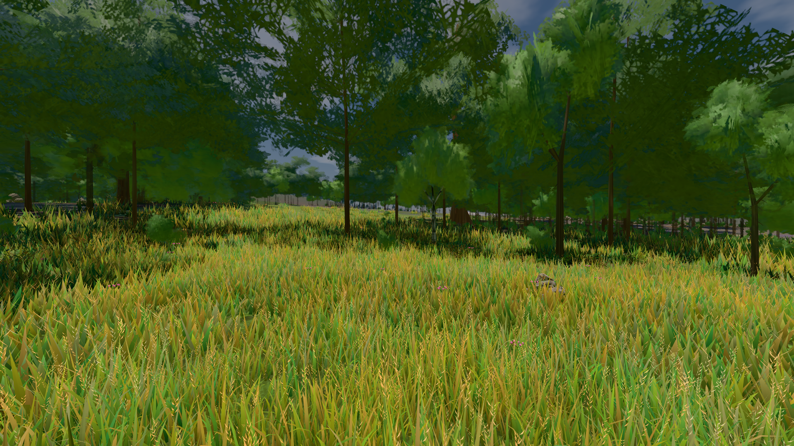
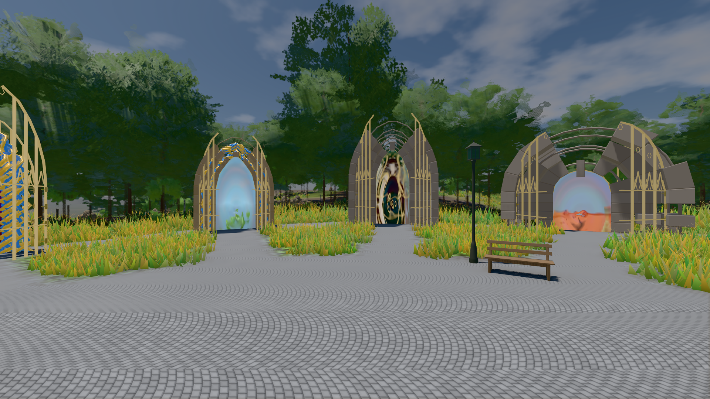

# GPU-PROBE cca0ec8d — GRÜN · ROT wie an main (bekannt): gate:pop: lod.K2#1 (main gtx: ungemessen) auf omen-gtx1060

Zweig `w28-preis-ort` · Kopf cca0ec8d326a719fc1ee7d17249473c81288e759 · Läufer omen-gtx1060 · 15.11. 16:29 · Wanduhr ab Push 608 s · Lauf https://github.com/MiguellD/AnazhRealm/actions/runs/43729240563

Ruf: `bild:wiese@0.5 bild:genesis@0.5 gate:pop`

## Läufer omen-gtx1060 — GRÜN

GPU NVIDIA GeForce GTX 1060 · node_modules bleiben (package-lock 5ba7a8f5)
Schloss /c/Users/micha/AppData/Local/Temp/claude/gpu-schloss hält „ci-runner 43729240563/1 probe“
- Hook 2026-11-15 16:20:08 start ci-runner 43729240563/1 probe: wartet auf Schloss von 'omen-sg-gang-ms2'
- Hook 2026-11-15 16:26:26 start ci-runner 43729240563/1 probe: Schloss genommen (refs/heads/w28-preis-ort cca0ec8d326a719fc1ee7d17249473c81288e759 ws=C:\actions-runner\_work\AnazhRealm\AnazhRealm)

### bild:wiese@0.5 — GRÜN · 48 s · Läufer omen-gtx1060

Adapter: [linse-gpu] nvidia/pascal

```text
Kamera des Spiels → Blick (10.0 m): -280.40 29.71 -1045.60 -289.61 29.71 -1049.50
 "abnahme": "ABNAHME GRÜN · beweis · Sicht 0.0 % · Ziel Blickziel im Bild frei 10 m · Luma 81.9 σ 39 schwarz 0.0 % weiß 0.0 % · Stand 18.546.292 · Bühne summer sunny 0.50 Tiere gehalten · Gerät WebGPU nvidia pascal · Inhalt nahWiese 48.2 % (≥ 15.0 %) h 107° Luma 117",
```



### bild:genesis@0.5 — GRÜN · 38 s · Läufer omen-gtx1060

Adapter: [linse-gpu] nvidia/pascal

```text
Kamera des Spiels → Blick (10.0 m): 0.00 92.40 0.00 -10.00 92.40 0.00
 "abnahme": "ABNAHME GRÜN · beweis · Sicht 0.0 % · Ziel Blickziel im Bild frei 10 m · Luma 108 σ 39 schwarz 0.0 % weiß 0.0 % · Stand 18.546.292 · Bühne summer sunny 0.50 Tiere gehalten · Gerät WebGPU nvidia pascal · Inhalt bodenSatz 36.4 % (≥ 15.0 %) Luma 140, portal-membran 2.7 % (≥ 0.3 %) Luma 140",
```



### gate:pop — BEKANNT · 73 s · Läufer omen-gtx1060

Adapter: ungenannt (die Probe nannte keinen Browser-Adapter) · ROT wie an main (bekannt): lod.K2#1 (main gtx: ungemessen)

```text
lod.K2#1 ROT 1.5483 % Pop-Pixel/s (32106 px) · 38*+24@116/486*+67@107/53*+84@120/5744*+40@130/16063*+63@138/2206*+68@140/6275*+42@152/1241*+76@156 · Laub 216 · dc, Dreiecke 98,362947 · GPU 24.42 ms, CPU 2.63 ms je Bild
BLOCK-TREUE GRÜN 231 Blöcke treu · Selbsttest nennt MeshStandardNodeMaterial · nahWiese:L1:0:0 · instanzFarbe: 1/880 Instanzen fremd
 "fehler": "lod.K2#1 ROT 1.5483 % Pop-Pixel/s > 0,05"
```
