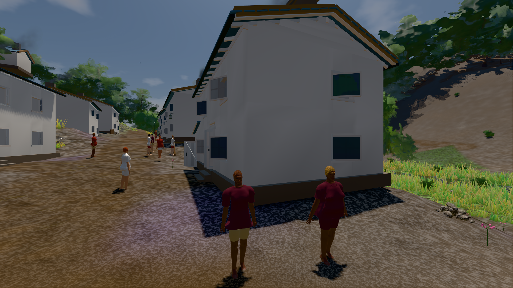
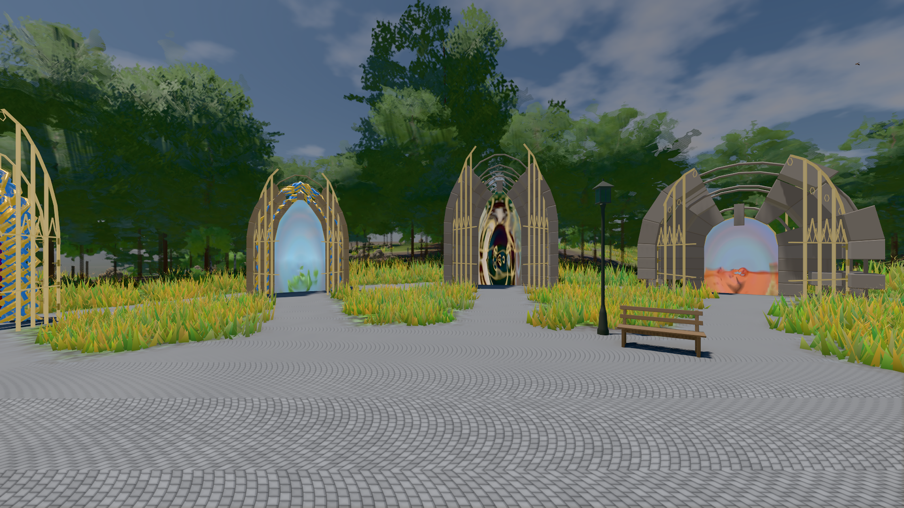

# GPU-PROBE 68df6ac0 — GRÜN

Zweig `w28-probe-schirm` · Kopf 68df6ac0ef441ffed4c1e69389ff54926f01327a · Läufer omen-gtx1060 · 15.11. 00:42 · Wanduhr ab Push 458 s · Lauf https://github.com/MiguellD/AnazhRealm/actions/runs/43653939383

Ruf: `bild:dorf@0.5 bild:genesis@0.5 gate:schirm-stufen`

## Läufer omen-gtx1060 — GRÜN

GPU NVIDIA GeForce GTX 1060 · npm ci 64 s (package-lock 6ad42099)
Schloss /c/Users/micha/AppData/Local/Temp/claude/gpu-schloss hält „ci-runner 43653939383/1 probe“
- Hook 2026-11-15 00:35:18 start ci-runner 43653939383/1 probe: wartet auf Schloss von 'omen-punkte-gtx-sitzung'
- Hook 2026-11-15 00:35:34 start ci-runner 43653939383/1 probe: Schloss genommen (refs/heads/w28-probe-schirm 68df6ac0ef441ffed4c1e69389ff54926f01327a ws=C:\actions-runner\_work\AnazhRealm\AnazhRealm)

### bild:dorf@0.5 — GRÜN · 95 s · Läufer omen-gtx1060

Adapter: [linse-gpu] nvidia/pascal

```text
Kamera des Spiels → Blick (5.2 m): -704.22 39.69 -880.02 -703.03 39.69 -874.96
 "abnahme": "ABNAHME GRÜN · beweis · Sicht 0.0 % · Ziel Blickziel im Bild frei 5.2 m · Luma 77.8 σ 31 schwarz 0.3 % weiß 0.0 % · Stand 18.546.290 · Bühne summer sunny 0.50 Tiere gehalten · Gerät WebGPU nvidia pascal · Inhalt bauSatz 28.7 % (≥ 2.0 %) Luma 80",
```



### bild:genesis@0.5 — GRÜN · 50 s · Läufer omen-gtx1060

Adapter: [linse-gpu] nvidia/pascal

```text
Kamera des Spiels → Blick (10.0 m): 0.00 92.40 0.00 -10.00 92.40 0.00
 "abnahme": "ABNAHME GRÜN · beweis · Sicht 0.0 % · Ziel Blickziel im Bild frei 10 m · Luma 108 σ 39 schwarz 0.0 % weiß 0.0 % · Stand 18.546.290 · Bühne summer sunny 0.50 Tiere gehalten · Gerät WebGPU nvidia pascal · Inhalt bodenSatz 36.4 % (≥ 15.0 %) Luma 140, portal-membran 2.7 % (≥ 0.3 %) Luma 140",
```



### gate:schirm-stufen — GRÜN · 159 s · Läufer omen-gtx1060

Adapter: ungenannt (die Probe nannte keinen Browser-Adapter)

```text
✅ GRÜN — jedes Ding trägt im Bild die Stufe der Welt, die ab dem Boot in 1080 Zeilen lebte (0 Abweichungen)
```
