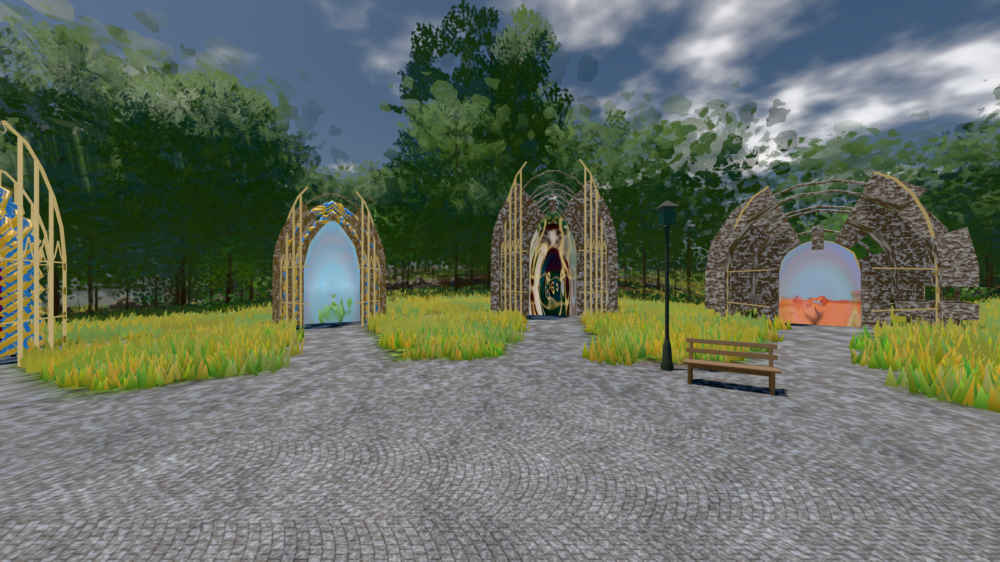

# GPU-PROBE 63fe3e5e — GRÜN

Zweig `w28-pruefbuehne-last` · Kopf 63fe3e5ee9a0a325f25db6b4a8e06ee223422bfc · Läufer radeon-890m · 12.11. 15:13 · Wanduhr ab Push 677 s · Lauf https://github.com/MiguellD/AnazhRealm/actions/runs/43232981757

Ruf: `bild:genesis@0.5`

## Läufer radeon-890m — GRÜN

GPU AMD Radeon(TM) 890M Graphics · node_modules bleiben (package-lock c9c8a14d)
Schloss /c/Users/micha/AppData/Local/Temp/claude/gpu-schloss hält „ci-runner 43232981757/1 probe“
- Hook 2026-11-12 15:11:45 start ci-runner 43232981757/1 probe: Schloss genommen (refs/heads/w28-pruefbuehne-last 63fe3e5ee9a0a325f25db6b4a8e06ee223422bfc ws=C:\actions-runner\_work\AnazhRealm\AnazhRealm)

### bild:genesis@0.5 — GRÜN · 49 s · Läufer radeon-890m

Adapter: [linse-gpu] amd/rdna-3

```text
Kamera des Spiels → Blick (10.0 m): 0.00 92.40 0.00 -10.00 92.40 0.00
 "abnahme": "ABNAHME GRÜN · beweis · Sicht 0.0 % · Ziel Blickziel im Bild frei 10 m · Luma 105.9 σ 40.3 schwarz 0.0 % weiß 0.0 % · Stand 18.546.264 · Bühne summer sunny 0.50 Tiere gehalten · Gerät WebGPU amd rdna-3 · Inhalt bodenSatz 35.3 % (≥ 15.0 %) Luma 130, portal-membran 2.8 % (≥ 0.3 %) Luma 139",
```


