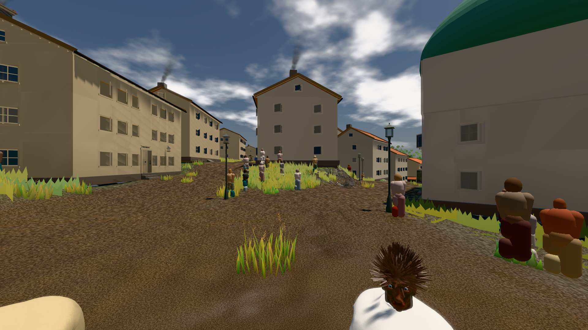

# GPU-PROBE 3c8dce79 — GRÜN

Zweig `w28-putz-wand` · Kopf 3c8dce7974b2aac836b1fbe929292422efdcc43d · Läufer radeon-890m · 11.11. 17:05 · Wanduhr ab Push 150 s · Lauf https://github.com/MiguellD/AnazhRealm/actions/runs/43054472289

Ruf: `bild:stadt@0.5`

## Läufer radeon-890m — GRÜN

GPU AMD Radeon(TM) 890M Graphics · npm ci 27 s (package-lock 9e40b075)
Schloss /c/Users/micha/AppData/Local/Temp/claude/gpu-schloss hält „ci-runner 43054472289/1 probe“
- Hook 2026-11-11 17:03:39 start ci-runner 43054472289/1 probe: Schloss genommen (refs/heads/w28-putz-wand 3c8dce7974b2aac836b1fbe929292422efdcc43d ws=C:\actions-runner\_work\AnazhRealm\AnazhRealm)

### bild:stadt@0.5 — GRÜN · 86 s · Läufer radeon-890m

Adapter: [linse-gpu] amd/rdna-3

```text
Kamera des Spiels → Blick (23.9 m): 662.72 63.28 429.48 686.59 63.28 428.39
 "abnahme": "ABNAHME GRÜN · beweis · Sicht 0.0 % · Ziel Blickziel im Bild frei 23.89 m · Luma 89.9 σ 42.7 schwarz 0.0 % weiß 0.0 % · Stand 18.546.252 · Bühne summer sunny 0.50 · Gerät WebGPU amd rdna-3",
```


