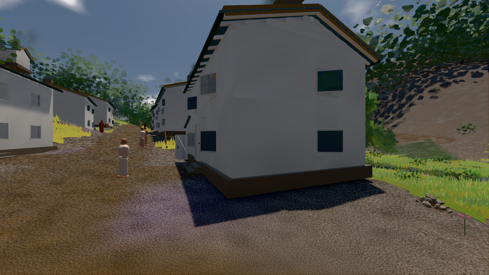
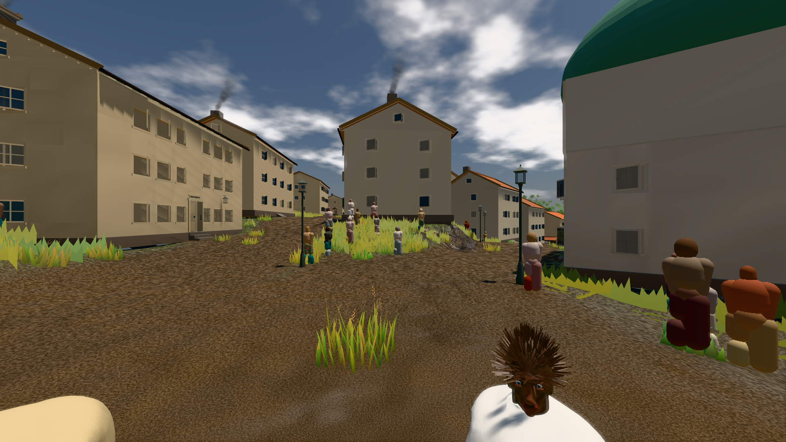

# GPU-PROBE a576a954 — GRÜN

Zweig `w28-putz-wand` · Kopf a576a954d09f4324c1f8cb56de4f29fb6012b5b4 · Läufer gtx1050-desktop · 11.11. 09:46 · Wanduhr ab Push 442 s · Lauf https://github.com/MiguellD/AnazhRealm/actions/runs/42988682266

Ruf: `bild:dorf@0.5 bild:stadt@0.5`

## Läufer gtx1050-desktop — GRÜN

GPU NVIDIA GeForce GTX 1050 · npm ci 34 s (package-lock bf9cc5c4)
Schloss /c/Users/User/AppData/Local/Temp/claude/gpu-schloss hält „ci-runner 42988682266/1 probe“
- Hook 2026-11-11 09:39:01 start ci-runner 42988682266/1 probe: Schloss genommen (refs/heads/w28-putz-wand a576a954d09f4324c1f8cb56de4f29fb6012b5b4 ws=C:\actions-runner\_work\AnazhRealm\AnazhRealm)

### bild:dorf@0.5 — GRÜN · 147 s · Läufer gtx1050-desktop

Adapter: [linse-gpu] nvidia/pascal

```text
Kamera des Spiels → Blick (5.2 m): -704.22 39.69 -880.02 -703.03 39.69 -874.96
 "abnahme": "ABNAHME GRÜN · beweis · Sicht 0.0 % · Ziel Blickziel im Bild frei 5.2 m · Luma 79.2 σ 30.8 schwarz 0.2 % weiß 0.0 % · Stand 18.546.250 · Bühne summer sunny 0.50 · Gerät WebGPU nvidia pascal",
```



### bild:stadt@0.5 — GRÜN · 213 s · Läufer gtx1050-desktop

Adapter: [linse-gpu] nvidia/pascal

```text
Kamera des Spiels → Blick (23.9 m): 662.72 63.28 429.48 686.59 63.28 428.39
 "abnahme": "ABNAHME GRÜN · beweis · Sicht 0.0 % · Ziel Blickziel im Bild frei 23.89 m · Luma 90.1 σ 42.7 schwarz 0.0 % weiß 0.0 % · Stand 18.546.250 · Bühne summer sunny 0.50 · Gerät WebGPU nvidia pascal",
```


