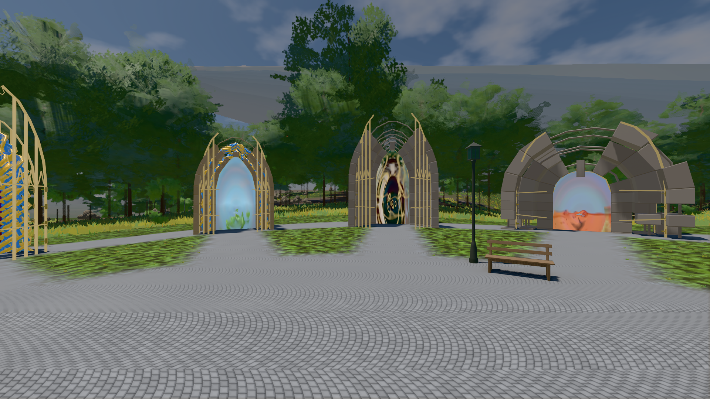
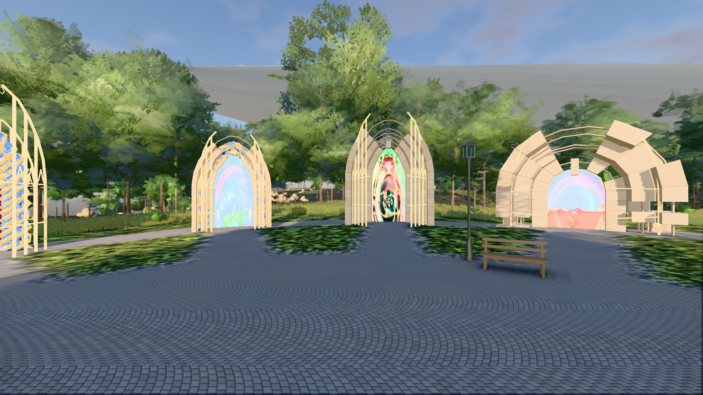

# GPU-PROBE 0a8074aa — GRÜN

Zweig `w28-rasen-schnitt` · Kopf 0a8074aa2299c6cccb42178104d6c9670e634d1e · Läufer gtx1050-desktop · 14.11. 14:08 · Wanduhr ab Push 592 s · Lauf https://github.com/MiguellD/AnazhRealm/actions/runs/43597401927

Ruf: `bild:genesis@0.5 bild:genesis@0.3`

## Läufer gtx1050-desktop — GRÜN

GPU NVIDIA GeForce GTX 1050 · node_modules bleiben (package-lock 57539f97)
Schloss /c/Users/User/AppData/Local/Temp/claude/gpu-schloss hält „ci-runner 43597401927/1 probe“
- Hook 2026-11-14 14:02:53 start ci-runner 43597401927/1 probe: wartet auf Schloss von 'hand werkbank kand-8 (Claude)'
- Hook 2026-11-14 14:03:08 start ci-runner 43597401927/1 probe: Schloss genommen (refs/heads/w28-rasen-schnitt 0a8074aa2299c6cccb42178104d6c9670e634d1e ws=C:\actions-runner\_work\AnazhRealm\AnazhRealm)

### bild:genesis@0.5 — GRÜN · 77 s · Läufer gtx1050-desktop

Adapter: [linse-gpu] nvidia/pascal

```text
Kamera des Spiels → Blick (10.0 m): 0.00 92.40 0.00 -10.00 92.40 0.00
 "abnahme": "ABNAHME GRÜN · beweis · Sicht 0.0 % · Ziel Blickziel im Bild frei 10 m · Luma 104.6 σ 38.7 schwarz 0.0 % weiß 0.0 % · Stand 18.546.283 · Bühne summer sunny 0.50 Tiere gehalten · Gerät WebGPU nvidia pascal · Inhalt bodenSatz 42.5 % (≥ 15.0 %) Luma 136, portal-membran 2.7 % (≥ 0.3 %) Luma 140",
```



### bild:genesis@0.3 — GRÜN · 80 s · Läufer gtx1050-desktop

Adapter: [linse-gpu] nvidia/pascal

```text
Kamera des Spiels → Blick (10.0 m): 0.00 92.40 0.00 -10.00 92.40 0.00
 "abnahme": "ABNAHME GRÜN · beweis · Sicht 0.0 % · Ziel Blickziel im Bild frei 10 m · Luma 119.5 σ 48.3 schwarz 0.0 % weiß 0.0 % · Stand 18.546.283 · Bühne summer sunny 0.30 Tiere gehalten · Gerät WebGPU nvidia pascal · Inhalt bodenSatz 42.5 % (≥ 15.0 %) Luma 92, portal-membran 2.7 % (≥ 0.3 %) Luma 218",
```


