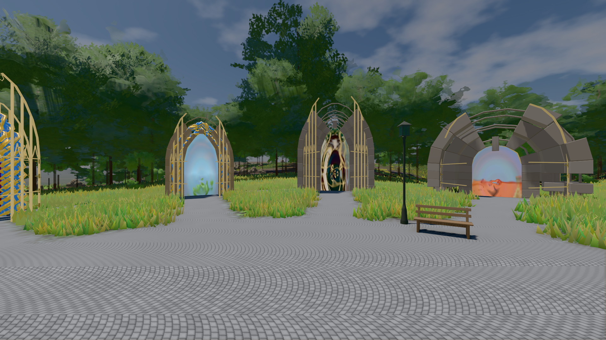
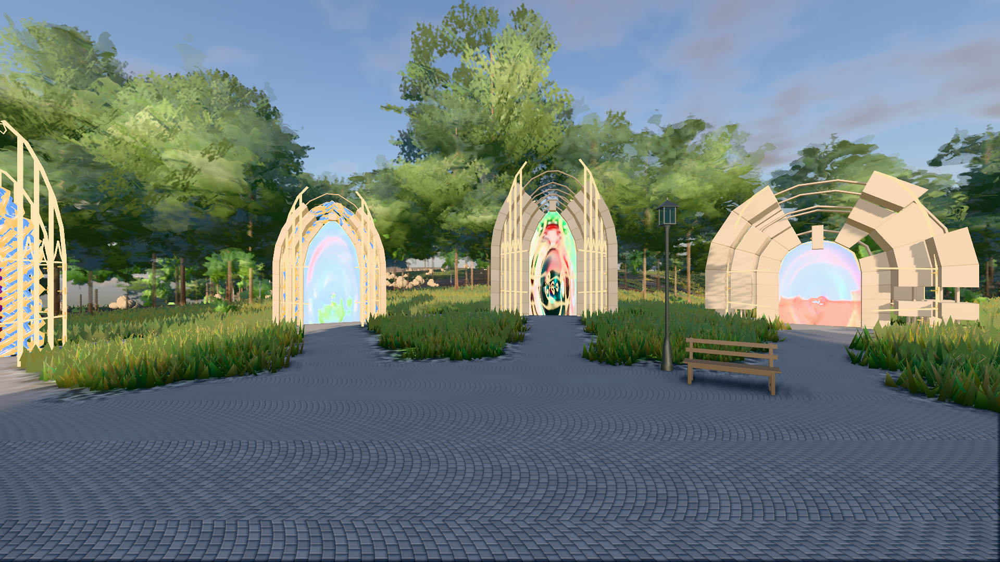

# GPU-PROBE 5787be8a — GRÜN

Zweig `w28-rasen-schnitt` · Kopf 5787be8a8d0ef770648569907ca95097714da326 · Läufer gtx1050-desktop · 14.11. 15:06 · Wanduhr ab Push 415 s · Lauf https://github.com/MiguellD/AnazhRealm/actions/runs/43602542535

Ruf: `bild:genesis@0.5 bild:genesis@0.3`

## Läufer gtx1050-desktop — GRÜN

GPU NVIDIA GeForce GTX 1050 · npm ci 40 s (package-lock 57539f97)
Schloss /c/Users/User/AppData/Local/Temp/claude/gpu-schloss hält „ci-runner 43602542535/1 probe“
- Hook 2026-11-14 15:01:51 start ci-runner 43602542535/1 probe: wartet auf Schloss von 'hand werkbank takt-4-B (Claude)'
- Hook 2026-11-14 15:02:51 start ci-runner 43602542535/1 probe: Schloss genommen (refs/heads/w28-rasen-schnitt 5787be8a8d0ef770648569907ca95097714da326 ws=C:\actions-runner\_work\AnazhRealm\AnazhRealm)

### bild:genesis@0.5 — GRÜN · 77 s · Läufer gtx1050-desktop

Adapter: [linse-gpu] nvidia/pascal

```text
Kamera des Spiels → Blick (10.0 m): 0.00 92.40 0.00 -10.00 92.40 0.00
 "abnahme": "ABNAHME GRÜN · beweis · Sicht 0.0 % · Ziel Blickziel im Bild frei 10 m · Luma 106.7 σ 38.5 schwarz 0.0 % weiß 0.0 % · Stand 18.546.283 · Bühne summer sunny 0.50 Tiere gehalten · Gerät WebGPU nvidia pascal · Inhalt bodenSatz 36.1 % (≥ 15.0 %) Luma 139, portal-membran 2.7 % (≥ 0.3 %) Luma 140",
```



### bild:genesis@0.3 — GRÜN · 83 s · Läufer gtx1050-desktop

Adapter: [linse-gpu] nvidia/pascal

```text
Kamera des Spiels → Blick (10.0 m): 0.00 92.40 0.00 -10.00 92.40 0.00
 "abnahme": "ABNAHME GRÜN · beweis · Sicht 0.0 % · Ziel Blickziel im Bild frei 10 m · Luma 119.9 σ 49.4 schwarz 0.0 % weiß 0.0 % · Stand 18.546.283 · Bühne summer sunny 0.30 Tiere gehalten · Gerät WebGPU nvidia pascal · Inhalt bodenSatz 36.1 % (≥ 15.0 %) Luma 90, portal-membran 2.7 % (≥ 0.3 %) Luma 218",
```


