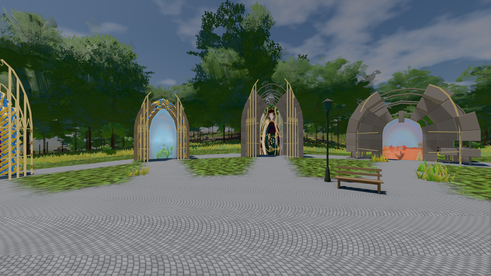
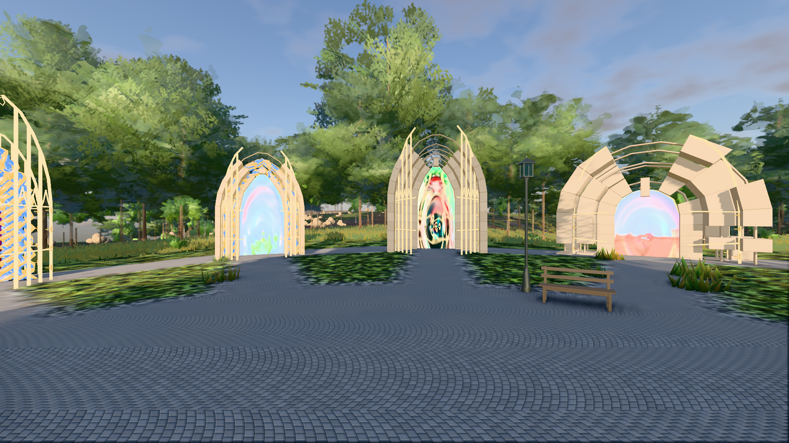

# GPU-PROBE f755b94f — GRÜN

Zweig `w28-rasen-schnitt` · Kopf f755b94fbddf11a86f32bac5146ace039499d377 · Läufer gtx1050-desktop · 14.11. 13:19 · Wanduhr ab Push 377 s · Lauf https://github.com/MiguellD/AnazhRealm/actions/runs/43593754668

Ruf: `bild:genesis@0.5 bild:genesis@0.3`

## Läufer gtx1050-desktop — GRÜN

GPU NVIDIA GeForce GTX 1050 · node_modules bleiben (package-lock 57539f97)
Schloss /c/Users/User/AppData/Local/Temp/claude/gpu-schloss hält „ci-runner 43593754668/1 probe“
- Hook 2026-11-14 13:15:36 start ci-runner 43593754668/1 probe: Schloss genommen (refs/heads/w28-rasen-schnitt f755b94fbddf11a86f32bac5146ace039499d377 ws=C:\actions-runner\_work\AnazhRealm\AnazhRealm)

### bild:genesis@0.5 — GRÜN · 82 s · Läufer gtx1050-desktop

Adapter: [linse-gpu] nvidia/pascal

```text
Kamera des Spiels → Blick (10.0 m): 0.00 92.40 0.00 -10.00 92.40 0.00
 "abnahme": "ABNAHME GRÜN · beweis · Sicht 0.0 % · Ziel Blickziel im Bild frei 10 m · Luma 105.3 σ 38.9 schwarz 0.0 % weiß 0.0 % · Stand 18.546.283 · Bühne summer sunny 0.50 Tiere gehalten · Gerät WebGPU nvidia pascal · Inhalt bodenSatz 42.1 % (≥ 15.0 %) Luma 136, portal-membran 2.7 % (≥ 0.3 %) Luma 140",
```



### bild:genesis@0.3 — GRÜN · 78 s · Läufer gtx1050-desktop

Adapter: [linse-gpu] nvidia/pascal

```text
Kamera des Spiels → Blick (10.0 m): 0.00 92.40 0.00 -10.00 92.40 0.00
 "abnahme": "ABNAHME GRÜN · beweis · Sicht 0.0 % · Ziel Blickziel im Bild frei 10 m · Luma 120.4 σ 49.7 schwarz 0.0 % weiß 0.0 % · Stand 18.546.283 · Bühne summer sunny 0.30 Tiere gehalten · Gerät WebGPU nvidia pascal · Inhalt bodenSatz 42.1 % (≥ 15.0 %) Luma 92, portal-membran 2.7 % (≥ 0.3 %) Luma 218",
```


