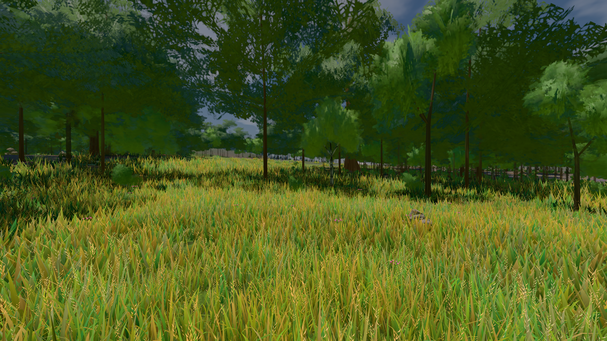

# GPU-PROBE 40f6f80e — GRÜN

Zweig `w28-raum-ofen` · Kopf 40f6f80e941f5d0ae2272269c4ff4e7d06d4a14a · Läufer gtx1050-desktop · 19.11. 00:55 · Wanduhr ab Push 155 s · Lauf https://github.com/MiguellD/AnazhRealm/actions/runs/44424400364

Ruf: `bild:wiese@0.5`

## Läufer gtx1050-desktop — GRÜN

GPU NVIDIA GeForce GTX 1050 · npm ci 36 s (package-lock cb318ad1)
Schloss /c/Users/User/AppData/Local/Temp/claude/gpu-schloss hält „ci-runner 44424400364/1 probe“
- Hook 2026-11-19 00:52:47 start ci-runner 44424400364/1 probe: Schloss genommen (refs/heads/w28-raum-ofen 40f6f80e941f5d0ae2272269c4ff4e7d06d4a14a ws=C:\actions-runner\_work\AnazhRealm\AnazhRealm)

### bild:wiese@0.5 — GRÜN · 78 s · Läufer gtx1050-desktop

Adapter: [linse-gpu] nvidia/pascal

```text
Kamera des Spiels → Blick (10.0 m): -280.40 29.71 -1045.60 -289.61 29.71 -1049.50
 "abnahme": "ABNAHME GRÜN · beweis · Sicht 0.0 % · Ziel Blickziel im Bild frei 10 m · Luma 81.9 σ 39 schwarz 0.0 % weiß 0.0 % · Stand 18.546.338 · Bühne summer sunny 0.50 Tiere gehalten · Gerät WebGPU nvidia pascal · Inhalt nahWiese 48.2 % (≥ 15.0 %) h 107° Luma 117",
```


