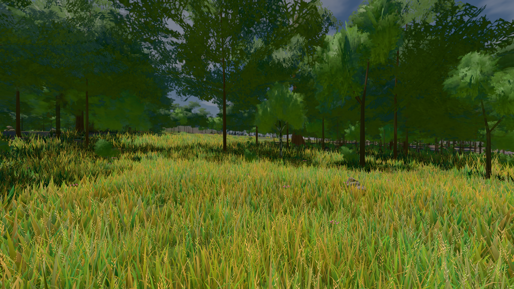

# GPU-PROBE fbe804fa — GRÜN

Zweig `w28-register-b` · Kopf fbe804fa111854ce032d739b975083d8773d50f5 · Läufer omen-gtx1060 · 18.11. 18:24 · Wanduhr ab Push 401 s · Lauf https://github.com/MiguellD/AnazhRealm/actions/runs/44357044368

Ruf: `bild:wiese@0.5`

## Läufer omen-gtx1060 — GRÜN

GPU NVIDIA GeForce GTX 1060 · npm ci 75 s (package-lock 9b0dd62a)
Schloss /c/Users/micha/AppData/Local/Temp/claude/gpu-schloss hält „ci-runner 44357044368/1 probe“
- Hook 2026-11-18 18:18:56 start ci-runner 44357044368/1 probe: Schloss genommen (refs/heads/w28-register-b fbe804fa111854ce032d739b975083d8773d50f5 ws=C:\actions-runner\_work\AnazhRealm\AnazhRealm)

### bild:wiese@0.5 — GRÜN · 77 s · Läufer omen-gtx1060

Adapter: [linse-gpu] nvidia/pascal

```text
Kamera des Spiels → Blick (10.0 m): -280.40 29.71 -1045.60 -289.61 29.71 -1049.50
 "abnahme": "ABNAHME GRÜN · beweis · Sicht 0.0 % · Ziel Blickziel im Bild frei 10 m · Luma 81.9 σ 39 schwarz 0.0 % weiß 0.0 % · Stand 18.546.336 · Bühne summer sunny 0.50 Tiere gehalten · Gerät WebGPU nvidia pascal · Inhalt nahWiese 48.2 % (≥ 15.0 %) h 107° Luma 117",
```


