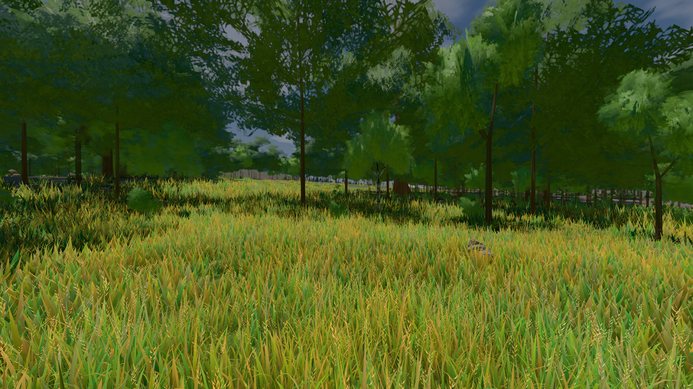

# GPU-PROBE 57d02ab1 — GRÜN

Zweig `w28-saison-am-laub` · Kopf 57d02ab1d8cc08a0f57fc13a5f923cd4d055d6b4 · Läufer omen-gtx1060 · 20.11. 09:22 · Wanduhr ab Push 741 s · Lauf https://github.com/MiguellD/AnazhRealm/actions/runs/44700332808

Ruf: `bild:wiese@0.5`

## Läufer omen-gtx1060 — GRÜN

GPU NVIDIA GeForce GTX 1060 · node_modules bleiben (package-lock 983fa64e)
Schloss /c/Users/micha/AppData/Local/Temp/claude/gpu-schloss hält „ci-runner 44700332808/1 probe“
- Hook 2026-11-20 09:18:02 start ci-runner 44700332808/1 probe: Schloss genommen (refs/heads/w28-saison-am-laub 57d02ab1d8cc08a0f57fc13a5f923cd4d055d6b4 ws=C:\actions-runner\_work\AnazhRealm\AnazhRealm)

### bild:wiese@0.5 — GRÜN · 47 s · Läufer omen-gtx1060

Adapter: [linse-gpu] nvidia/pascal

```text
Kamera des Spiels → Blick (10.0 m): -280.40 29.71 -1045.60 -289.61 29.71 -1049.50
 "abnahme": "ABNAHME GRÜN · beweis · Sicht 0.0 % · Ziel Blickziel im Bild frei 10 m · Luma 81.9 σ 38.9 schwarz 0.0 % weiß 0.0 % · Stand 18.546.347 · Bühne summer sunny 0.50 Tiere gehalten · Gerät WebGPU nvidia pascal · Inhalt nahWiese 48.2 % (≥ 15.0 %) h 107° Luma 117",
```


