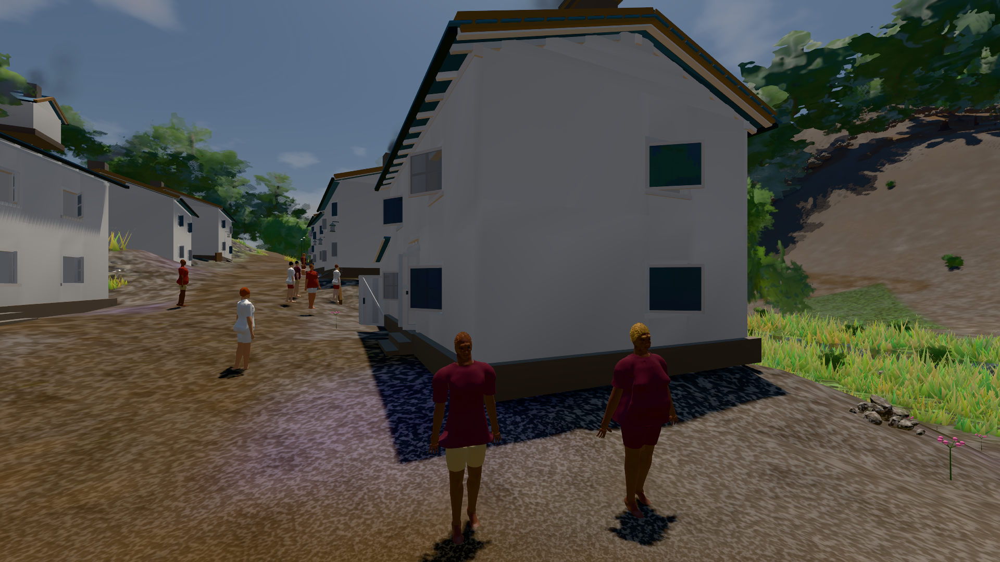
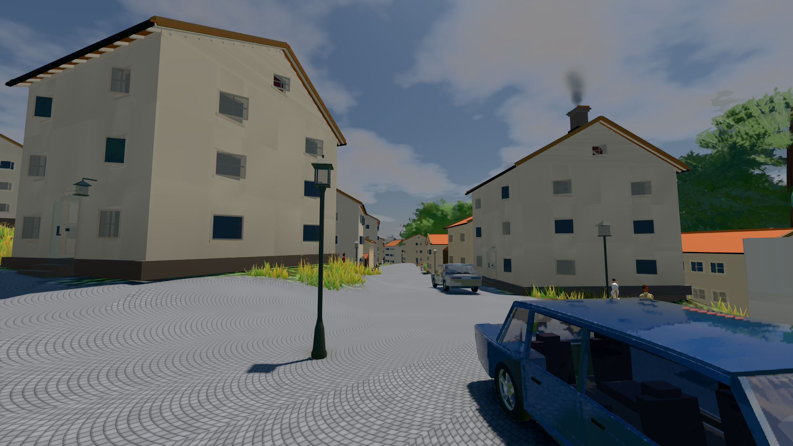

# GPU-PROBE 2c6cb1cf — GRÜN

Zweig `w28-satz-menge` · Kopf 2c6cb1cf960a112ada6d41e3e46badfd121a1ec3 · Läufer radeon-890m · 15.11. 16:01 · Wanduhr ab Push 615 s · Lauf https://github.com/MiguellD/AnazhRealm/actions/runs/43726648284

Ruf: `bild:dorf@0.5 bild:stadt@0.5 gate:kamera-leib:echt`

## Läufer radeon-890m — GRÜN

GPU AMD Radeon(TM) 890M Graphics · npm ci 62 s (package-lock 5ba7a8f5)
Schloss /c/Users/micha/AppData/Local/Temp/claude/gpu-schloss hält „ci-runner 43726648284/1 probe“
- Hook 2026-11-15 15:52:03 start ci-runner 43726648284/1 probe: wartet auf Schloss von 'w28-preis-ort-paar 2026-11-15T15:49:29+01:00 pid=28920'
- Hook 2026-11-15 15:55:53 start ci-runner 43726648284/1 probe: Schloss genommen (refs/heads/w28-satz-menge 2c6cb1cf960a112ada6d41e3e46badfd121a1ec3 ws=C:\actions-runner\_work\AnazhRealm\AnazhRealm)

### bild:dorf@0.5 — GRÜN · 77 s · Läufer radeon-890m

Adapter: [linse-gpu] amd/rdna-3

```text
Kamera des Spiels → Blick (5.2 m): -704.22 39.69 -880.02 -703.03 39.69 -874.96
 "abnahme": "ABNAHME GRÜN · beweis · Sicht 0.0 % · Ziel Blickziel im Bild frei 5.2 m · Luma 77.9 σ 31 schwarz 0.3 % weiß 0.0 % · Stand 18.546.292 · Bühne summer sunny 0.50 Tiere gehalten · Gerät WebGPU amd rdna-3 · Inhalt bauSatz 28.7 % (≥ 2.0 %) Luma 80",
```



### bild:stadt@0.5 — GRÜN · 105 s · Läufer radeon-890m

Adapter: [linse-gpu] amd/rdna-3

```text
Kamera des Spiels → Blick (30.0 m): 693.57 62.25 437.26 716.34 64.65 456.65
 "abnahme": "ABNAHME GRÜN · beweis · Sicht 0.0 % · Ziel Blickziel im Bild frei 30 m · Luma 102.1 σ 39.9 schwarz 0.3 % weiß 0.0 % · Stand 18.546.292 · Bühne summer sunny 0.50 Tiere gehalten · Gerät WebGPU amd rdna-3 · Inhalt bauSatz 34.1 % (≥ 2.0 %) Luma 99, f:(kompakt_fwd|limousine|suv) 11.9 % (≥ 0.5 %) Luma 53",
```



### gate:kamera-leib:echt — GRÜN · 71 s · Läufer radeon-890m

Adapter: [linse-gpu] amd/rdna-3

```text
  ✅ K6 Strafe am Prüfplatz — A0 Kopf 0.0 % Leib 1.2 % (2457 px),A1 Kopf 0.0 % Leib 1.7 % (2461 px),A2 Kopf 0.0 % Leib 1.6 % (2461 px),A3 Kopf 1.9 % Leib 1.3 % (2513 px),D0 Kopf 0.0 % Leib 2.9 % (2484 px),D1 Kopf 0.0 % Leib 1.6 % (2441 px),D2 Kopf 0.8 % Leib 2.2 % (2473 px),D3 Kopf 0.0 % Leib 0.8 % (2519 px) · Rückstrahl 0.1 %
✅ GRÜN — die Kamera steckt nie in Laub, Strauch, Fels oder Boden.
```
