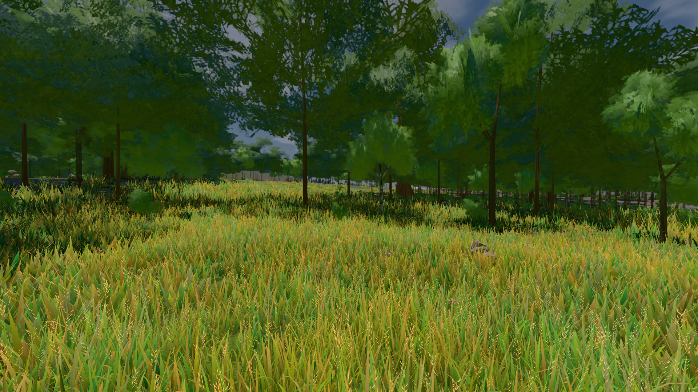

# GPU-PROBE 6564ad8d — GRÜN

Zweig `w28-seiten-stille-2` · Kopf 6564ad8dc402f033d99887f86fa367636d840449 · Läufer omen-gtx1060 · 18.11. 13:50 · Wanduhr ab Push 278 s · Lauf https://github.com/MiguellD/AnazhRealm/actions/runs/44306949124

Ruf: `bild:wiese@0.5`

## Läufer omen-gtx1060 — GRÜN

GPU NVIDIA GeForce GTX 1060 · npm ci 50 s (package-lock a57f7437)
Schloss /c/Users/micha/AppData/Local/Temp/claude/gpu-schloss hält „ci-runner 44306949124/1 probe“
- Hook 2026-11-18 13:45:44 start ci-runner 44306949124/1 probe: wartet auf Schloss von 'omen-landung-wache'
- Hook 2026-11-18 13:45:59 start ci-runner 44306949124/1 probe: Schloss genommen (refs/heads/w28-seiten-stille-2 6564ad8dc402f033d99887f86fa367636d840449 ws=C:\actions-runner\_work\AnazhRealm\AnazhRealm)

### bild:wiese@0.5 — GRÜN · 45 s · Läufer omen-gtx1060

Adapter: [linse-gpu] nvidia/pascal

```text
Kamera des Spiels → Blick (10.0 m): -280.40 29.71 -1045.60 -289.61 29.71 -1049.50
 "abnahme": "ABNAHME GRÜN · beweis · Sicht 0.0 % · Ziel Blickziel im Bild frei 10 m · Luma 81.9 σ 39 schwarz 0.0 % weiß 0.0 % · Stand 18.546.335 · Bühne summer sunny 0.50 Tiere gehalten · Gerät WebGPU nvidia pascal · Inhalt nahWiese 48.2 % (≥ 15.0 %) h 107° Luma 117",
```


