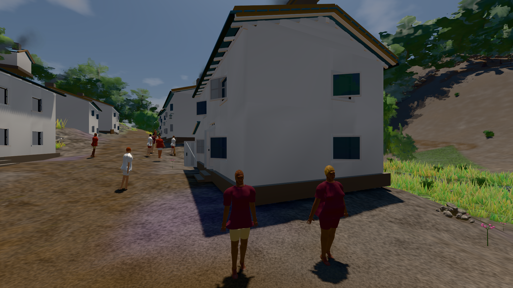
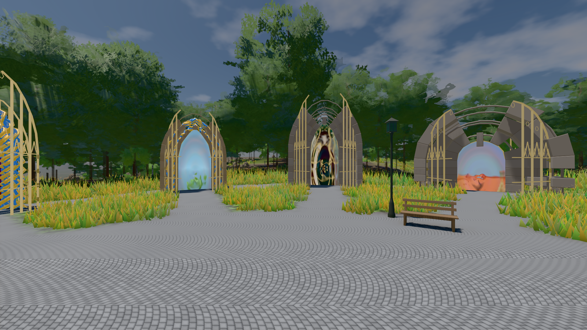

# GPU-PROBE 8b60d653 — GRÜN

Zweig `w28-speicher-ring` · Kopf 8b60d6538a9c6aa51703683d686f987a96bf34a3 · Läufer radeon-890m · 17.11. 06:15 · Wanduhr ab Push 498 s · Lauf https://github.com/MiguellD/AnazhRealm/actions/runs/44021803633

Ruf: `bild:dorf@0.5 bild:genesis@0.5`

## Läufer radeon-890m — GRÜN

GPU AMD Radeon(TM) 890M Graphics · npm ci 62 s (package-lock 55a7d6a8)
Schloss /c/Users/micha/AppData/Local/Temp/claude/gpu-schloss hält „ci-runner 44021803633/1 probe“
- Hook 2026-11-17 06:07:35 start ci-runner 44021803633/1 probe: wartet auf Schloss von 'punkte-radeon-sitzungpid=58780'
- Hook 2026-11-17 06:11:07 start ci-runner 44021803633/1 probe: verwaistes Schloss 'punkte-radeon-sitzungpid=58780' geloest - Halter pid=58780 lebt nicht
- Hook 2026-11-17 06:11:09 start ci-runner 44021803633/1 probe: Schloss genommen (refs/heads/w28-speicher-ring 8b60d6538a9c6aa51703683d686f987a96bf34a3 ws=C:\actions-runner\_work\AnazhRealm\AnazhRealm)

### bild:dorf@0.5 — GRÜN · 71 s · Läufer radeon-890m

Adapter: [linse-gpu] amd/rdna-3

```text
Kamera des Spiels → Blick (5.2 m): -704.22 39.69 -880.02 -703.03 39.69 -874.96
 "abnahme": "ABNAHME GRÜN · beweis · Sicht 0.0 % · Ziel Blickziel im Bild frei 5.2 m · Luma 77.7 σ 30.9 schwarz 0.2 % weiß 0.0 % · Stand 18.546.317 · Bühne summer sunny 0.50 Tiere gehalten · Gerät WebGPU amd rdna-3 · Inhalt bauSatz 28.7 % (≥ 2.0 %) Luma 80",
```



### bild:genesis@0.5 — GRÜN · 50 s · Läufer radeon-890m

Adapter: [linse-gpu] amd/rdna-3

```text
Kamera des Spiels → Blick (10.0 m): 0.00 92.40 0.00 -10.00 92.40 0.00
 "abnahme": "ABNAHME GRÜN · beweis · Sicht 0.0 % · Ziel Blickziel im Bild frei 10 m · Luma 108.5 σ 38.5 schwarz 0.0 % weiß 0.0 % · Stand 18.546.317 · Bühne summer sunny 0.50 Tiere gehalten · Gerät WebGPU amd rdna-3 · Inhalt bodenSatz 36.4 % (≥ 15.0 %) Luma 140, portal-membran 2.7 % (≥ 0.3 %) Luma 140",
```


