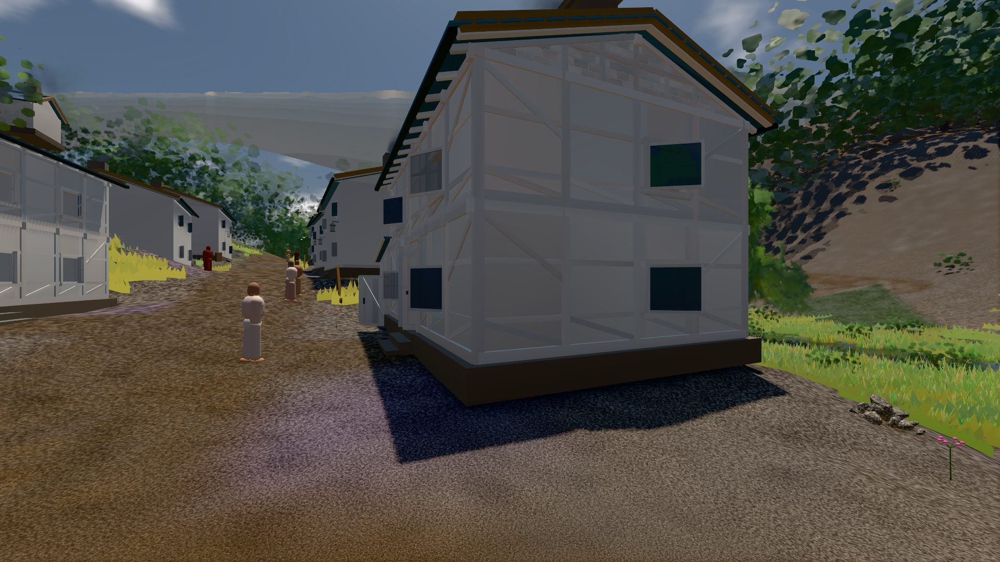

# GPU-PROBE 0a721419 — ROT

Zweig `w28-stadt-boden` · Kopf 0a72141916a7b355501a6315b62e8c8c3705678e · Läufer gtx1050-desktop · 11.11. 00:33 · Wanduhr ab Push 648 s · Lauf https://github.com/MiguellD/AnazhRealm/actions/runs/42922892242

Ruf: `bild:dorf@0.5 bild:stadt-voll@0.5 bild:stadt@0.5`

## Läufer gtx1050-desktop — ROT

GPU NVIDIA GeForce GTX 1050 · node_modules bleiben (package-lock df29564e)
Schloss /c/Users/User/AppData/Local/Temp/claude/gpu-schloss hält „ci-runner 42922892242/1 probe“
- Hook 2026-11-11 00:24:11 start ci-runner 42922892242/1 probe: Schloss genommen (refs/heads/w28-stadt-boden 0a72141916a7b355501a6315b62e8c8c3705678e ws=C:\actions-runner\_work\AnazhRealm\AnazhRealm)

### bild:dorf@0.5 — GRÜN · 177 s · Läufer gtx1050-desktop

Adapter: [linse-gpu] nvidia/pascal

```text
Kamera des Spiels → Blick (5.2 m): -704.22 39.69 -880.02 -703.03 39.69 -874.96
 "abnahme": "ABNAHME GRÜN · beweis · Sicht 0.0 % · Ziel Blickziel im Bild frei 5.2 m · Luma 78.7 σ 30.5 schwarz 0.2 % weiß 0.0 % · Stand 18.546.249 · Bühne summer sunny 0.50 · Gerät WebGPU nvidia pascal",
```



### bild:stadt-voll@0.5 — ROT · 299 s · Läufer gtx1050-desktop

Adapter: [linse-gpu] nvidia/pascal

```text
Kamera des Spiels → Blick (60.0 m): 836.20 58.51 438.50 896.20 58.51 437.85
 "fehler": "ABNAHME ROT [Ziel Blickziel verdeckt von bauSatz in 45.16 m] · beweis · Sicht 0.0 % · Ziel Blickziel im Bild VERDECKT 60 m · Luma 114.1 σ 46 schwarz 0.1 % weiß 0.0 % · Stand 18.546.249 · Bühne summer sunny 0.50 · Gerät WebGPU nvidia pascal — die Aufnahme speichert nichts",
```

### bild:stadt@0.5 — NACHGEGEBEN · 73 s · Läufer gtx1050-desktop

Adapter: [linse-gpu] nvidia/pascal · NACHGEGEBEN: Karten-Job „echt gtx1050 (GPU-Wände auf der Karte)“ (Lauf 42921610752) wartet auf diesen Läufer (gtx1050-gpu)

```text
[linse-gpu] nvidia/pascal
```
