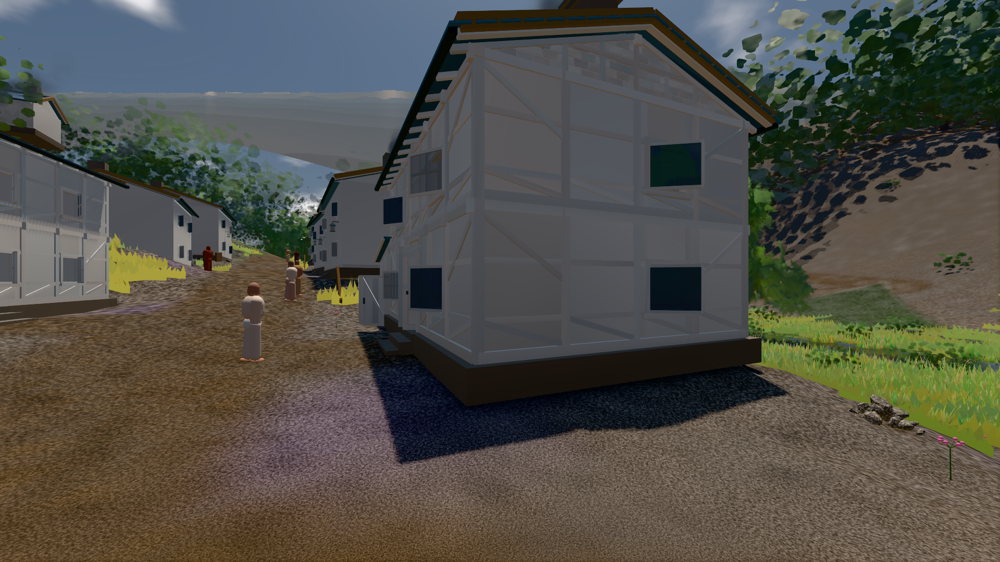

# GPU-PROBE 65655605 — GRÜN

Zweig `w28-stadt-boden` · Kopf 65655605508bd81ba107ddf1adadcee200549052 · Läufer gtx1050-desktop · 11.11. 16:18 · Wanduhr ab Push 2550 s · Lauf https://github.com/MiguellD/AnazhRealm/actions/runs/43040066736

Ruf: `bild:stadt-voll@0.5 bild:stadt@0.5 bild:dorf@0.5`

## Läufer gtx1050-desktop — GRÜN

GPU NVIDIA GeForce GTX 1050 · node_modules bleiben (package-lock 9e40b075)
Schloss /c/Users/User/AppData/Local/Temp/claude/gpu-schloss hält „ci-runner 43040066736/2 probe“
- Hook 2026-11-11 16:03:38 start ci-runner 43040066736/2 probe: wartet auf Schloss von 'hand zweit atlas1 (Claude)'
- Hook 2026-11-11 16:04:54 start ci-runner 43040066736/2 probe: Schloss genommen (refs/heads/w28-stadt-boden 65655605508bd81ba107ddf1adadcee200549052 ws=C:\actions-runner\_work\AnazhRealm\AnazhRealm)

### bild:stadt-voll@0.5 — GRÜN · 355 s · Läufer gtx1050-desktop

Adapter: [linse-gpu] nvidia/pascal

```text
Kamera des Spiels → Blick (14.6 m): 837.84 58.51 445.42 842.31 58.51 459.32
 "abnahme": "ABNAHME GRÜN · beweis · Sicht 0.0 % · Ziel Blickziel im Bild frei 14.6 m, verdeckt nur von Leibern: 1 Punkt, nächster 3.69 m (Leib bewohner) · Luma 105.5 σ 59 schwarz 0.1 % weiß 0.0 % · Stand 18.546.252 · Bühne summer sunny 0.50 · Gerät WebGPU nvidia pascal",
```


### bild:stadt@0.5 — GRÜN · 266 s · Läufer gtx1050-desktop

Adapter: [linse-gpu] nvidia/pascal

```text
Kamera des Spiels → Blick (23.9 m): 662.72 63.28 429.48 686.59 63.28 428.39
 "abnahme": "ABNAHME GRÜN · beweis · Sicht 0.0 % · Ziel Blickziel im Bild frei 23.89 m · Luma 113 σ 40.4 schwarz 0.0 % weiß 0.0 % · Stand 18.546.252 · Bühne summer sunny 0.50 · Gerät WebGPU nvidia pascal",
```


### bild:dorf@0.5 — GRÜN · 158 s · Läufer gtx1050-desktop

Adapter: [linse-gpu] nvidia/pascal

```text
Kamera des Spiels → Blick (5.2 m): -704.22 39.69 -880.02 -703.03 39.69 -874.96
 "abnahme": "ABNAHME GRÜN · beweis · Sicht 0.0 % · Ziel Blickziel im Bild frei 5.2 m · Luma 78.7 σ 30.5 schwarz 0.2 % weiß 0.0 % · Stand 18.546.252 · Bühne summer sunny 0.50 · Gerät WebGPU nvidia pascal",
```


