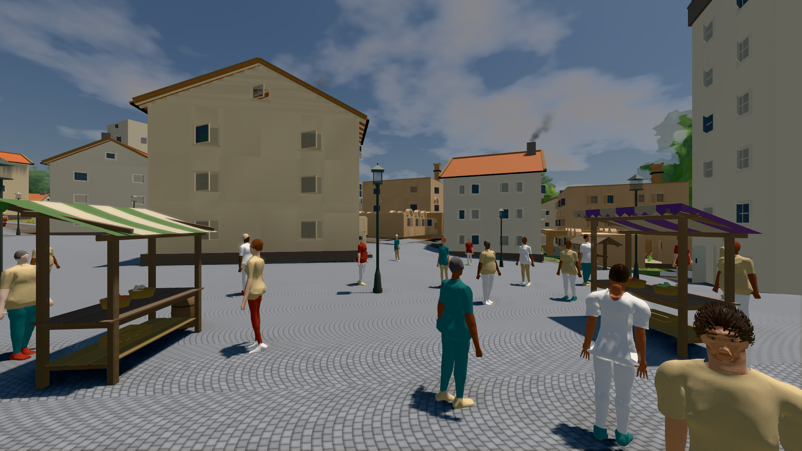
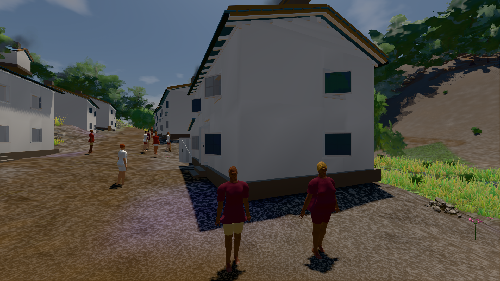
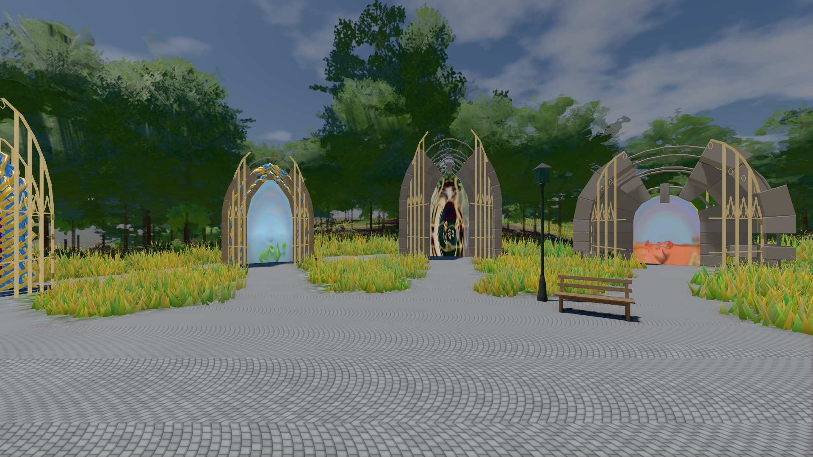

# GPU-PROBE b0f25c2d — GRÜN

Zweig `w28-stadt-funktion` · Kopf b0f25c2db417f07d35ff267e30142349185a9223 · Läufer gtx1050-desktop · 15.11. 03:04 · Wanduhr ab Push 650 s · Lauf https://github.com/MiguellD/AnazhRealm/actions/runs/43665205217

Ruf: `bild:stadt-voll@0.5 bild:dorf@0.5 bild:genesis@0.5`

## Läufer gtx1050-desktop — GRÜN

GPU NVIDIA GeForce GTX 1050 · npm ci 63 s (package-lock 668076d3)
Schloss /c/Users/User/AppData/Local/Temp/claude/gpu-schloss hält „ci-runner 43665205217/1 probe“
- Hook 2026-11-15 02:54:09 start ci-runner 43665205217/1 probe: Schloss genommen (refs/heads/w28-stadt-funktion b0f25c2db417f07d35ff267e30142349185a9223 ws=C:\actions-runner\_work\AnazhRealm\AnazhRealm)

### bild:stadt-voll@0.5 — GRÜN · 290 s · Läufer gtx1050-desktop

Adapter: [linse-gpu] nvidia/pascal

```text
Kamera des Spiels → Blick (29.4 m): 842.49 57.57 451.79 871.75 57.57 454.60
 "abnahme": "ABNAHME GRÜN · beweis · Sicht 0.0 % · Leib im Vordergrund 7.3 % (Leib bewohner 7.3 %) · Ziel Blickziel im Bild frei 29.39 m · Luma 104.5 σ 35.5 schwarz 0.1 % weiß 0.0 % · Stand 18.546.291 · Bühne summer sunny 0.50 Tiere gehalten · Gerät WebGPU nvidia pascal · Inhalt bauSatz 34.2 % (≥ 2.0 %) Luma 92, bewohner 9.8 % (≥ 1.0 %) Luma 97",
```



### bild:dorf@0.5 — GRÜN · 157 s · Läufer gtx1050-desktop

Adapter: [linse-gpu] nvidia/pascal

```text
Kamera des Spiels → Blick (5.2 m): -704.22 39.69 -880.02 -703.03 39.69 -874.96
 "abnahme": "ABNAHME GRÜN · beweis · Sicht 0.0 % · Ziel Blickziel im Bild frei 5.2 m · Luma 77.7 σ 31 schwarz 0.3 % weiß 0.0 % · Stand 18.546.291 · Bühne summer sunny 0.50 Tiere gehalten · Gerät WebGPU nvidia pascal · Inhalt bauSatz 28.7 % (≥ 2.0 %) Luma 80",
```



### bild:genesis@0.5 — GRÜN · 74 s · Läufer gtx1050-desktop

Adapter: [linse-gpu] nvidia/pascal

```text
Kamera des Spiels → Blick (10.0 m): 0.00 92.40 0.00 -10.00 92.40 0.00
 "abnahme": "ABNAHME GRÜN · beweis · Sicht 0.0 % · Ziel Blickziel im Bild frei 10 m · Luma 108 σ 39 schwarz 0.0 % weiß 0.0 % · Stand 18.546.291 · Bühne summer sunny 0.50 Tiere gehalten · Gerät WebGPU nvidia pascal · Inhalt bodenSatz 36.4 % (≥ 15.0 %) Luma 140, portal-membran 2.7 % (≥ 0.3 %) Luma 140",
```


