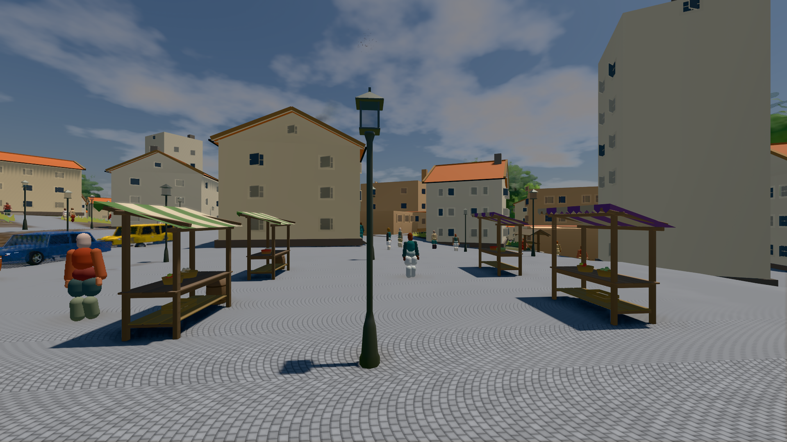
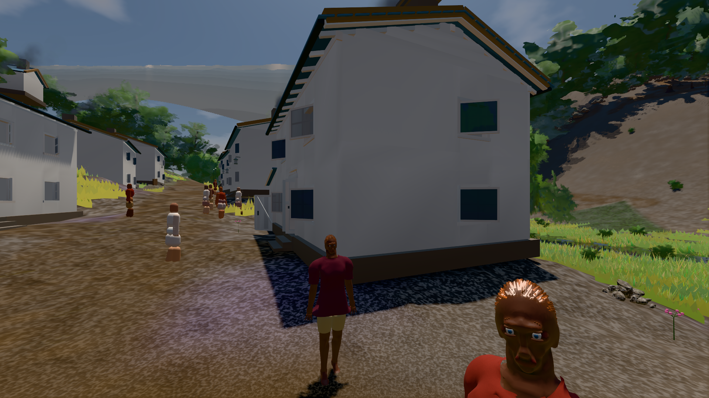
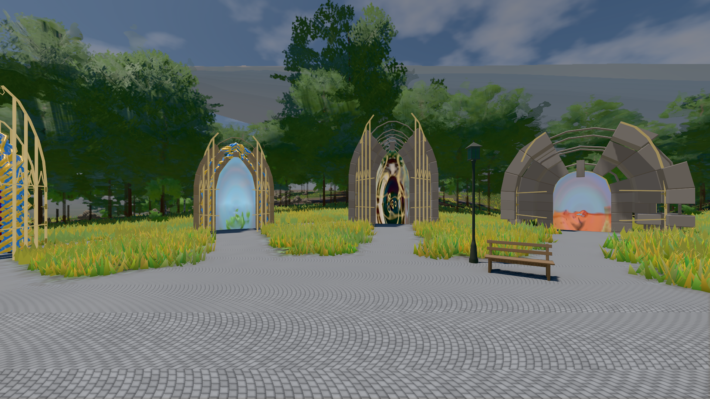

# GPU-PROBE 04e55908 — ROT

Zweig `w28-stadt-grammatik` · Kopf 04e5590887940a89a598c9a5584a9ecf6e1d47dd · Läufer gtx1050-desktop · 14.11. 15:01 · Wanduhr ab Push 890 s · Lauf https://github.com/MiguellD/AnazhRealm/actions/runs/43601471560

Ruf: `bild:stadt-voll@0.5 bild:dorf@0.5 bild:genesis@0.5`

## Läufer gtx1050-desktop — ROT

GPU NVIDIA GeForce GTX 1050 · npm ci 50 s (package-lock 2fb635b1)
Schloss /c/Users/User/AppData/Local/Temp/claude/gpu-schloss hält „ci-runner 43601471560/1 probe“
- Hook 2026-11-14 14:47:48 start ci-runner 43601471560/1 probe: wartet auf Schloss von 'hand werkbank takt-3-A (Claude)'
- Hook 2026-11-14 14:50:20 start ci-runner 43601471560/1 probe: Schloss genommen (refs/heads/w28-stadt-grammatik 04e5590887940a89a598c9a5584a9ecf6e1d47dd ws=C:\actions-runner\_work\AnazhRealm\AnazhRealm)

### bild:stadt-voll@0.5 — ROT · 229 s · Läufer gtx1050-desktop

Adapter: [linse-gpu] nvidia/pascal · "fehler": "ABNAHME ROT [kein bewohner im Bild: 0.0 % < 1.0 %] · beweis · Sicht 0.0 % · Ziel Blickziel im Bild frei 35.69 m · Luma 110.7 σ 32.8 schwarz 0.0 % weiß 0.0 % · Stand 18.546.284 · Bühne summer sunny 0.50 Tiere g — keine Station beim Namen

```text
Kamera des Spiels → Blick (35.7 m): 836.09 57.57 451.79 871.66 57.57 454.75
 "fehler": "ABNAHME ROT [kein bewohner im Bild: 0.0 % < 1.0 %] · beweis · Sicht 0.0 % · Ziel Blickziel im Bild frei 35.69 m · Luma 110.7 σ 32.8 schwarz 0.0 % weiß 0.0 % · Stand 18.546.284 · Bühne summer sunny 0.50 Tiere gehalten · Gerät WebGPU nvidia pascal · Inhalt bauSatz 31.0 % (≥ 2.0 %) Luma 93, bewohner 0.0 % (≥ 1.0 %) · ROT-Bild C:\\actions-runner\\_work\\_temp\\probe\\04e55908-stadt-voll-0.5-rot.png",
```



### bild:dorf@0.5 — GRÜN · 141 s · Läufer gtx1050-desktop

Adapter: [linse-gpu] nvidia/pascal

```text
Kamera des Spiels → Blick (5.2 m): -704.22 39.69 -880.02 -703.03 39.69 -874.96
 "abnahme": "ABNAHME GRÜN · beweis · Sicht 0.0 % · Leib im Vordergrund 2.9 % (Leib bewohner 2.9 %) · Ziel Blickziel im Bild frei 5.2 m · Luma 76.8 σ 31.4 schwarz 0.4 % weiß 0.0 % · Stand 18.546.284 · Bühne summer sunny 0.50 Tiere gehalten · Gerät WebGPU nvidia pascal · Inhalt bauSatz 29.0 % (≥ 2.0 %) Luma 79",
```



### bild:genesis@0.5 — GRÜN · 72 s · Läufer gtx1050-desktop

Adapter: [linse-gpu] nvidia/pascal

```text
Kamera des Spiels → Blick (10.0 m): 0.00 92.40 0.00 -10.00 92.40 0.00
 "abnahme": "ABNAHME GRÜN · beweis · Sicht 0.0 % · Ziel Blickziel im Bild frei 10 m · Luma 106.6 σ 39 schwarz 0.0 % weiß 0.0 % · Stand 18.546.284 · Bühne summer sunny 0.50 Tiere gehalten · Gerät WebGPU nvidia pascal · Inhalt bodenSatz 36.1 % (≥ 15.0 %) Luma 140, portal-membran 2.7 % (≥ 0.3 %) Luma 140",
```


