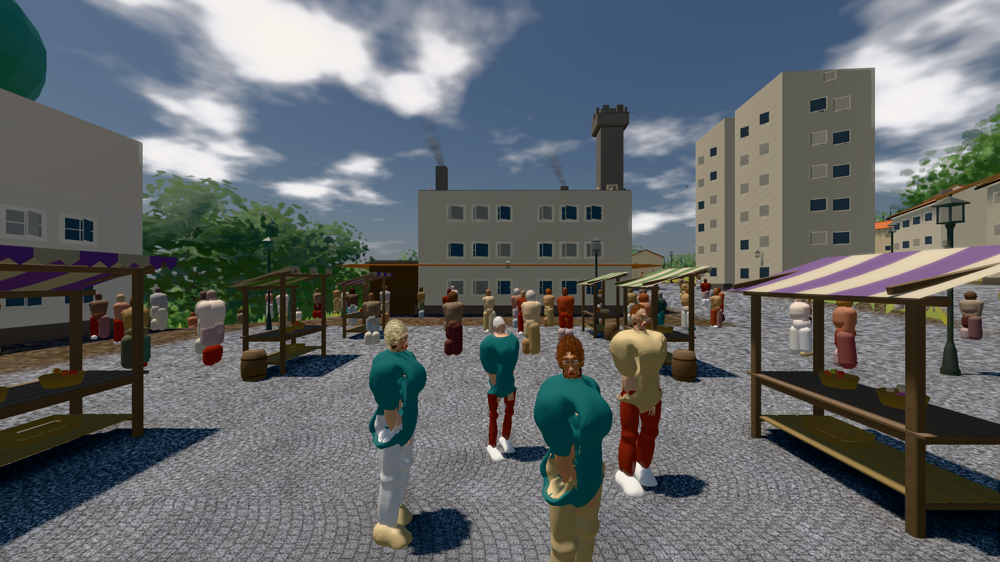
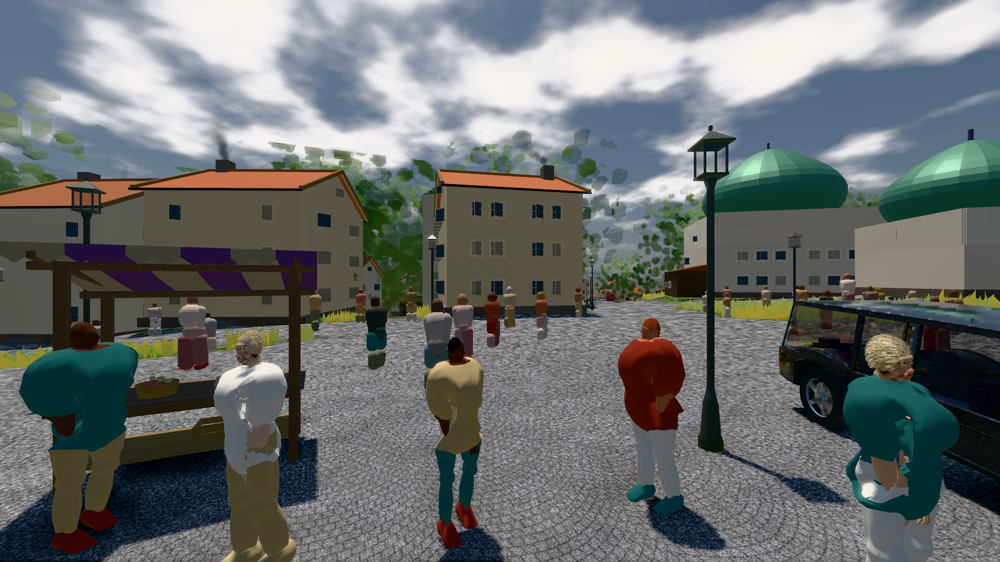
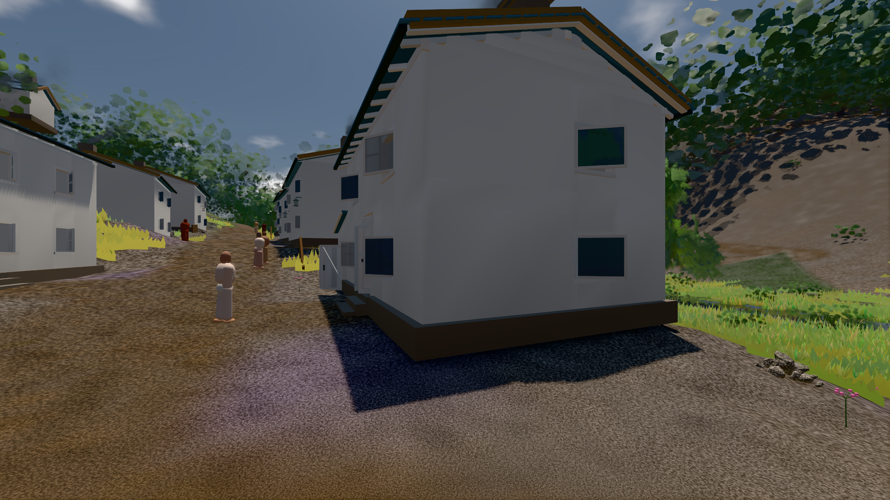

# GPU-PROBE 0698fb92 — GRÜN

Zweig `w28-stadt-grammatik` · Kopf 0698fb92de30dc88630a8e2520c1099b28e67000 · Läufer gtx1050-desktop · 12.11. 00:50 · Wanduhr ab Push 1251 s · Lauf https://github.com/MiguellD/AnazhRealm/actions/runs/43120264912

Ruf: `bild:stadt@0.5 bild:stadt-voll@0.5 bild:dorf@0.5`

## Läufer gtx1050-desktop — GRÜN

GPU NVIDIA GeForce GTX 1050 · npm ci 63 s (package-lock 657462dc)
Schloss /c/Users/User/AppData/Local/Temp/claude/gpu-schloss hält „ci-runner 43120264912/2 probe“
- Hook 2026-11-12 00:38:20 start ci-runner 43120264912/2 probe: Schloss genommen (refs/heads/w28-stadt-grammatik 0698fb92de30dc88630a8e2520c1099b28e67000 ws=C:\actions-runner\_work\AnazhRealm\AnazhRealm)

### bild:stadt@0.5 — GRÜN · 190 s · Läufer gtx1050-desktop

Adapter: [linse-gpu] nvidia/pascal

```text
Kamera des Spiels → Blick (21.2 m): 662.72 62.25 435.86 641.52 62.25 435.94
 "abnahme": "ABNAHME GRÜN · beweis · Sicht 0.0 % · Ziel Blickziel im Bild frei 21.2 m · Luma 102.8 σ 51.1 schwarz 0.4 % weiß 0.0 % · Stand 18.546.259 · Bühne summer sunny 0.50 · Gerät WebGPU nvidia pascal",
```



### bild:stadt-voll@0.5 — GRÜN · 285 s · Läufer gtx1050-desktop

Adapter: [linse-gpu] nvidia/pascal

```text
Kamera des Spiels → Blick (21.4 m): 836.09 57.57 451.79 826.52 57.57 470.94
 "abnahme": "ABNAHME GRÜN · beweis · Sicht 0.0 % · Ziel Blickziel im Bild frei 21.41 m · Luma 110.1 σ 61.3 schwarz 0.3 % weiß 0.0 % · Stand 18.546.259 · Bühne summer sunny 0.50 · Gerät WebGPU nvidia pascal",
```



### bild:dorf@0.5 — GRÜN · 166 s · Läufer gtx1050-desktop

Adapter: [linse-gpu] nvidia/pascal

```text
Kamera des Spiels → Blick (5.2 m): -704.22 39.69 -880.02 -703.03 39.69 -874.96
 "abnahme": "ABNAHME GRÜN · beweis · Sicht 0.0 % · Ziel Blickziel im Bild frei 5.2 m · Luma 79.3 σ 30.8 schwarz 0.2 % weiß 0.0 % · Stand 18.546.259 · Bühne summer sunny 0.50 · Gerät WebGPU nvidia pascal",
```


