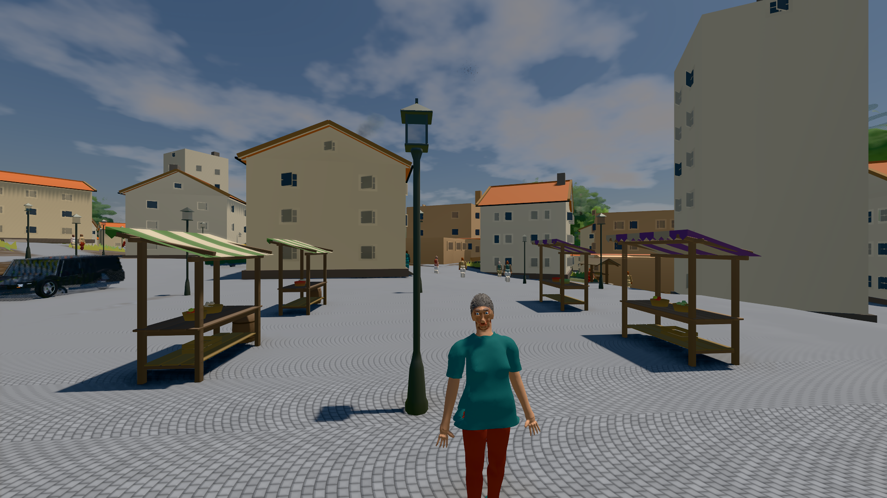
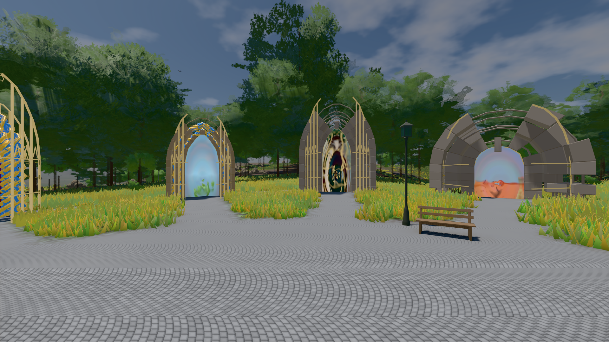

# GPU-PROBE 163f3e0b — GRÜN

Zweig `w28-stadt-grammatik` · Kopf 163f3e0b9f9d75139c71745bea32c945fce2a748 · Läufer radeon-890m · 14.11. 10:45 · Wanduhr ab Push 357 s · Lauf https://github.com/MiguellD/AnazhRealm/actions/runs/43581567413

Ruf: `bild:stadt-voll@0.5 bild:genesis@0.5`

## Läufer radeon-890m — GRÜN

GPU AMD Radeon(TM) 890M Graphics · npm ci 71 s (package-lock 57539f97)
Schloss /c/Users/micha/AppData/Local/Temp/claude/gpu-schloss hält „ci-runner 43581567413/1 probe“
- Hook 2026-11-14 10:39:40 start ci-runner 43581567413/1 probe: Schloss genommen (refs/heads/w28-stadt-grammatik 163f3e0b9f9d75139c71745bea32c945fce2a748 ws=C:\actions-runner\_work\AnazhRealm\AnazhRealm)

### bild:stadt-voll@0.5 — GRÜN · 140 s · Läufer radeon-890m

Adapter: [linse-gpu] amd/rdna-3

```text
Kamera des Spiels → Blick (35.7 m): 836.09 57.57 451.79 871.66 57.57 454.75
 "abnahme": "ABNAHME GRÜN · beweis · Sicht 0.0 % · Leib im Vordergrund 1.7 % (Leib bewohner 1.7 %) · Ziel Blickziel im Bild frei 35.69 m · Luma 109.1 σ 34 schwarz 0.0 % weiß 0.0 % · Stand 18.546.283 · Bühne summer sunny 0.50 Tiere gehalten · Gerät WebGPU amd rdna-3 · Inhalt bauSatz 31.1 % (≥ 2.0 %) Luma 93, bewohner 2.3 % (≥ 1.0 %) Luma 62",
```



### bild:genesis@0.5 — GRÜN · 53 s · Läufer radeon-890m

Adapter: [linse-gpu] amd/rdna-3

```text
Kamera des Spiels → Blick (10.0 m): 0.00 92.40 0.00 -10.00 92.40 0.00
 "abnahme": "ABNAHME GRÜN · beweis · Sicht 0.0 % · Ziel Blickziel im Bild frei 10 m · Luma 107.5 σ 39 schwarz 0.0 % weiß 0.0 % · Stand 18.546.283 · Bühne summer sunny 0.50 Tiere gehalten · Gerät WebGPU amd rdna-3 · Inhalt bodenSatz 36.1 % (≥ 15.0 %) Luma 140, portal-membran 2.7 % (≥ 0.3 %) Luma 140",
```


