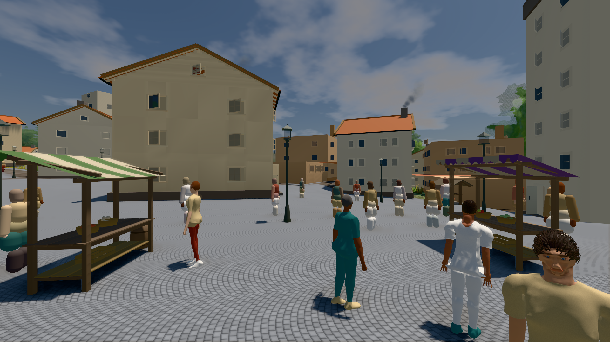
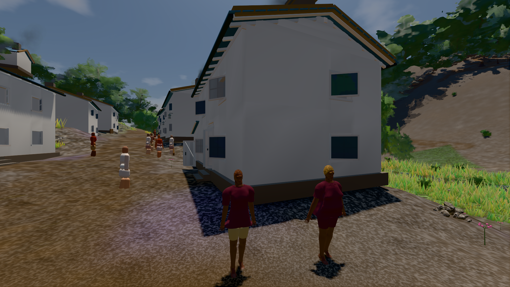
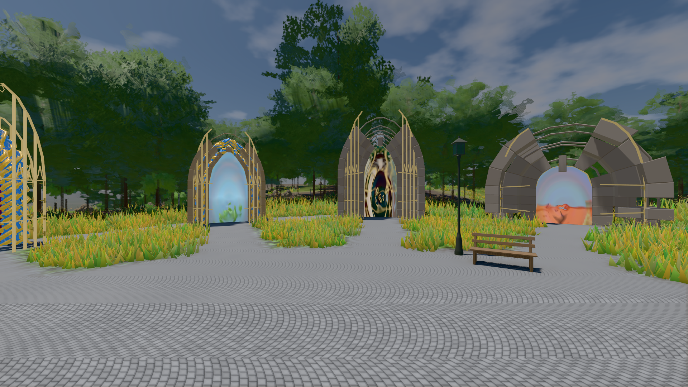

# GPU-PROBE 20f15043 — GRÜN

Zweig `w28-stadt-grammatik` · Kopf 20f150439b0ef20c50d3aaa2439b675f519d06f0 · Läufer omen-gtx1060 · 14.11. 20:46 · Wanduhr ab Push 325 s · Lauf https://github.com/MiguellD/AnazhRealm/actions/runs/43633429123

Ruf: `bild:stadt-voll@0.5 bild:dorf@0.5 bild:genesis@0.5`

## Läufer omen-gtx1060 — GRÜN

GPU NVIDIA GeForce GTX 1060 · npm ci 37 s (package-lock ab649e4a)
Schloss /c/Users/micha/AppData/Local/Temp/claude/gpu-schloss hält „ci-runner 43633429123/1 probe“
- Hook 2026-11-14 20:41:33 start ci-runner 43633429123/1 probe: Schloss genommen (refs/heads/w28-stadt-grammatik 20f150439b0ef20c50d3aaa2439b675f519d06f0 ws=C:\actions-runner\_work\AnazhRealm\AnazhRealm)

### bild:stadt-voll@0.5 — GRÜN · 124 s · Läufer omen-gtx1060

Adapter: [linse-gpu] nvidia/pascal

```text
Kamera des Spiels → Blick (29.4 m): 842.49 57.57 451.79 871.75 57.57 454.60
 "abnahme": "ABNAHME GRÜN · beweis · Sicht 0.0 % · Leib im Vordergrund 6.6 % (Leib bewohner 6.6 %) · Ziel Blickziel im Bild frei 29.39 m · Luma 104.3 σ 35.4 schwarz 0.1 % weiß 0.0 % · Stand 18.546.288 · Bühne summer sunny 0.50 Tiere gehalten · Gerät WebGPU nvidia pascal · Inhalt bauSatz 34.2 % (≥ 2.0 %) Luma 92, bewohner 7.4 % (≥ 1.0 %) Luma 96",
```



### bild:dorf@0.5 — GRÜN · 63 s · Läufer omen-gtx1060

Adapter: [linse-gpu] nvidia/pascal

```text
Kamera des Spiels → Blick (5.2 m): -704.22 39.69 -880.02 -703.03 39.69 -874.96
 "abnahme": "ABNAHME GRÜN · beweis · Sicht 0.0 % · Ziel Blickziel im Bild frei 5.2 m · Luma 77.8 σ 31 schwarz 0.3 % weiß 0.0 % · Stand 18.546.288 · Bühne summer sunny 0.50 Tiere gehalten · Gerät WebGPU nvidia pascal · Inhalt bauSatz 28.7 % (≥ 2.0 %) Luma 80",
```



### bild:genesis@0.5 — GRÜN · 41 s · Läufer omen-gtx1060

Adapter: [linse-gpu] nvidia/pascal

```text
Kamera des Spiels → Blick (10.0 m): 0.00 92.40 0.00 -10.00 92.40 0.00
 "abnahme": "ABNAHME GRÜN · beweis · Sicht 0.0 % · Ziel Blickziel im Bild frei 10 m · Luma 107.6 σ 39 schwarz 0.0 % weiß 0.0 % · Stand 18.546.288 · Bühne summer sunny 0.50 Tiere gehalten · Gerät WebGPU nvidia pascal · Inhalt bodenSatz 36.4 % (≥ 15.0 %) Luma 140, portal-membran 2.7 % (≥ 0.3 %) Luma 140",
```


