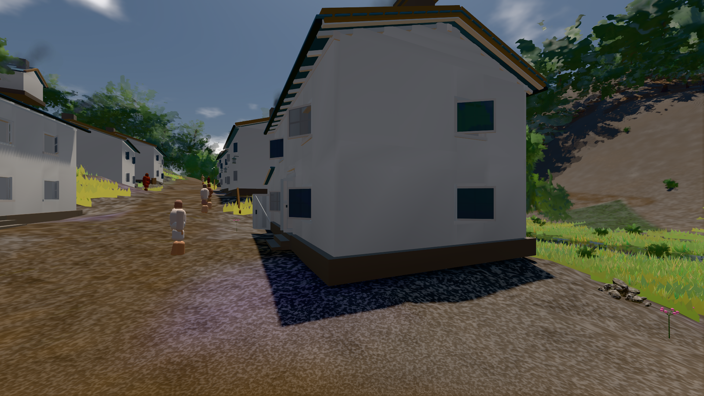
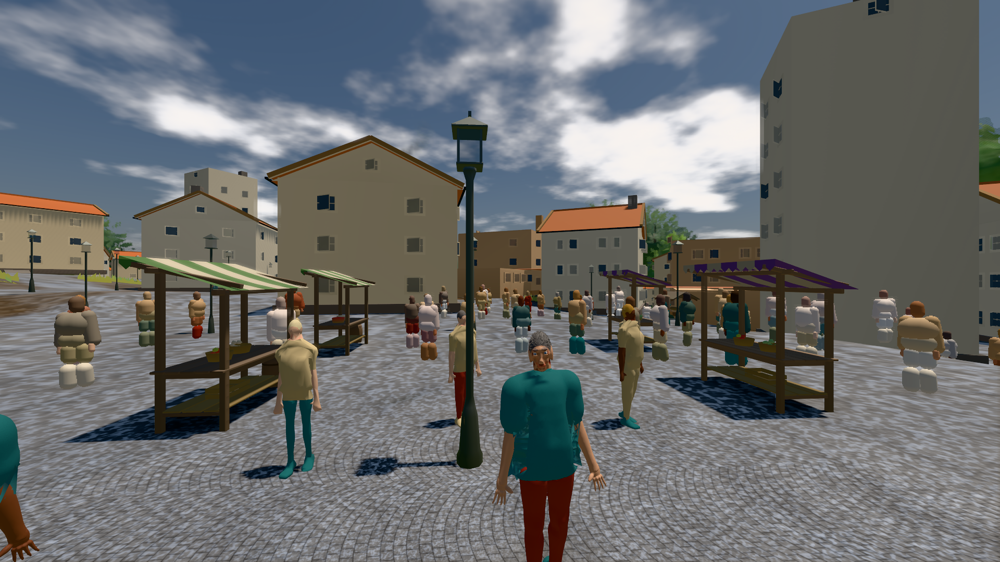

# GPU-PROBE 22872718 — GRÜN · ROT wie an main (bekannt): bild:stadt-voll@0.5: stadt-voll.leib (Messort, haushalt.json bekannt) auf gtx1050-desktop

Zweig `w28-stadt-grammatik` · Kopf 2287271871fae992e0ba14a903e787a002b2252b · Läufer gtx1050-desktop · 13.11. 15:59 · Wanduhr ab Push 1593 s · Lauf https://github.com/MiguellD/AnazhRealm/actions/runs/43443723619

Ruf: `bild:dorf@0.5 bild:stadt-voll@0.5`

## Läufer gtx1050-desktop — GRÜN

GPU NVIDIA GeForce GTX 1050 · node_modules bleiben (package-lock 57368c8e)
Schloss /c/Users/User/AppData/Local/Temp/claude/gpu-schloss hält „ci-runner 43443723619/2 probe“
- Hook 2026-11-13 15:50:09 start ci-runner 43443723619/2 probe: wartet auf Schloss von 'hand stoff-spike c4 (Claude)'
- Hook 2026-11-13 15:52:11 start ci-runner 43443723619/2 probe: Schloss genommen (refs/heads/w28-stadt-grammatik 2287271871fae992e0ba14a903e787a002b2252b ws=C:\actions-runner\_work\AnazhRealm\AnazhRealm)

### bild:dorf@0.5 — GRÜN · 162 s · Läufer gtx1050-desktop

Adapter: [linse-gpu] nvidia/pascal

```text
Kamera des Spiels → Blick (5.2 m): -704.22 39.69 -880.02 -703.03 39.69 -874.96
 "abnahme": "ABNAHME GRÜN · beweis · Sicht 0.0 % · Ziel Blickziel im Bild frei 5.2 m · Luma 79.2 σ 30.8 schwarz 0.3 % weiß 0.0 % · Stand 18.546.272 · Bühne summer sunny 0.50 Tiere gehalten · Gerät WebGPU nvidia pascal · Inhalt bauSatz 30.0 % (≥ 2.0 %) Luma 78",
```



### bild:stadt-voll@0.5 — BEKANNT · 239 s · Läufer gtx1050-desktop

Adapter: [linse-gpu] nvidia/pascal · ROT wie an main (bekannt): stadt-voll.leib (Messort, haushalt.json bekannt)

```text
Kamera des Spiels → Blick (35.7 m): 836.09 57.57 451.79 871.66 57.57 454.75
 "abnahme": "ABNAHME BEKANNT · ROT wie an main (bekannt): stadt-voll.leib Sicht verdeckt 3.5 % (Laub · Rinde · Fels · Böschung näher als 2 m, Bau als 1 m): Leib bewohner (≤ 8 m) 3.5 % · beweis · Sicht 3.5 % (Leib bewohner (≤ 8 m) 3.5 %) · Ziel Blickziel im Bild frei 35.69 m · Luma 108.7 σ 43.2 schwarz 0.1 % weiß 0.0 % · Stand 18.546.272 · Bühne summer sunny 0.50 Tiere gehalten · Gerät WebGPU nvidia pascal · Inhalt bauSatz 30.0 % (≥ 2.0 %) Luma 89, bewohner 4.7 % (≥ 1.0 %) Luma 77",
```


