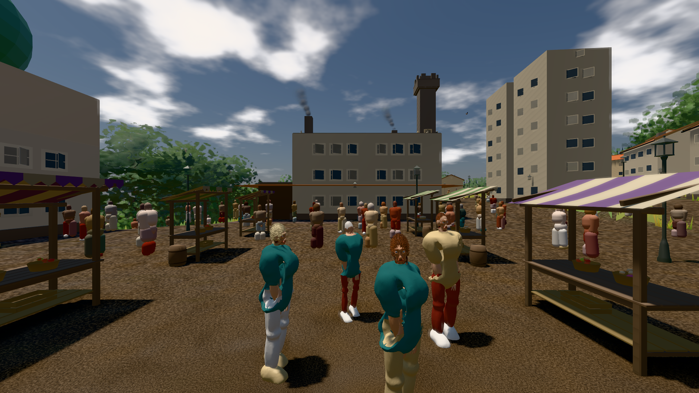
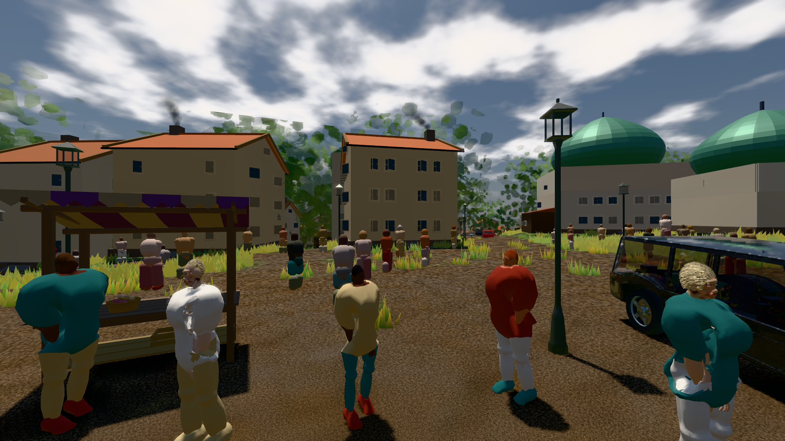
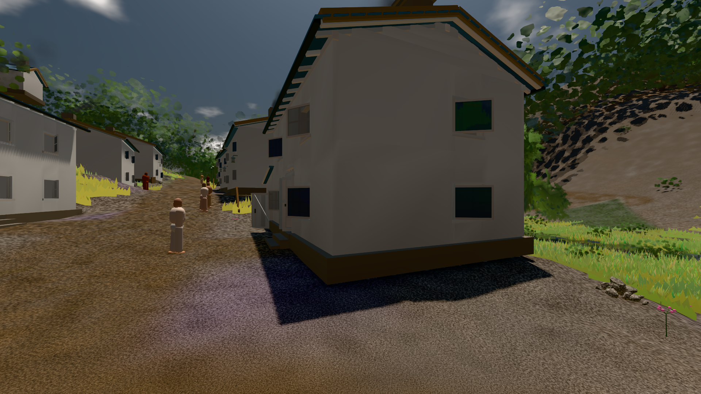

# GPU-PROBE 4073fb2f — GRÜN

Zweig `w28-stadt-grammatik` · Kopf 4073fb2f668c35512fdae66688efb961cb88cb9a · Läufer radeon-890m · 11.11. 23:04 · Wanduhr ab Push 7513 s · Lauf https://github.com/MiguellD/AnazhRealm/actions/runs/43092256609

Ruf: `bild:stadt@0.5 bild:stadt-voll@0.5 bild:dorf@0.5`

## Läufer radeon-890m — GRÜN

GPU AMD Radeon(TM) 890M Graphics · node_modules bleiben (package-lock 50ac1117)
Schloss /c/Users/micha/AppData/Local/Temp/claude/gpu-schloss hält „ci-runner 43092256609/2 probe“
- Hook 2026-11-11 22:58:21 start ci-runner 43092256609/2 probe: Schloss genommen (refs/heads/w28-stadt-grammatik 4073fb2f668c35512fdae66688efb961cb88cb9a ws=C:\actions-runner\_work\AnazhRealm\AnazhRealm)

### bild:stadt@0.5 — GRÜN · 107 s · Läufer radeon-890m

Adapter: [linse-gpu] amd/rdna-3

```text
Kamera des Spiels → Blick (21.2 m): 662.72 62.25 435.86 641.52 62.25 435.94
 "abnahme": "ABNAHME GRÜN · beweis · Sicht 0.0 % · Ziel Blickziel im Bild frei 21.2 m · Luma 84.7 σ 52.3 schwarz 1.7 % weiß 0.0 % · Stand 18.546.254 · Bühne summer sunny 0.50 · Gerät WebGPU amd rdna-3",
```



### bild:stadt-voll@0.5 — GRÜN · 115 s · Läufer radeon-890m

Adapter: [linse-gpu] amd/rdna-3

```text
Kamera des Spiels → Blick (21.4 m): 836.09 57.57 451.79 826.52 57.57 470.94
 "abnahme": "ABNAHME GRÜN · beweis · Sicht 0.0 % · Ziel Blickziel im Bild frei 21.41 m · Luma 94.3 σ 64.9 schwarz 2.1 % weiß 0.0 % · Stand 18.546.254 · Bühne summer sunny 0.50 · Gerät WebGPU amd rdna-3",
```



### bild:dorf@0.5 — GRÜN · 70 s · Läufer radeon-890m

Adapter: [linse-gpu] amd/rdna-3

```text
Kamera des Spiels → Blick (5.2 m): -704.22 39.69 -880.02 -703.03 39.69 -874.96
 "abnahme": "ABNAHME GRÜN · beweis · Sicht 0.0 % · Ziel Blickziel im Bild frei 5.2 m · Luma 71.5 σ 29.4 schwarz 0.7 % weiß 0.0 % · Stand 18.546.254 · Bühne summer sunny 0.50 · Gerät WebGPU amd rdna-3",
```


