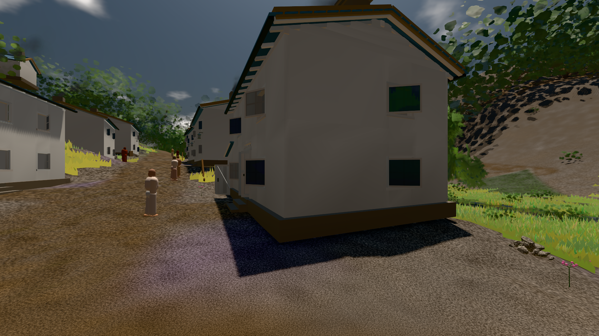

# GPU-PROBE 66a4c85b — ROT

Zweig `w28-stadt-grammatik` · Kopf 66a4c85b2b29060e2748d55fcaca8677acf20a5c · Läufer radeon-890m · 11.11. 20:50 · Wanduhr ab Push 426 s · Lauf https://github.com/MiguellD/AnazhRealm/actions/runs/43089851545

Ruf: `bild:stadt@0.5 bild:stadt-voll@0.5 bild:dorf@0.5`

## Läufer radeon-890m — ROT

GPU AMD Radeon(TM) 890M Graphics · node_modules bleiben (package-lock 50ac1117)
Schloss /c/Users/micha/AppData/Local/Temp/claude/gpu-schloss hält „ci-runner 43089851545/1 probe“
- Hook 2026-11-11 20:45:34 start ci-runner 43089851545/1 probe: Schloss genommen (refs/heads/w28-stadt-grammatik 66a4c85b2b29060e2748d55fcaca8677acf20a5c ws=C:\actions-runner\_work\AnazhRealm\AnazhRealm)

### bild:stadt@0.5 — ROT · 86 s · Läufer radeon-890m

Adapter: [linse-gpu] amd/rdna-3

```text
ROT umstellen --ort stadt: DIE WELT STEHT NICHT nach 2114 Takten: Ruhe 0, zuletzt brach sie: Fege-Takt archLod wartet (1 Zusagen, zuerst fahrzeug_limousine L2 in 87 m) (DER BAU STEHT NICHT: die Welt nach 2114 Takten — die Welt hat nichts mehr offen)
```

### bild:stadt-voll@0.5 — ROT · 123 s · Läufer radeon-890m

Adapter: [linse-gpu] amd/rdna-3

```text
ROT umstellen --ort stadt-voll: DIE WELT STEHT NICHT nach 2639 Takten: Ruhe 0, zuletzt brach sie: Fege-Takt archLod wartet (5 Zusagen, zuerst fahrzeug_kompakt_fwd L2 in 133 m) (DER BAU STEHT NICHT: die Welt nach 2639 Takten — die Welt hat nichts mehr offen)
```

### bild:dorf@0.5 — GRÜN · 69 s · Läufer radeon-890m

Adapter: [linse-gpu] amd/rdna-3

```text
Kamera des Spiels → Blick (5.2 m): -704.22 39.69 -880.02 -703.03 39.69 -874.96
 "abnahme": "ABNAHME GRÜN · beweis · Sicht 0.0 % · Ziel Blickziel im Bild frei 5.2 m · Luma 71.5 σ 29.3 schwarz 0.7 % weiß 0.0 % · Stand 18.546.254 · Bühne summer sunny 0.50 · Gerät WebGPU amd rdna-3",
```


