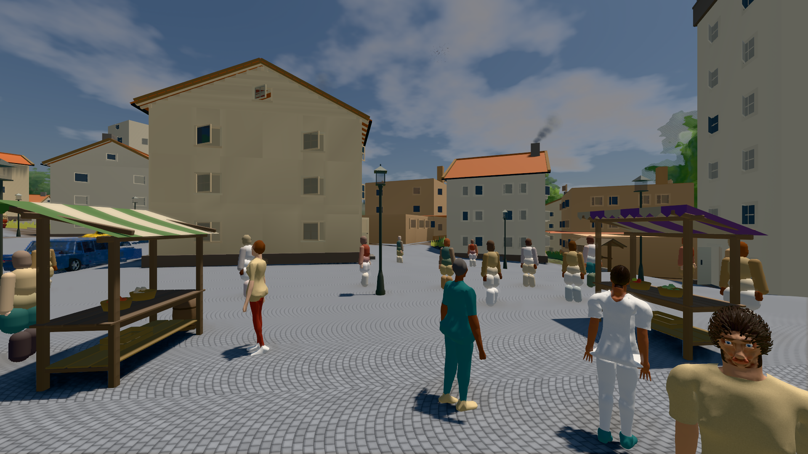
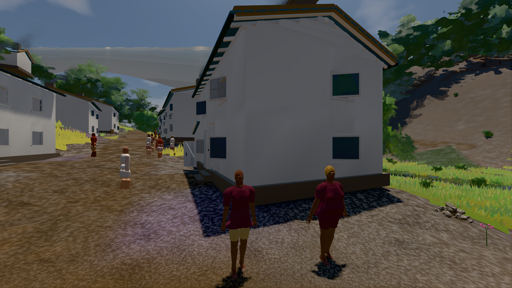
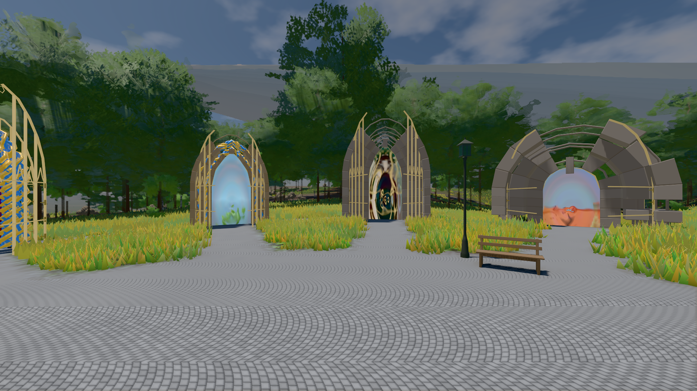

# GPU-PROBE a9f6f6bc — GRÜN

Zweig `w28-stadt-grammatik` · Kopf a9f6f6bc498d66cec267ccc63f869fc9c2937a87 · Läufer gtx1050-desktop · 14.11. 17:41 · Wanduhr ab Push 1457 s · Lauf https://github.com/MiguellD/AnazhRealm/actions/runs/43614788030

Ruf: `bild:stadt-voll@0.5 bild:dorf@0.5 bild:genesis@0.5`

## Läufer gtx1050-desktop — GRÜN

GPU NVIDIA GeForce GTX 1050 · node_modules bleiben (package-lock 2fb635b1)
Schloss /c/Users/User/AppData/Local/Temp/claude/gpu-schloss hält „ci-runner 43614788030/2 probe“
- Hook 2026-11-14 17:33:39 start ci-runner 43614788030/2 probe: Schloss genommen (refs/heads/w28-stadt-grammatik a9f6f6bc498d66cec267ccc63f869fc9c2937a87 ws=C:\actions-runner\_work\AnazhRealm\AnazhRealm)

### bild:stadt-voll@0.5 — GRÜN · 247 s · Läufer gtx1050-desktop

Adapter: [linse-gpu] nvidia/pascal

```text
Kamera des Spiels → Blick (29.4 m): 842.49 57.57 451.79 871.75 57.57 454.60
 "abnahme": "ABNAHME GRÜN · beweis · Sicht 0.0 % · Leib im Vordergrund 6.8 % (Leib bewohner 6.8 %) · Ziel Blickziel im Bild frei 29.39 m · Luma 103.5 σ 35.8 schwarz 0.1 % weiß 0.0 % · Stand 18.546.284 · Bühne summer sunny 0.50 Tiere gehalten · Gerät WebGPU nvidia pascal · Inhalt bauSatz 34.2 % (≥ 2.0 %) Luma 92, bewohner 7.4 % (≥ 1.0 %) Luma 95",
```



### bild:dorf@0.5 — GRÜN · 135 s · Läufer gtx1050-desktop

Adapter: [linse-gpu] nvidia/pascal

```text
Kamera des Spiels → Blick (5.2 m): -704.22 39.69 -880.02 -703.03 39.69 -874.96
 "abnahme": "ABNAHME GRÜN · beweis · Sicht 0.0 % · Ziel Blickziel im Bild frei 5.2 m · Luma 77.7 σ 31 schwarz 0.3 % weiß 0.0 % · Stand 18.546.284 · Bühne summer sunny 0.50 Tiere gehalten · Gerät WebGPU nvidia pascal · Inhalt bauSatz 28.7 % (≥ 2.0 %) Luma 80",
```



### bild:genesis@0.5 — GRÜN · 70 s · Läufer gtx1050-desktop

Adapter: [linse-gpu] nvidia/pascal

```text
Kamera des Spiels → Blick (10.0 m): 0.00 92.40 0.00 -10.00 92.40 0.00
 "abnahme": "ABNAHME GRÜN · beweis · Sicht 0.0 % · Ziel Blickziel im Bild frei 10 m · Luma 106.6 σ 39 schwarz 0.0 % weiß 0.0 % · Stand 18.546.284 · Bühne summer sunny 0.50 Tiere gehalten · Gerät WebGPU nvidia pascal · Inhalt bodenSatz 36.1 % (≥ 15.0 %) Luma 140, portal-membran 2.7 % (≥ 0.3 %) Luma 140",
```


