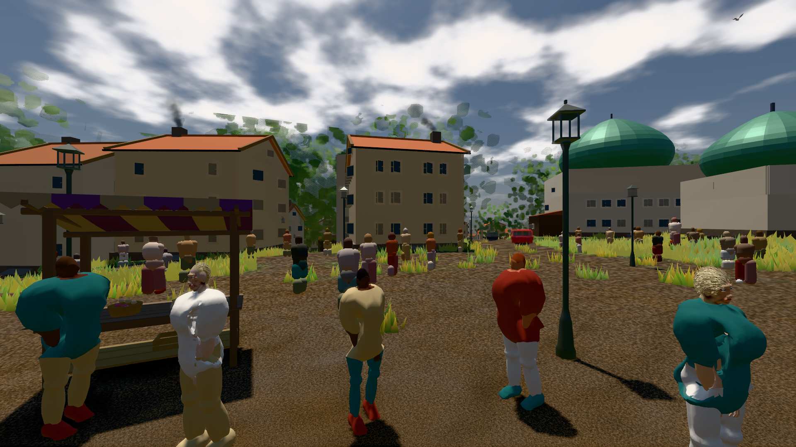

# GPU-PROBE adeeb1c3 — ROT

Zweig `w28-stadt-grammatik` · Kopf adeeb1c32ec63f9dd19cb22a1e427da6fbb1b56a · Läufer omen-gtx1060 · 11.11. 20:03 · Wanduhr ab Push 460 s · Lauf https://github.com/MiguellD/AnazhRealm/actions/runs/43082360124

Ruf: `bild:stadt-voll@0.5 bild:stadt@0.5 bild:dorf@0.5`

## Läufer omen-gtx1060 — ROT

GPU NVIDIA GeForce GTX 1060 · npm ci 45 s (package-lock 50ac1117)
Schloss /c/Users/micha/AppData/Local/Temp/claude/gpu-schloss hält „ci-runner 43082360124/1 probe“
- Hook 2026-11-11 19:55:57 start ci-runner 43082360124/1 probe: Schloss genommen (refs/heads/w28-stadt-grammatik adeeb1c32ec63f9dd19cb22a1e427da6fbb1b56a ws=C:\actions-runner\_work\AnazhRealm\AnazhRealm)

### bild:stadt-voll@0.5 — GRÜN · 152 s · Läufer omen-gtx1060

Adapter: [linse-gpu] nvidia/pascal

```text
Kamera des Spiels → Blick (21.4 m): 836.09 57.57 451.79 826.52 57.57 470.94
 "abnahme": "ABNAHME GRÜN · beweis · Sicht 0.0 % · Ziel Blickziel im Bild frei 21.41 m · Luma 97 σ 63.3 schwarz 1.4 % weiß 0.0 % · Stand 18.546.254 · Bühne summer sunny 0.50 · Gerät WebGPU nvidia pascal",
```



### bild:stadt@0.5 — ROT · 135 s · Läufer omen-gtx1060

Adapter: [linse-gpu] nvidia/pascal

```text
TypeError: Cannot read properties of undefined (reading '0')
Kamera des Spiels → Blick ( m): 662.72 62.25 435.86 NaN NaN NaN
```

### bild:dorf@0.5 — NACHGEGEBEN · 44 s · Läufer omen-gtx1060

Adapter: [linse-gpu] nvidia/pascal · NACHGEGEBEN: Karten-Job „echt omen (GPU-Wände auf der Karte)“ (Lauf 43083322430) wartet auf diesen Läufer (omen-gpu)

```text
[linse-gpu] nvidia/pascal
```
