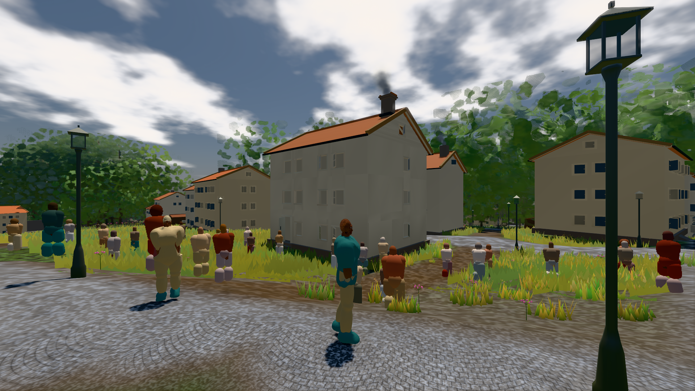
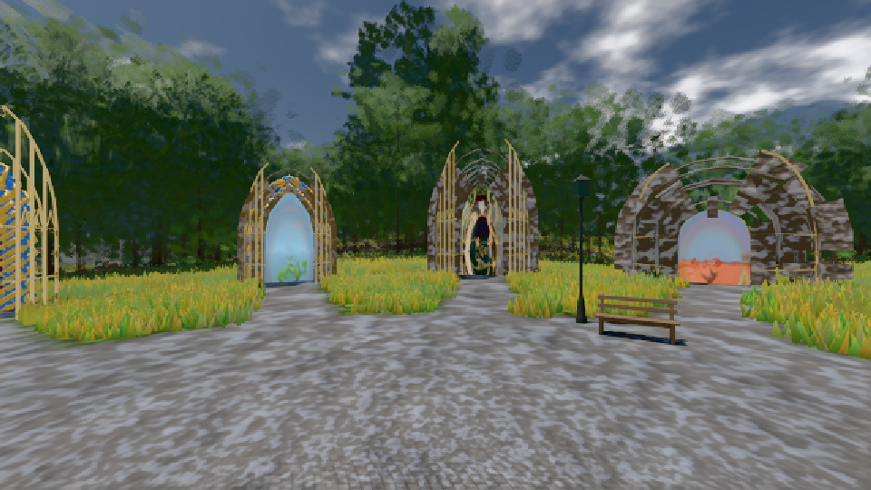
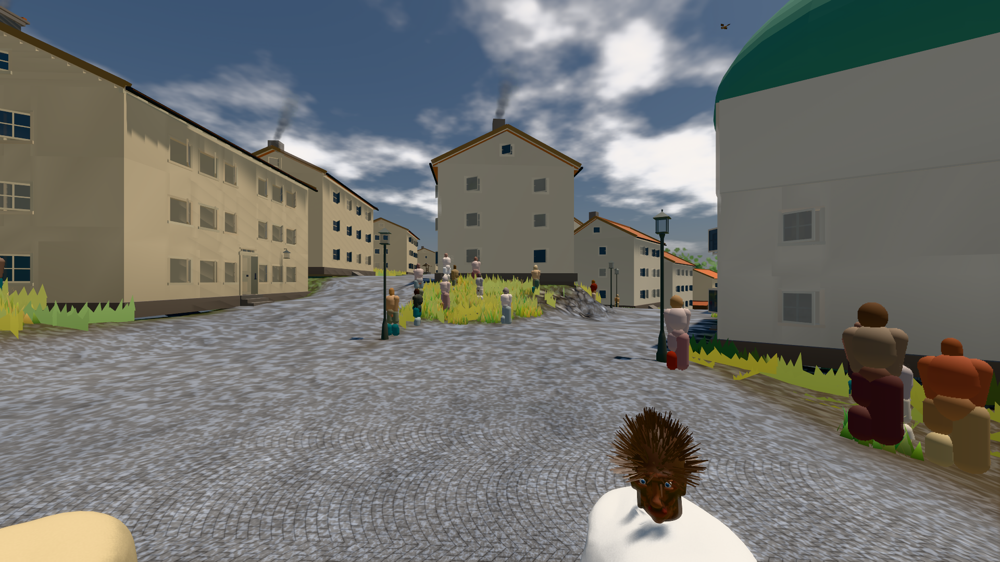

# GPU-PROBE b065ed91 — GRÜN

Zweig `w28-stadt-grund` · Kopf b065ed91a587b3d27acd33e4edb05dbcf334c591 · Läufer omen-gtx1060 · 12.11. 03:33 · Wanduhr ab Push 338 s · Lauf https://github.com/MiguellD/AnazhRealm/actions/runs/43141598001

Ruf: `bild:stadt-voll bild:genesis bild:stadt`

## Läufer omen-gtx1060 — GRÜN

GPU NVIDIA GeForce GTX 1060 · node_modules bleiben (package-lock 657462dc)
Schloss /c/Users/micha/AppData/Local/Temp/claude/gpu-schloss hält „ci-runner 43141598001/1 probe“
- Hook 2026-11-12 03:28:13 start ci-runner 43141598001/1 probe: wartet auf Schloss von 'omen-punkte-gtx-sitzung'
- Hook 2026-11-12 03:28:28 start ci-runner 43141598001/1 probe: Schloss genommen (refs/heads/w28-stadt-grund b065ed91a587b3d27acd33e4edb05dbcf334c591 ws=C:\actions-runner\_work\AnazhRealm\AnazhRealm)

### bild:stadt-voll — GRÜN · 138 s · Läufer omen-gtx1060

Adapter: [linse-gpu] nvidia/pascal

```text
Kamera des Spiels → Blick (14.6 m): 837.84 58.51 445.42 842.31 58.51 459.32
 "abnahme": "ABNAHME GRÜN · beweis · Sicht 0.0 % · Ziel Blickziel im Bild frei 14.6 m, verdeckt nur von Leibern: 1 Punkt, nächster 3.7 m (Leib bewohner) · Luma 113.9 σ 56.6 schwarz 0.0 % weiß 0.0 % · Stand 18.546.259 · Bühne summer sunny 0.50 · Gerät WebGPU nvidia pascal",
```



### bild:genesis — GRÜN · 35 s · Läufer omen-gtx1060

Adapter: [linse-gpu] nvidia/pascal

```text
Kamera des Spiels → Blick (10.0 m): 0.00 92.40 0.00 -10.00 92.40 0.00
 "abnahme": "ABNAHME GRÜN · beweis · Sicht 0.0 % · Ziel Blickziel im Bild frei 10 m · Luma 105.7 σ 39.1 schwarz 0.0 % weiß 0.0 % · Stand 18.546.259 · Bühne summer sunny 0.50 · Gerät WebGPU nvidia pascal",
```



### bild:stadt — GRÜN · 107 s · Läufer omen-gtx1060

Adapter: [linse-gpu] nvidia/pascal

```text
Kamera des Spiels → Blick (23.9 m): 662.72 63.28 429.48 686.59 63.28 428.39
 "abnahme": "ABNAHME GRÜN · beweis · Sicht 0.0 % · Ziel Blickziel im Bild frei 23.89 m · Luma 114.1 σ 39.7 schwarz 0.0 % weiß 0.0 % · Stand 18.546.259 · Bühne summer sunny 0.50 · Gerät WebGPU nvidia pascal",
```


