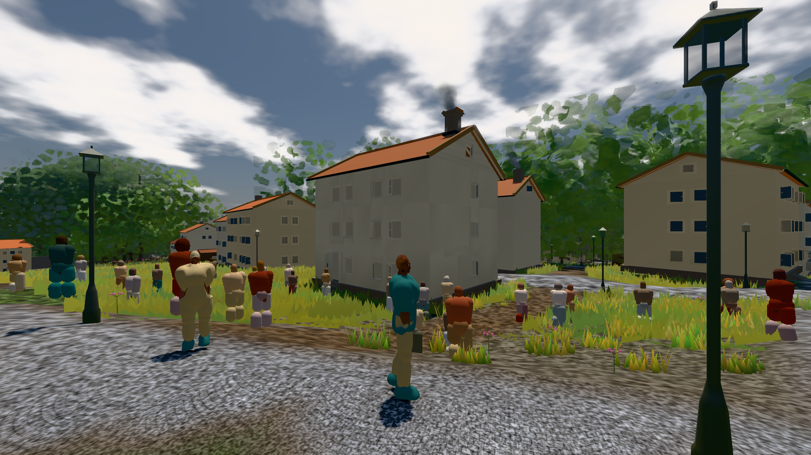
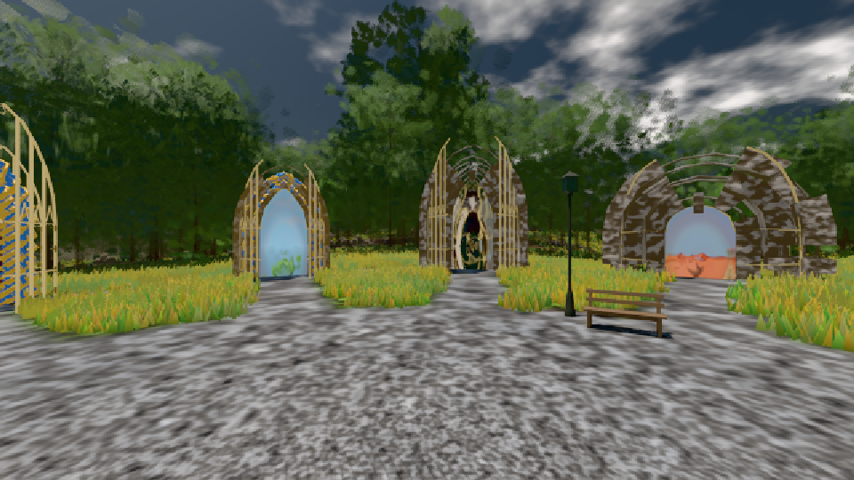
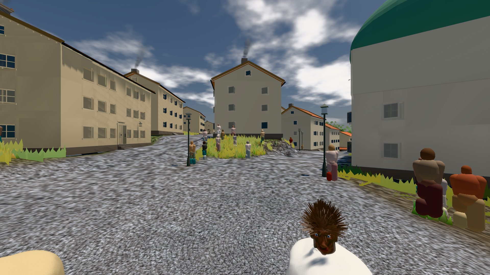

# GPU-PROBE f48e2f4c — GRÜN

Zweig `w28-stadt-grund` · Kopf f48e2f4c352d03c324b467a8c575b3ea6f90e2c1 · Läufer radeon-890m · 12.11. 03:23 · Wanduhr ab Push 489 s · Lauf https://github.com/MiguellD/AnazhRealm/actions/runs/43140127175

Ruf: `bild:stadt-voll bild:genesis bild:stadt`

## Läufer radeon-890m — GRÜN

GPU AMD Radeon(TM) 890M Graphics · node_modules bleiben (package-lock 657462dc)
Schloss /c/Users/micha/AppData/Local/Temp/claude/gpu-schloss hält „ci-runner 43140127175/1 probe“
- Hook 2026-11-12 03:16:37 start ci-runner 43140127175/1 probe: Schloss genommen (refs/heads/w28-stadt-grund f48e2f4c352d03c324b467a8c575b3ea6f90e2c1 ws=C:\actions-runner\_work\AnazhRealm\AnazhRealm)

### bild:stadt-voll — GRÜN · 183 s · Läufer radeon-890m

Adapter: [linse-gpu] amd/rdna-3

```text
Kamera des Spiels → Blick (14.6 m): 837.84 58.51 445.42 842.31 58.51 459.32
 "abnahme": "ABNAHME GRÜN · beweis · Sicht 0.0 % · Ziel Blickziel im Bild frei 14.6 m, verdeckt nur von Leibern: 1 Punkt, nächster 3.7 m (Leib bewohner) · Luma 113.4 σ 57.3 schwarz 0.0 % weiß 0.0 % · Stand 18.546.259 · Bühne summer sunny 0.50 · Gerät WebGPU amd rdna-3",
```



### bild:genesis — GRÜN · 43 s · Läufer radeon-890m

Adapter: [linse-gpu] amd/rdna-3

```text
Kamera des Spiels → Blick (10.0 m): 0.00 92.40 0.00 -10.00 92.40 0.00
 "abnahme": "ABNAHME GRÜN · beweis · Sicht 0.0 % · Ziel Blickziel im Bild frei 10 m · Luma 100.4 σ 41.6 schwarz 0.0 % weiß 0.0 % · Stand 18.546.259 · Bühne summer sunny 0.50 · Gerät WebGPU amd rdna-3",
```



### bild:stadt — GRÜN · 142 s · Läufer radeon-890m

Adapter: [linse-gpu] amd/rdna-3

```text
Kamera des Spiels → Blick (23.9 m): 662.72 63.28 429.48 686.59 63.28 428.39
 "abnahme": "ABNAHME GRÜN · beweis · Sicht 0.0 % · Ziel Blickziel im Bild frei 23.89 m · Luma 113.6 σ 41.2 schwarz 0.0 % weiß 0.0 % · Stand 18.546.259 · Bühne summer sunny 0.50 · Gerät WebGPU amd rdna-3",
```


