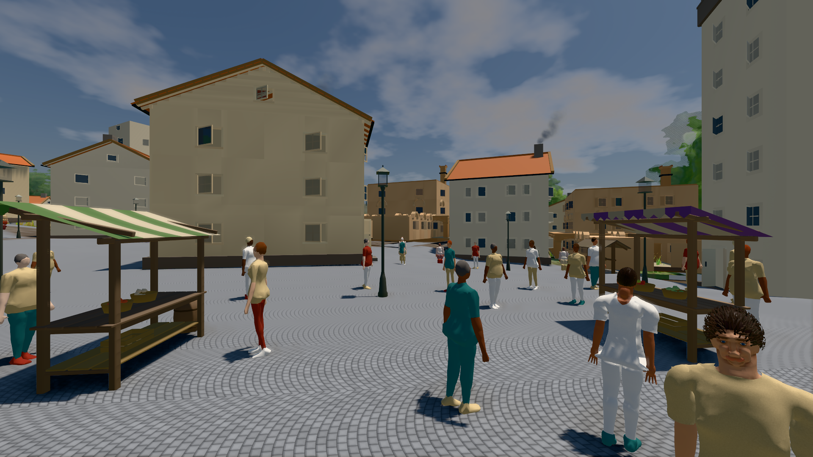
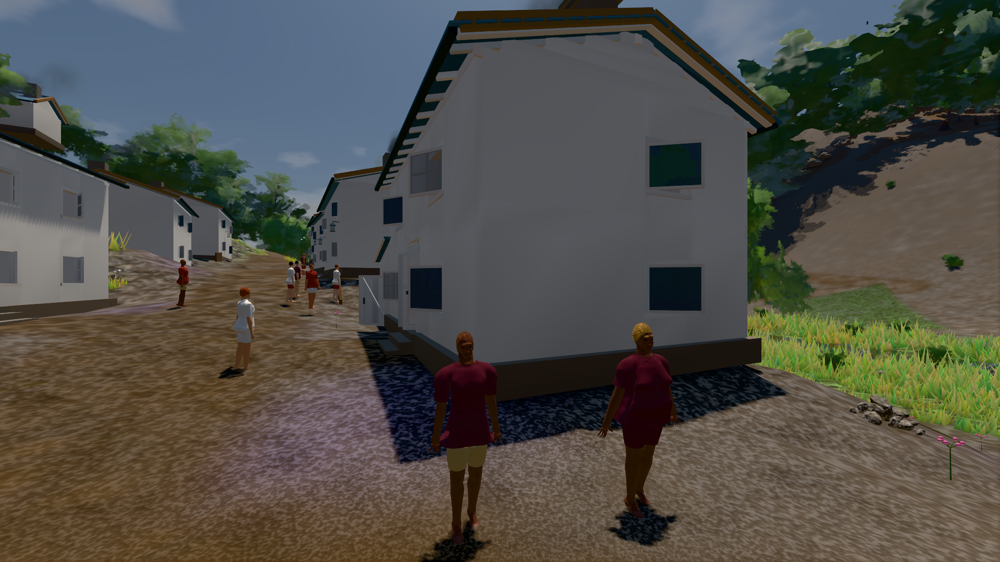

# GPU-PROBE 3266c01f — GRÜN · ROT wie an main (bekannt): gate:pop: lod.K2#1 (main gtx: ungemessen) auf gtx1050-desktop

Zweig `w28-stadt-netz` · Kopf 3266c01fe248dc437baf604f85bfe3eadf019c3f · Läufer gtx1050-desktop · 15.11. 20:09 · Wanduhr ab Push 1411 s · Lauf https://github.com/MiguellD/AnazhRealm/actions/runs/43748544004

Ruf: `bild:stadt-voll@0.5 bild:dorf@0.5 gate:pop`

## Läufer gtx1050-desktop — GRÜN

GPU NVIDIA GeForce GTX 1050 · node_modules bleiben (package-lock 604b0b39)
Schloss /c/Users/User/AppData/Local/Temp/claude/gpu-schloss hält „ci-runner 43748544004/1 probe“
- Hook 2026-11-15 19:56:00 start ci-runner 43748544004/1 probe: Schloss genommen (refs/heads/w28-stadt-netz 3266c01fe248dc437baf604f85bfe3eadf019c3f ws=C:\actions-runner\_work\AnazhRealm\AnazhRealm)

### bild:stadt-voll@0.5 — GRÜN · 283 s · Läufer gtx1050-desktop

Adapter: [linse-gpu] nvidia/pascal

```text
Kamera des Spiels → Blick (29.4 m): 842.49 57.57 451.79 871.75 57.57 454.60
 "abnahme": "ABNAHME GRÜN · beweis · Sicht 0.0 % · Leib im Vordergrund 7.3 % (Leib bewohner 7.3 %) · Ziel Blickziel im Bild frei 29.39 m · Luma 104.4 σ 35.4 schwarz 0.1 % weiß 0.0 % · Stand 18.546.294 · Bühne summer sunny 0.50 Tiere gehalten · Gerät WebGPU nvidia pascal · Inhalt bauSatz 34.2 % (≥ 2.0 %) Luma 92, bewohner 9.8 % (≥ 1.0 %) Luma 97",
```



### bild:dorf@0.5 — GRÜN · 144 s · Läufer gtx1050-desktop

Adapter: [linse-gpu] nvidia/pascal

```text
Kamera des Spiels → Blick (5.2 m): -704.22 39.69 -880.02 -703.03 39.69 -874.96
 "abnahme": "ABNAHME GRÜN · beweis · Sicht 0.0 % · Ziel Blickziel im Bild frei 5.2 m · Luma 77.8 σ 31 schwarz 0.3 % weiß 0.0 % · Stand 18.546.294 · Bühne summer sunny 0.50 Tiere gehalten · Gerät WebGPU nvidia pascal · Inhalt bauSatz 28.7 % (≥ 2.0 %) Luma 80",
```



### gate:pop — BEKANNT · 165 s · Läufer gtx1050-desktop

Adapter: ungenannt (die Probe nannte keinen Browser-Adapter) · ROT wie an main (bekannt): lod.K2#1 (main gtx: ungemessen)

```text
lod.K2#1 ROT 1.8026 % Pop-Pixel/s (37379 px) · 57+94@103/576*+93@120/5223*+66@131/5888*+73@136/6443*+66@145/16149*+92@146/2926*+46@155/117*+48@154 · Laub 216 · dc, Dreiecke 98,357224 · GPU 41.81 ms, CPU 6.61 ms je Bild
BLOCK-TREUE GRÜN 231 Blöcke treu · Selbsttest nennt MeshStandardNodeMaterial · nahWiese:L2:0:0 · instanzFarbe: 1/880 Instanzen fremd
 "fehler": "lod.K2#1 ROT 1.8026 % Pop-Pixel/s > 0,05"
```
