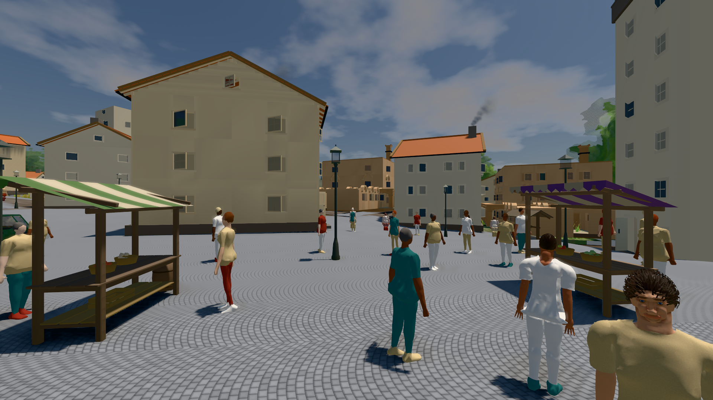
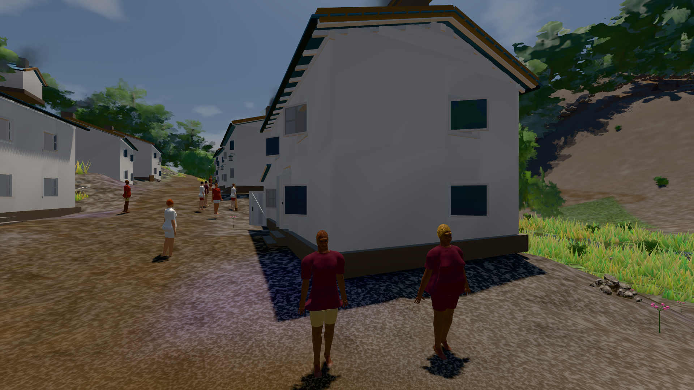

# GPU-PROBE 3de2b281 — ROT

Zweig `w28-stadt-netz` · Kopf 3de2b281ee51c245ffd9bf549ca066a794eee045 · Läufer radeon-890m · 15.11. 18:55 · Wanduhr ab Push 546 s · Lauf https://github.com/MiguellD/AnazhRealm/actions/runs/43742964497

Ruf: `bild:stadt-voll@0.5 bild:dorf@0.5 gate:pop`

## Läufer radeon-890m — ROT

GPU AMD Radeon(TM) 890M Graphics · node_modules bleiben (package-lock 604b0b39)
Schloss /c/Users/micha/AppData/Local/Temp/claude/gpu-schloss hält „ci-runner 43742964497/1 probe“
- Hook 2026-11-15 18:49:25 start ci-runner 43742964497/1 probe: Schloss genommen (refs/heads/w28-stadt-netz 3de2b281ee51c245ffd9bf549ca066a794eee045 ws=C:\actions-runner\_work\AnazhRealm\AnazhRealm)

### bild:stadt-voll@0.5 — GRÜN · 118 s · Läufer radeon-890m

Adapter: [linse-gpu] amd/rdna-3

```text
Kamera des Spiels → Blick (29.4 m): 842.49 57.57 451.79 871.75 57.57 454.60
 "abnahme": "ABNAHME GRÜN · beweis · Sicht 0.0 % · Leib im Vordergrund 7.3 % (Leib bewohner 7.3 %) · Ziel Blickziel im Bild frei 29.39 m · Luma 104.2 σ 35.5 schwarz 0.1 % weiß 0.0 % · Stand 18.546.294 · Bühne summer sunny 0.50 Tiere gehalten · Gerät WebGPU amd rdna-3 · Inhalt bauSatz 34.2 % (≥ 2.0 %) Luma 92, bewohner 9.7 % (≥ 1.0 %) Luma 97",
```



### bild:dorf@0.5 — GRÜN · 59 s · Läufer radeon-890m

Adapter: [linse-gpu] amd/rdna-3

```text
Kamera des Spiels → Blick (5.2 m): -704.22 39.69 -880.02 -703.03 39.69 -874.96
 "abnahme": "ABNAHME GRÜN · beweis · Sicht 0.0 % · Ziel Blickziel im Bild frei 5.2 m · Luma 77.9 σ 31 schwarz 0.3 % weiß 0.0 % · Stand 18.546.294 · Bühne summer sunny 0.50 Tiere gehalten · Gerät WebGPU amd rdna-3 · Inhalt bauSatz 28.7 % (≥ 2.0 %) Luma 80",
```



### gate:pop — ROT · 88 s · Läufer radeon-890m

Adapter: ungenannt (die Probe nannte keinen Browser-Adapter) · lod.K2#1 ROT 1.6929 % Pop-Pixel/s (35104 px) · 56+86@103/547*+87@117/40*/12927*+77@138/13376*+97@136/5659*+85@144/1998*+85@159/501*+11@154 · Laub 216 · dc, Dreiecke 98,355851 · GPU 23.59 ms, CPU 4.24 ms je Bild — lod.K2#1 ist an main GRÜN (radeon)

```text
lod.K2#1 ROT 1.6929 % Pop-Pixel/s (35104 px) · 56+86@103/547*+87@117/40*/12927*+77@138/13376*+97@136/5659*+85@144/1998*+85@159/501*+11@154 · Laub 216 · dc, Dreiecke 98,355851 · GPU 23.59 ms, CPU 4.24 ms je Bild
BLOCK-TREUE GRÜN 231 Blöcke treu · Selbsttest nennt MeshStandardNodeMaterial · nahWiese:L1:0:0 · instanzFarbe: 1/880 Instanzen fremd
 "fehler": "lod.K2#1 ROT 1.6929 % Pop-Pixel/s > 0,05"
```
