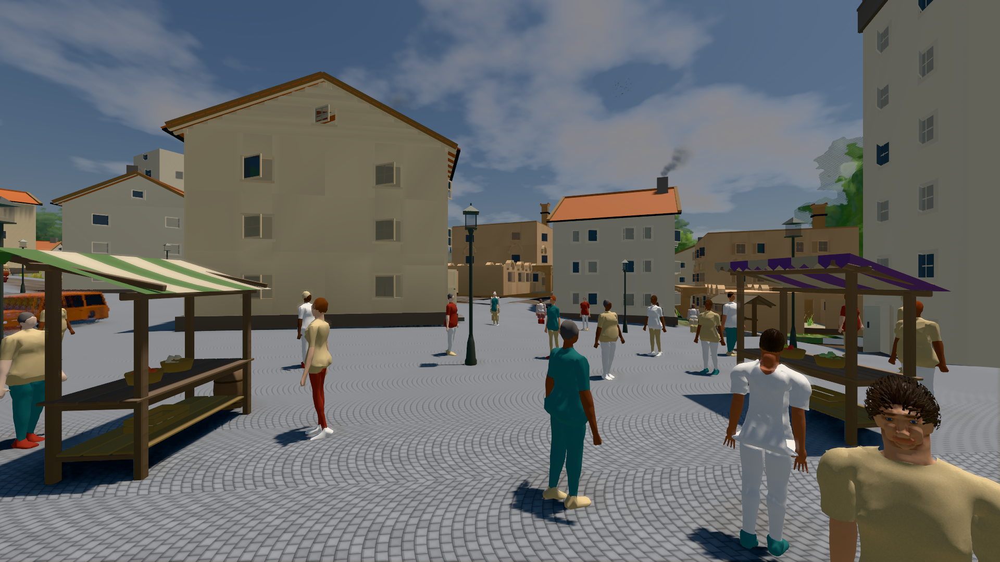
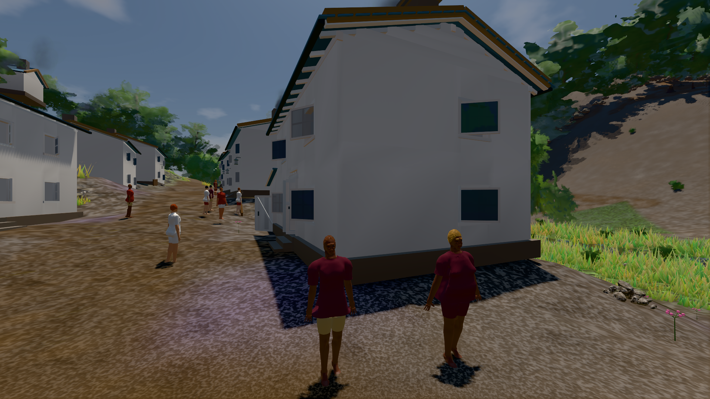

# GPU-PROBE 76c41a69 — GRÜN · ROT wie an main (bekannt): gate:pop: lod.K2#1 (main gtx: ungemessen) auf gtx1050-desktop

Zweig `w28-stadt-netz` · Kopf 76c41a69577e513f908af9ccd3ee80427076be9b · Läufer gtx1050-desktop · 15.11. 20:50 · Wanduhr ab Push 897 s · Lauf https://github.com/MiguellD/AnazhRealm/actions/runs/43753271774

Ruf: `bild:stadt-voll@0.5 bild:dorf@0.5 gate:pop`

## Läufer gtx1050-desktop — GRÜN

GPU NVIDIA GeForce GTX 1050 · node_modules bleiben (package-lock 604b0b39)
Schloss /c/Users/User/AppData/Local/Temp/claude/gpu-schloss hält „ci-runner 43753271774/1 probe“
- Hook 2026-11-15 20:35:42 start ci-runner 43753271774/1 probe: Schloss genommen (refs/heads/w28-stadt-netz 76c41a69577e513f908af9ccd3ee80427076be9b ws=C:\actions-runner\_work\AnazhRealm\AnazhRealm)

### bild:stadt-voll@0.5 — GRÜN · 360 s · Läufer gtx1050-desktop

Adapter: [linse-gpu] nvidia/pascal

```text
Kamera des Spiels → Blick (29.4 m): 842.49 57.57 451.79 871.75 57.57 454.60
 "abnahme": "ABNAHME GRÜN · beweis · Sicht 0.0 % · Leib im Vordergrund 7.3 % (Leib bewohner 7.3 %) · Ziel Blickziel im Bild frei 29.39 m · Luma 104.1 σ 35.5 schwarz 0.1 % weiß 0.0 % · Stand 18.546.294 · Bühne summer sunny 0.50 Tiere gehalten · Gerät WebGPU nvidia pascal · Inhalt bauSatz 34.1 % (≥ 2.0 %) Luma 92, bewohner 9.8 % (≥ 1.0 %) Luma 97",
```



### bild:dorf@0.5 — GRÜN · 221 s · Läufer gtx1050-desktop

Adapter: [linse-gpu] nvidia/pascal

```text
Kamera des Spiels → Blick (5.2 m): -704.22 39.69 -880.02 -703.03 39.69 -874.96
 "abnahme": "ABNAHME GRÜN · beweis · Sicht 0.0 % · Ziel Blickziel im Bild frei 5.2 m · Luma 77.7 σ 31 schwarz 0.3 % weiß 0.0 % · Stand 18.546.294 · Bühne summer sunny 0.50 Tiere gehalten · Gerät WebGPU nvidia pascal · Inhalt bauSatz 28.7 % (≥ 2.0 %) Luma 80",
```



### gate:pop — BEKANNT · 255 s · Läufer gtx1050-desktop

Adapter: ungenannt (die Probe nannte keinen Browser-Adapter) · ROT wie an main (bekannt): lod.K2#1 (main gtx: ungemessen)

```text
lod.K2#1 ROT 1.5752 % Pop-Pixel/s (32663 px) · 171+98@110/437*+96@120/8622*+69@135/4648*+83@143/16880*+93@155/946*+78@159/386+75@168/573*+54@154 · Laub 216 · dc, Dreiecke 98,364302 · GPU 41.22 ms, CPU 9.52 ms je Bild
BLOCK-TREUE GRÜN 231 Blöcke treu · Selbsttest nennt MeshStandardNodeMaterial · nahWiese:L1:0:0 · instanzFarbe: 1/880 Instanzen fremd
 "fehler": "lod.K2#1 ROT 1.5752 % Pop-Pixel/s > 0,05"
```
