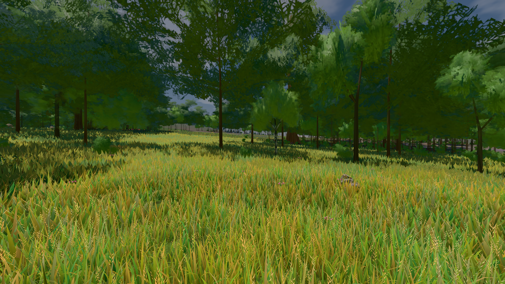

# GPU-PROBE 21783ddb — ROT

Zweig `w28-stamm-krone` · Kopf 21783ddbadeca1cbe9a115004b5a64c2f6a06508 · Läufer omen-gtx1060 · 14.11. 11:59 · Wanduhr ab Push 393 s · Lauf https://github.com/MiguellD/AnazhRealm/actions/runs/43587361801

Ruf: `bild:wiese@0.5 gate:pop gate:nah-fern`

## Läufer omen-gtx1060 — ROT

GPU NVIDIA GeForce GTX 1060 · npm ci 45 s (package-lock 57539f97)
Schloss /c/Users/micha/AppData/Local/Temp/claude/gpu-schloss hält „ci-runner 43587361801/1 probe“
- Hook 2026-11-14 11:53:18 start ci-runner 43587361801/1 probe: wartet auf Schloss von 'omen-sg-asset-contract'
- Hook 2026-11-14 11:56:35 start ci-runner 43587361801/1 probe: Schloss genommen (refs/heads/w28-stamm-krone 21783ddbadeca1cbe9a115004b5a64c2f6a06508 ws=C:\actions-runner\_work\AnazhRealm\AnazhRealm)

### bild:wiese@0.5 — GRÜN · 44 s · Läufer omen-gtx1060

Adapter: [linse-gpu] nvidia/pascal

```text
Kamera des Spiels → Blick (10.0 m): -280.40 29.71 -1045.60 -289.61 29.71 -1049.50
 "abnahme": "ABNAHME GRÜN · beweis · Sicht 0.0 % · Ziel Blickziel im Bild frei 10 m · Luma 82.6 σ 38.8 schwarz 0.0 % weiß 0.0 % · Stand 18.546.283 · Bühne summer sunny 0.50 Tiere gehalten · Gerät WebGPU nvidia pascal · Inhalt nahWiese 48.3 % (≥ 15.0 %) h 107° Luma 118",
```



### gate:pop — ROT · 13 s · Läufer omen-gtx1060

Adapter: ungenannt (die Probe nannte keinen Browser-Adapter) · Exit 2 ohne ROTE Zeile: at ChildProcess._handle.onexit (node:internal/child_process:293:12)

```text
werkbank.cjs ABSTURZ: Error: die Werkbank endete vor dem Start (Exit 1)
```

### gate:nah-fern — GRÜN · 45 s · Läufer omen-gtx1060

Adapter: ungenannt (die Probe nannte keinen Browser-Adapter)

```text
✅ SELBSTTEST GRÜN — das Nah-Fern-Urteil nennt die zwei Farben derselben Stelle beim Namen
✅ NAH-FERN GRÜN — EINE Boden-Farbe je Ort
```
