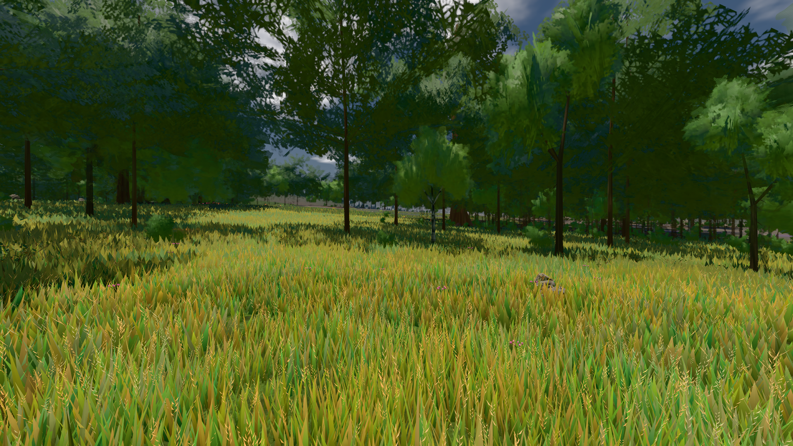
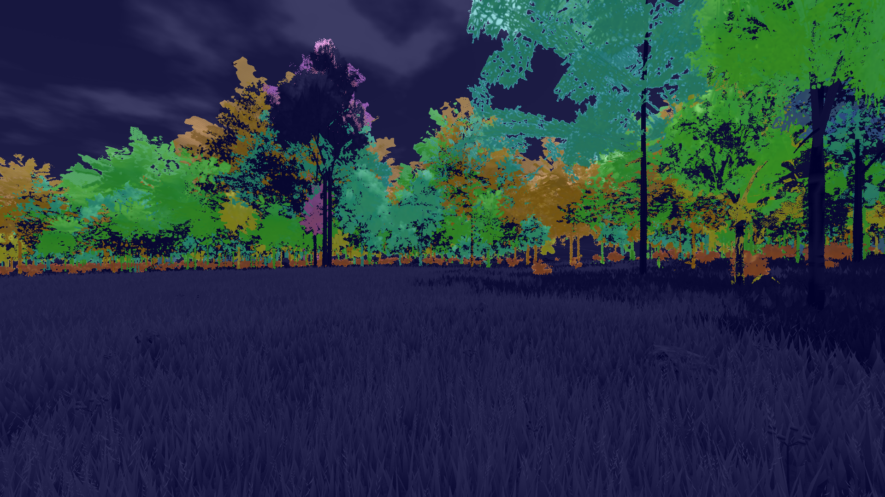
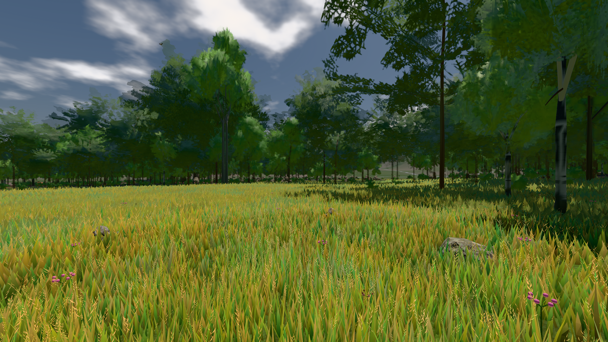
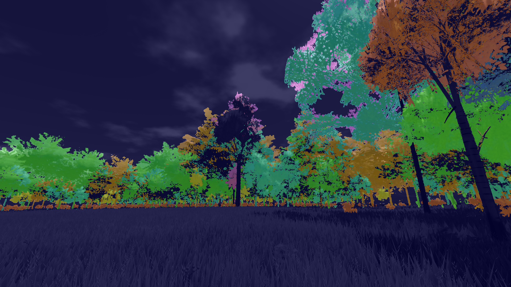
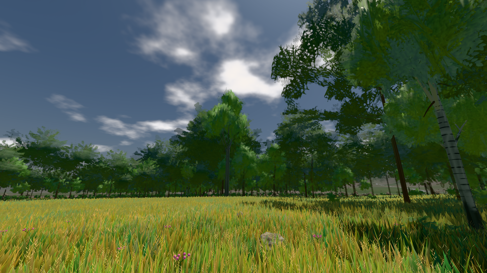

# GPU-PROBE 31f4607c — ROT

Zweig `w28-stamm-krone` · Kopf 31f4607c8ccb0dbb7eaa16f1e160ebb3e9caa7ba · Läufer omen-gtx1060 · 12.11. 20:12 · Wanduhr ab Push 1105 s · Lauf https://github.com/MiguellD/AnazhRealm/actions/runs/43284638584

Ruf: `bild:wiese@0.5 gate:laub-kante gate:koerper-stand`

## Läufer omen-gtx1060 — ROT

GPU NVIDIA GeForce GTX 1060 · node_modules bleiben (package-lock 7bd472a8)
Schloss /c/Users/micha/AppData/Local/Temp/claude/gpu-schloss hält „ci-runner 43284638584/1 probe“
- Hook 2026-11-12 19:57:20 start ci-runner 43284638584/1 probe: Schloss genommen (refs/heads/w28-stamm-krone 31f4607c8ccb0dbb7eaa16f1e160ebb3e9caa7ba ws=C:\actions-runner\_work\AnazhRealm\AnazhRealm)

### bild:wiese@0.5 — GRÜN · 52 s · Läufer omen-gtx1060

Adapter: [linse-gpu] nvidia/pascal

```text
Kamera des Spiels → Blick (10.0 m): -280.40 29.71 -1045.60 -289.61 29.71 -1049.50
 "abnahme": "ABNAHME GRÜN · beweis · Sicht 0.0 % · Ziel Blickziel im Bild frei 10 m · Luma 81.7 σ 42.6 schwarz 0.0 % weiß 0.0 % · Stand 18.546.267 · Bühne summer sunny 0.50 Tiere gehalten · Gerät WebGPU nvidia pascal · Inhalt nahWiese 48.3 % (≥ 15.0 %) h 107° Luma 119",
```



### gate:laub-kante — BEKANNT · 148 s · Läufer omen-gtx1060

Adapter: ungenannt (die Probe nannte keinen Browser-Adapter) · ROT wie an main (bekannt): lod.K1#1 (main gtx: ungemessen)

```text
lod.K1#1 Tafel-Pose ROT [["f:birke:L0",0.1847,114274,0,0,0],["f:birke:L1",0.2206,75227,0,0,0],["f:fichte:L0",0.1437,15914,0,0.0001,1],["f:fichte:L1",0.1842,136702,0,0,0],["f:tanne:L1",0.2144,16417,0,0,0],["fimp:birke:L2",0.2157,13708,0,0,0],["fimp:buche:L2",0.2118,6451,0,0.0005,3],["fimp:eiche:L2",0.1793,60006,0,0,0],["fimp:fichte:L2",0.1896,96976,0,0.0001,3],["fimp:strauch:L2",0.2733,19470,0,0,0],["fimp:tanne:L2",0.1882,139379,0,0.0003,11]]
lod.K1#1 Spielgang ROT [["f:birke:L1",0.183,120815,0,0,0],["f:fichte:L1",0.1785,151969,0,0,1],["f:tanne:L1",0.1792,7301,0,0,0],["fimp:birke:L2",0.2291,27489,0,0,0],["fimp:buche:L2",0.2125,7682,0,0.001,5],["fimp:eiche:L2",0.1677,59815,0,0.0001,2],["fimp:fichte:L2",0.1864,99183,0,0.0001,3],["fimp:strauch:L2",0.2742,22571,0,0,0],["fimp:tanne:L2",0.1904,128513,0,0.0002,3]]
 "abnahme": "ABNAHME GRÜN · beweis · Sicht 0.0 % · Ziel Blickziel im Bild frei 12 m · Luma 91.3 σ 45.3 schwarz 0.0 % weiß 0.0 % · Stand 18.546.267 · Bühne summer sunny 0.50 Tiere gehalten · Gerät WebGPU nvidia pascal",
 "fehler": "lod.K1#1 ROT: Tafel-Pose f:birke:L1 0.2206, fimp:strauch:L2 0.2733 · Spielgang fimp:birke:L2 0.2291, fimp:strauch:L2 0.2742 (Soll ≤ 0,22, zweiton 0)"
```









### gate:koerper-stand — ROT · 554 s · Läufer omen-gtx1060

Adapter: ungenannt (die Probe nannte keinen Browser-Adapter) · DECKEL 480 s

```text
  ✅ Selbsttest „tod" macht K5 Tod-Lage rot — K5 Tod-Lage: die tiefste Stelle liegt -35 cm über ihrem Stand-Kontakt, auf dem Weg -35 … 3.2 cm (Soll ± 3, Weg ≥ −5)
  ✅ Selbsttest „fuge" macht K4 Fuge rot — K4 Fuge: 1850 von 1850 Fugen tragen einen Leib — Täter baum_kiefer#11 Box 0 unter Box 1 (Oberkante 88.86, trägt Kapsel+Tier); baum_kiefer#11 Box 1 unter Box 2 (Oberkante 89.23, trägt Kapsel+Tier); baum_kiefer#11 Box 2 unter Box 3 (Oberkante 89.60, trägt Kapsel+Tier) (die Auflage _resolveCapsuleVsAABB/_kreaturAuflage liest box.gedeckt nicht)
  ✅ Selbsttest „rand" macht K6 Leser im Rand-Streifen rot — K6 Leser im Rand-Streifen: 728 von 792 Punkten verfehlen den gezeichneten Boden um mehr als 25 cm (max 50 cm bei -43.15,-40, Karten dort L0,L1,L1,L1, Mitte 0,0) — Täter _standSicht/_bodenSichtAt: dort trägt der Träger
  ✅ Selbsttest „wiese" macht K7 Wiese im Rand-Streifen + K7 Streu im Rand-Streifen rot — K7 Wiese im Rand-Streifen: Dichte gegen daneben 0.226 ± 0.051 (Soll 1 ± 15 %; 326/5341 in 29 Chunks) — Täter: der Leser der Kachel (_nahWieseKachelBueschel/_nahStreuKachel) liest nicht _bodenSichtAt | K7 Streu im Rand-Streifen: Dichte gegen daneben 0.009 ± 0.004 (Soll 1 ± 10 %; 4/977 in 30 Chunks) — Täter: der Leser der Kachel (_nahWieseKachelBueschel/_nahStreuKachel) liest nicht _bodenSichtAt
  ✅ Selbsttest „rolle" macht K8 streu wiese + K8 streu hang + K8 huf hang + K8 rad hang rot — K8 streu wiese: p95 12.7 cm (Median 0.2, Soll ≤ 3) — Täter: der Fuß der Streu (_streuFuss: der gezeichnete Boden, dem Auge nach) | K8 streu hang: p95 16.1 cm (Median -0.1, Soll ≤ 3) — Täter: der Fuß der Streu (_streuFuss: der gezeichnete Boden, dem Auge nach) | K8 huf hang: p95 85.1 cm (Median gigant 63.4, Soll ≤ 3) — Täter: der Huf (_kreaturFussBoden, seine Sohle _gaitSohlenKipp) | K8 rad hang: p95 6.5 cm (Median -4.2, Soll ≤ 3) — Täter: das Rad (_archRadMatrix: der Reifen
  ✅ Selbsttest „sohle" macht K8 huf hang rot — K8 huf hang: p95 8.9 cm (Median gigant -3.9, Soll ≤ 3) — Täter: der Huf (_kreaturFussBoden, seine Sohle _gaitSohlenKipp)
  ✅ Selbsttest „ring" macht K8 Ring wiese + K8 Ring hang rot — K8 Ring wiese: 2 von 4 — Täter: _ringWaechst (der Ring wächst bis zum Ziel) | K8 Ring hang: 2 von 4 — Täter: _ringWaechst (der Ring wächst bis zum Ziel)
  ✅ Selbsttest „nexus" macht K8 Aufbau: der Nexus rot — K8 Aufbau: der Nexus entwickelte sich 18-mal in der Mess-Welt — Täter: evolveNexus ohne Gate-Treue
  ✅ Selbsttest „fuss" macht K8 fuss hang + K8 Aufbau hang stufe + K8 Aufbau wiese stufe rot — K8 fuss hang: p95 11.6 cm (Median 11.4, Soll ≤ 3) — Täter: der Fuß des Spielers (die Sohle des Leibs gegen _gaitBodenY) | K8 Aufbau hang stufe: undefined Kontakte (Soll ≥ 200) | K8 Aufbau wiese stufe: undefined Kontakte (Soll ≥ 200)
  ✅ Selbsttest „sprung" macht K9 Mutante masse first + K9 Mutante kraft third rot — K9 Mutante masse first: 0.322819200000076/2.846250000001646 gegen 0.3228192000000689/2.8462500000018736 m | K9 Mutante kraft third: 0.32281920000009734/2.846250000001646 gegen 0.3228192000000867/2.846250000001646 m
```
