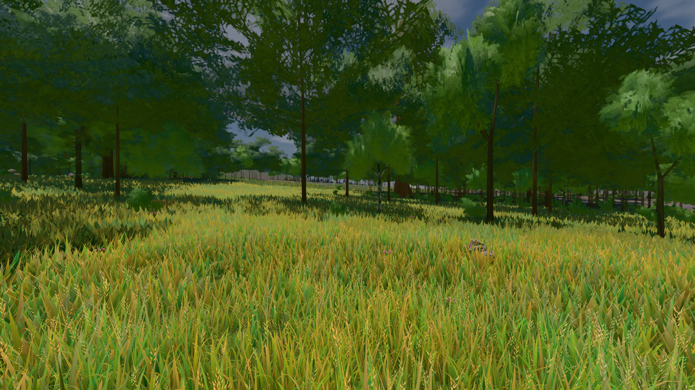

# GPU-PROBE 93864c40 — GRÜN

Zweig `w28-stamm-krone` · Kopf 93864c40dedd84ea45aa4b858e757b3b68b2032a · Läufer gtx1050-desktop · 14.11. 12:45 · Wanduhr ab Push 610 s · Lauf https://github.com/MiguellD/AnazhRealm/actions/runs/43590774165

Ruf: `bild:wiese@0.5 gate:pop gate:nah-fern`

## Läufer gtx1050-desktop — GRÜN

GPU NVIDIA GeForce GTX 1050 · node_modules bleiben (package-lock 57539f97)
Schloss /c/Users/User/AppData/Local/Temp/claude/gpu-schloss hält „ci-runner 43590774165/1 probe“
- Hook 2026-11-14 12:36:26 start ci-runner 43590774165/1 probe: wartet auf Schloss von 'hand werkbank jagd-11 (Claude)'
- Hook 2026-11-14 12:38:11 start ci-runner 43590774165/1 probe: Schloss genommen (refs/heads/w28-stamm-krone 93864c40dedd84ea45aa4b858e757b3b68b2032a ws=C:\actions-runner\_work\AnazhRealm\AnazhRealm)

### bild:wiese@0.5 — GRÜN · 90 s · Läufer gtx1050-desktop

Adapter: [linse-gpu] nvidia/pascal

```text
Kamera des Spiels → Blick (10.0 m): -280.40 29.71 -1045.60 -289.61 29.71 -1049.50
 "abnahme": "ABNAHME GRÜN · beweis · Sicht 0.0 % · Ziel Blickziel im Bild frei 10 m · Luma 82.5 σ 38.8 schwarz 0.0 % weiß 0.0 % · Stand 18.546.283 · Bühne summer sunny 0.50 Tiere gehalten · Gerät WebGPU nvidia pascal · Inhalt nahWiese 48.3 % (≥ 15.0 %) h 107° Luma 118",
```



### gate:pop — GRÜN · 138 s · Läufer gtx1050-desktop

Adapter: ungenannt (die Probe nannte keinen Browser-Adapter)

```text
lod.K2#1 GRÜN 0.0398 % Pop-Pixel/s (826 px) · 24*+1@189/43*/45*+1@207/403+1@154/66*/50*+2@192/74+1@155/121*+1@189 · Laub 216 · dc, Dreiecke 100,435490 · GPU 43.89 ms, CPU 6.21 ms je Bild
BLOCK-TREUE GRÜN 233 Blöcke treu · Selbsttest nennt MeshStandardNodeMaterial · nahWiese:L1:0:0 · instanzFarbe: 1/880 Instanzen fremd
```

### gate:nah-fern — GRÜN · 85 s · Läufer gtx1050-desktop

Adapter: ungenannt (die Probe nannte keinen Browser-Adapter)

```text
✅ SELBSTTEST GRÜN — das Nah-Fern-Urteil nennt die zwei Farben derselben Stelle beim Namen
✅ NAH-FERN GRÜN — EINE Boden-Farbe je Ort
```
