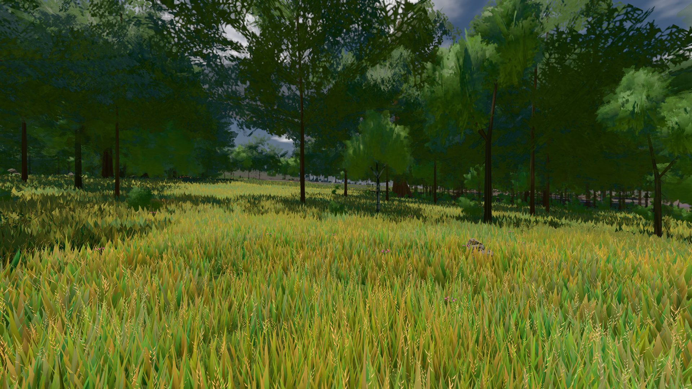
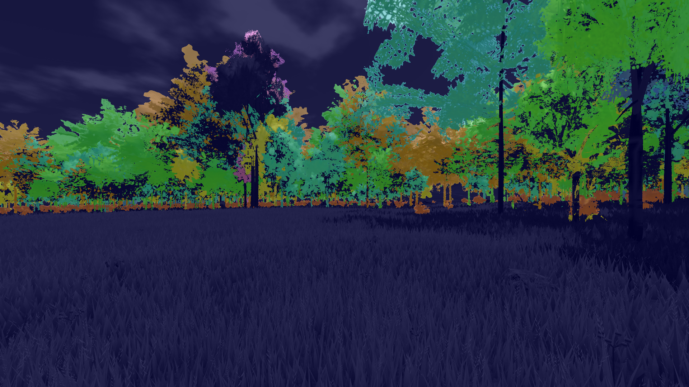
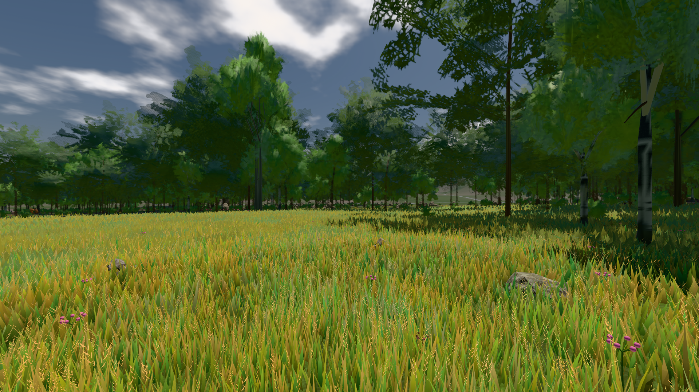
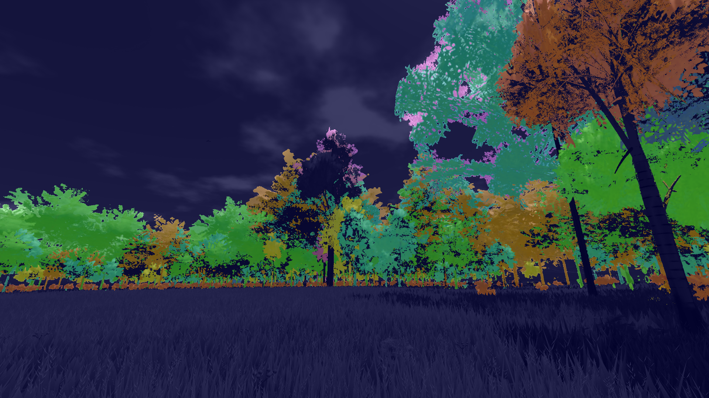
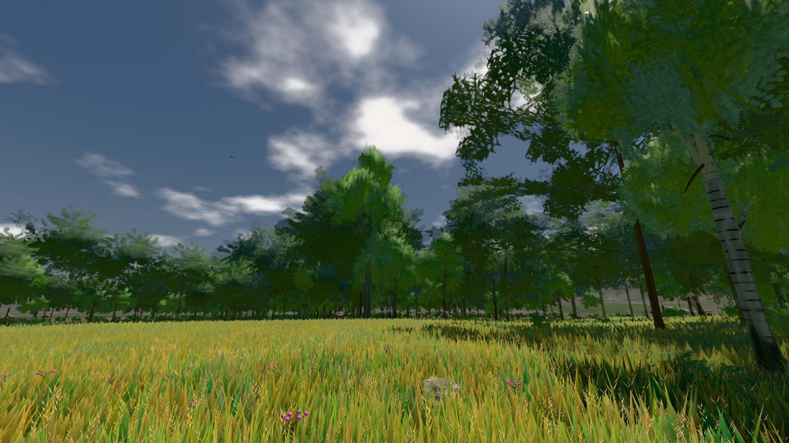

# GPU-PROBE ee3fa5f5 — GRÜN · ROT wie an main (bekannt): gate:laub-kante: lod.K1#1 (main radeon: ungemessen) auf gtx1050-desktop

Zweig `w28-stamm-krone` · Kopf ee3fa5f54f84e1478a2194cad0baddf215a8049c · Läufer gtx1050-desktop · 12.11. 19:28 · Wanduhr ab Push 1844 s · Lauf https://github.com/MiguellD/AnazhRealm/actions/runs/43274783806

Ruf: `bild:wiese@0.5 gate:laub-kante gate:koerper-stand`

## Läufer gtx1050-desktop — GRÜN

GPU NVIDIA GeForce GTX 1050 · npm ci 111 s (package-lock 7bd472a8)
Schloss /c/Users/User/AppData/Local/Temp/claude/gpu-schloss hält „ci-runner 43274783806/1 probe“
- Hook 2026-11-12 18:57:52 start ci-runner 43274783806/1 probe: Schloss genommen (refs/heads/w28-stamm-krone ee3fa5f54f84e1478a2194cad0baddf215a8049c ws=C:\actions-runner\_work\AnazhRealm\AnazhRealm)

### bild:wiese@0.5 — GRÜN · 248 s · Läufer gtx1050-desktop

Adapter: [linse-gpu] nvidia/pascal

```text
Kamera des Spiels → Blick (10.0 m): -280.40 29.71 -1045.60 -289.61 29.71 -1049.50
 "abnahme": "ABNAHME GRÜN · beweis · Sicht 0.0 % · Ziel Blickziel im Bild frei 10 m · Luma 81.6 σ 42.5 schwarz 0.0 % weiß 0.0 % · Stand 18.546.267 · Bühne summer sunny 0.50 Tiere gehalten · Gerät WebGPU nvidia pascal · Inhalt nahWiese 48.2 % (≥ 15.0 %) h 107° Luma 119",
```



### gate:laub-kante — BEKANNT · 422 s · Läufer gtx1050-desktop

Adapter: ungenannt (die Probe nannte keinen Browser-Adapter) · ROT wie an main (bekannt): lod.K1#1 (main radeon: ungemessen)

```text
lod.K1#1 Tafel-Pose ROT [["f:birke:L0",0.1834,113761,0,0,0],["f:birke:L1",0.219,73989,0,0,0],["f:fichte:L0",0.1432,15910,0,0.0001,1],["f:fichte:L1",0.1933,135368,0,0,0],["f:tanne:L1",0.2143,16347,0,0,0],["fimp:birke:L2",0.2185,21364,0,0,0],["fimp:buche:L2",0.1869,5094,0,0.0004,2],["fimp:eiche:L2",0.1791,56997,0,0.0001,3],["fimp:fichte:L2",0.1899,96474,0.0004,0.0001,3],["fimp:strauch:L2",0.2573,19144,0,0,0],["fimp:tanne:L2",0.1882,138510,0.0002,0.0003,11]]
lod.K1#1 Spielgang ROT [["f:birke:L1",0.1832,120439,0,0,0],["f:fichte:L1",0.1819,149223,0,0,1],["f:tanne:L1",0.1821,7180,0,0,0],["fimp:birke:L2",0.2351,36213,0,0,0],["fimp:buche:L2",0.1898,6001,0,0.0013,5],["fimp:eiche:L2",0.1662,57755,0,0,0],["fimp:fichte:L2",0.1865,98679,0,0.0004,4],["fimp:strauch:L2",0.2658,22035,0,0,0],["fimp:tanne:L2",0.1911,127410,0,0.0002,3]]
 "abnahme": "ABNAHME GRÜN · beweis · Sicht 0.0 % · Ziel Blickziel im Bild frei 12 m · Luma 91.4 σ 45.3 schwarz 0.0 % weiß 0.0 % · Stand 18.546.267 · Bühne summer sunny 0.50 Tiere gehalten · Gerät WebGPU nvidia pascal",
 "fehler": "lod.K1#1 ROT: Tafel-Pose fimp:fichte:L2 0.1899, fimp:strauch:L2 0.2573, fimp:tanne:L2 0.1882 · Spielgang fimp:birke:L2 0.2351, fimp:strauch:L2 0.2658 (Soll ≤ 0,22, zweiton 0)"
```









### gate:koerper-stand — GRÜN · 950 s · Läufer gtx1050-desktop

Adapter: ungenannt (die Probe nannte keinen Browser-Adapter)

```text
[stall-akte] Stderr [4084:13256:1112/191455.868:ERROR:services\on_device_model\public\cpp\service_client.cc:37] Unexpected on_device_model service disconnect; reason: 1, description: Error loading backend.
  ✅ Selbsttest „sohle" macht K8 huf hang rot — K8 huf hang: p95 8.9 cm (Median gigant -3.9, Soll ≤ 3) — Täter: der Huf (_kreaturFussBoden, seine Sohle _gaitSohlenKipp)
  ✅ Selbsttest „ring" macht K8 Ring wiese + K8 Ring hang rot — K8 Ring wiese: 2 von 4 — Täter: _ringWaechst (der Ring wächst bis zum Ziel) | K8 Ring hang: 2 von 4 — Täter: _ringWaechst (der Ring wächst bis zum Ziel)
[stall-akte] Stderr [4084:13256:1112/191455.868:ERROR:services\on_device_model\public\cpp\service_client.cc:37] Unexpected on_device_model service disconnect; reason: 1, description: Error loading backend.
  ✅ Selbsttest „nexus" macht K8 Aufbau: der Nexus rot — K8 Aufbau: der Nexus entwickelte sich 18-mal in der Mess-Welt — Täter: evolveNexus ohne Gate-Treue
  ✅ Selbsttest „fuss" macht K8 fuss hang + K8 Aufbau hang stufe + K8 Aufbau wiese stufe rot — K8 fuss hang: p95 11.8 cm (Median 11.5, Soll ≤ 3) — Täter: der Fuß des Spielers (die Sohle des Leibs gegen _gaitBodenY) | K8 Aufbau hang stufe: undefined Kontakte (Soll ≥ 200) | K8 Aufbau wiese stufe: undefined Kontakte (Soll ≥ 200)
[stall-akte] Stderr [4084:13256:1112/191455.868:ERROR:services\on_device_model\public\cpp\service_client.cc:37] Unexpected on_device_model service disconnect; reason: 1, description: Error loading backend.
  ✅ Selbsttest „sprung" macht K9 Mutante masse first + K9 Mutante kraft third rot — K9 Mutante masse first: 0.3228853333333781/2.846250000001646 gegen 0.32288533333337455/2.846250000001646 m | K9 Mutante kraft third: 0.3228853333333781/2.846250000002783 gegen 0.3228853333333923/2.8462500000018736 m
[stall-akte] Stderr [4084:13256:1112/191455.868:ERROR:services\on_device_model\public\cpp\service_client.cc:37] Unexpected on_device_model service disconnect; reason: 1, description: Error loading backend.
✅ gate:koerper-stand grün
```
