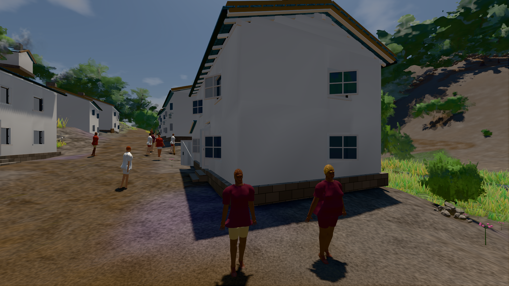

# GPU-PROBE 4daaa141 — GRÜN

Zweig `w28-stein-ein-gesetz` · Kopf 4daaa14196bac2db94e83258fbd93aea1c5c1945 · Läufer omen-gtx1060 · 20.11. 02:20 · Wanduhr ab Push 1212 s · Lauf https://github.com/MiguellD/AnazhRealm/actions/runs/44650272402

Ruf: `gate:haus-fern bild:dorf@0.5`

## Läufer omen-gtx1060 — GRÜN

GPU NVIDIA GeForce GTX 1060 · npm ci 38 s (package-lock bd5d6c75)
Schloss /c/Users/micha/AppData/Local/Temp/claude/gpu-schloss hält „ci-runner 44650272402/1 probe“
- Hook 2026-11-20 02:02:03 start ci-runner 44650272402/1 probe: wartet auf Schloss von 'omen-punkte-gtx-sitzung'
- Hook 2026-11-20 02:12:18 start ci-runner 44650272402/1 probe: Schloss genommen (refs/heads/w28-stein-ein-gesetz 4daaa14196bac2db94e83258fbd93aea1c5c1945 ws=C:\actions-runner\_work\AnazhRealm\AnazhRealm)

### gate:haus-fern — GRÜN · 238 s · Läufer omen-gtx1060

Adapter: ungenannt (die Probe nannte keinen Browser-Adapter)

```text
✅ GRÜN — jede Stufe wirft den grundriss-treuen Fernkörper, zeigt sich erst ≤ 1 px von der L0, kein Querfirst, der Körper liegt innen, jedes Türblatt sitzt an seinem Scharnier, jedes Fenster ist Glas in jeder Stufe.
```

### bild:dorf@0.5 — GRÜN · 65 s · Läufer omen-gtx1060

Adapter: [linse-gpu] nvidia/pascal

```text
Kamera des Spiels → Blick (5.2 m): -704.22 39.69 -880.02 -703.01 39.69 -874.96
 "abnahme": "ABNAHME GRÜN · beweis · Sicht 0.0 % · Ziel Blickziel im Bild frei 5.2 m · Luma 75.8 σ 30.9 schwarz 0.2 % weiß 0.0 % · Stand 18.546.345 · Bühne summer sunny 0.50 Tiere gehalten · Gerät WebGPU nvidia pascal · Inhalt bauSatz 29.7 % (≥ 2.0 %) Luma 79",
```


