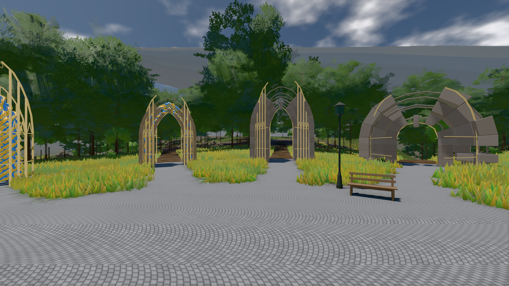

# GPU-PROBE 82aa09eb — ROT

Zweig `w28-stein-kamm` · Kopf 82aa09ebcab1e4ff15e7ad02022392d98531ac88 · Läufer gtx1050-desktop · 14.11. 01:52 · Wanduhr ab Push 178 s · Lauf https://github.com/MiguellD/AnazhRealm/actions/runs/43536688711

Ruf: `bild:genesis@0.5 bild:genesis@0.3`

## Läufer gtx1050-desktop — ROT

GPU NVIDIA GeForce GTX 1050 · node_modules bleiben (package-lock 95130897)
Schloss /c/Users/User/AppData/Local/Temp/claude/gpu-schloss hält „ci-runner 43536688711/1 probe“
- Hook 2026-11-14 01:49:30 start ci-runner 43536688711/1 probe: Schloss genommen (refs/heads/w28-stein-kamm 82aa09ebcab1e4ff15e7ad02022392d98531ac88 ws=C:\actions-runner\_work\AnazhRealm\AnazhRealm)

### bild:genesis@0.5 — ROT · 65 s · Läufer gtx1050-desktop

Adapter: [linse-gpu] nvidia/pascal · "fehler": "ABNAHME ROT [kein portal-membran im Bild: 0.0 % < 0.3 %] · beweis · Sicht 0.0 % · Ziel Blickziel im Bild frei 10 m · Luma 106.4 σ 41 schwarz 0.0 % weiß 0.0 % · Stand 18.546.276 · Bühne summer sunny 0.50 Tiere  — keine Station beim Namen

```text
Kamera des Spiels → Blick (10.0 m): 0.00 92.40 0.00 -10.00 92.40 0.00
 "fehler": "ABNAHME ROT [kein portal-membran im Bild: 0.0 % < 0.3 %] · beweis · Sicht 0.0 % · Ziel Blickziel im Bild frei 10 m · Luma 106.4 σ 41 schwarz 0.0 % weiß 0.0 % · Stand 18.546.276 · Bühne summer sunny 0.50 Tiere gehalten · Gerät WebGPU nvidia pascal · Inhalt bodenSatz 36.9 % (≥ 15.0 %) Luma 139, portal-membran 0.0 % (≥ 0.3 %) · ROT-Bild C:\\actions-runner\\_work\\_temp\\probe\\82aa09eb-genesis-0.5-rot.png",
```



### bild:genesis@0.3 — GRÜN · 74 s · Läufer gtx1050-desktop

Adapter: [linse-gpu] nvidia/pascal

```text
Kamera des Spiels → Blick (10.0 m): 0.00 92.40 0.00 -10.00 92.40 0.00
 "abnahme": "ABNAHME GRÜN · beweis · Sicht 0.0 % · Ziel Blickziel im Bild frei 10 m · Luma 121 σ 51.1 schwarz 0.0 % weiß 0.0 % · Stand 18.546.276 · Bühne summer sunny 0.30 Tiere gehalten · Gerät WebGPU nvidia pascal · Inhalt bodenSatz 36.3 % (≥ 15.0 %) Luma 90, portal-membran 2.8 % (≥ 0.3 %) Luma 218",
```


