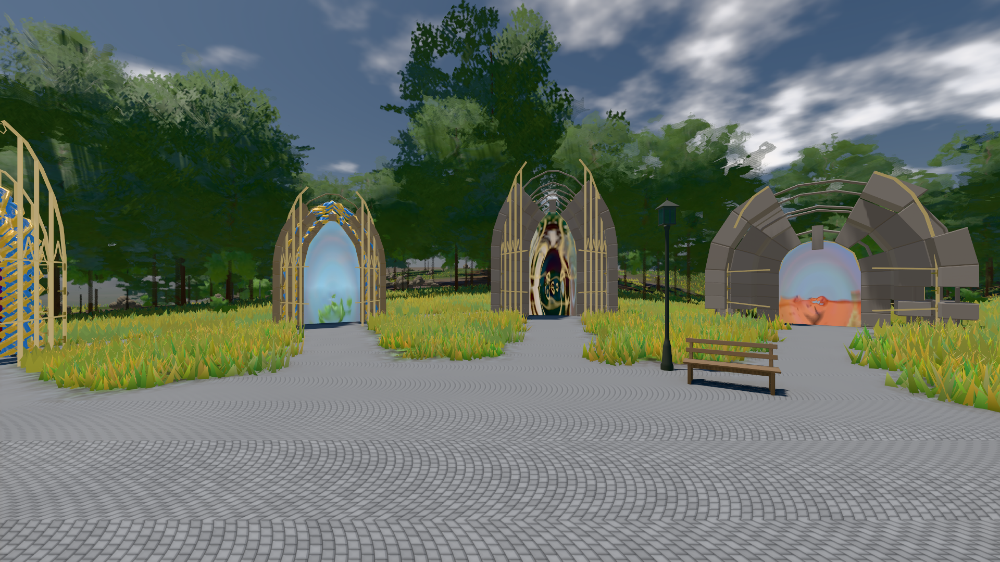
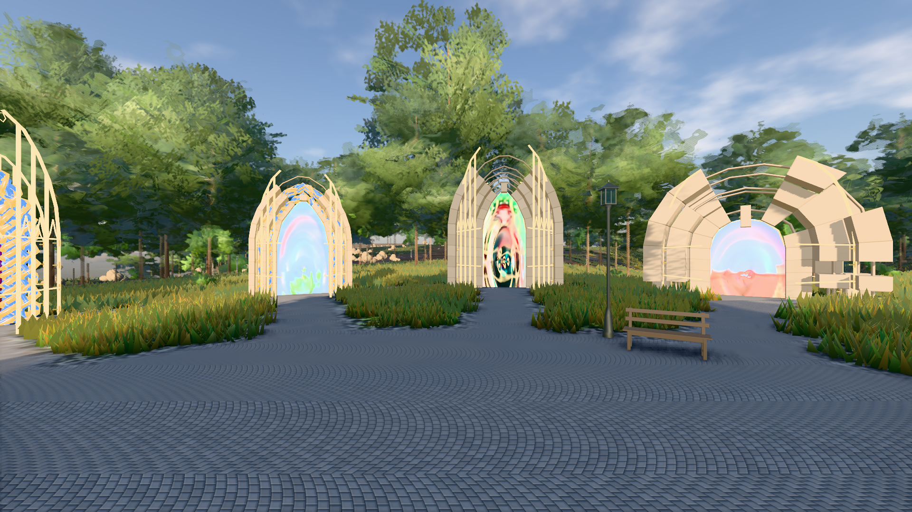

# GPU-PROBE 82aa09eb — GRÜN

Zweig `w28-stein-kamm` · Kopf 82aa09ebcab1e4ff15e7ad02022392d98531ac88 · Läufer radeon-890m · 14.11. 02:50 · Wanduhr ab Push 3658 s · Lauf https://github.com/MiguellD/AnazhRealm/actions/runs/43536688711

Ruf: `bild:genesis@0.5 bild:genesis@0.3`

## Läufer radeon-890m — GRÜN

GPU AMD Radeon(TM) 890M Graphics · node_modules bleiben (package-lock 95130897)
Schloss /c/Users/micha/AppData/Local/Temp/claude/gpu-schloss hält „ci-runner 43536688711/2 probe“
- Hook 2026-11-14 02:46:59 start ci-runner 43536688711/2 probe: Schloss genommen (refs/heads/w28-stein-kamm 82aa09ebcab1e4ff15e7ad02022392d98531ac88 ws=C:\actions-runner\_work\AnazhRealm\AnazhRealm)

### bild:genesis@0.5 — GRÜN · 63 s · Läufer radeon-890m

Adapter: [linse-gpu] amd/rdna-3

```text
Kamera des Spiels → Blick (10.0 m): 0.00 92.40 0.00 -10.00 92.40 0.00
 "abnahme": "ABNAHME GRÜN · beweis · Sicht 0.0 % · Ziel Blickziel im Bild frei 10 m · Luma 110.6 σ 42.3 schwarz 0.0 % weiß 0.0 % · Stand 18.546.276 · Bühne summer sunny 0.50 Tiere gehalten · Gerät WebGPU amd rdna-3 · Inhalt bodenSatz 36.2 % (≥ 15.0 %) Luma 140, portal-membran 2.8 % (≥ 0.3 %) Luma 139",
```



### bild:genesis@0.3 — GRÜN · 60 s · Läufer radeon-890m

Adapter: [linse-gpu] amd/rdna-3

```text
Kamera des Spiels → Blick (10.0 m): 0.00 92.40 0.00 -10.00 92.40 0.00
 "abnahme": "ABNAHME GRÜN · beweis · Sicht 0.0 % · Ziel Blickziel im Bild frei 10 m · Luma 121.1 σ 50.9 schwarz 0.0 % weiß 0.0 % · Stand 18.546.276 · Bühne summer sunny 0.30 Tiere gehalten · Gerät WebGPU amd rdna-3 · Inhalt bodenSatz 36.3 % (≥ 15.0 %) Luma 90, portal-membran 2.8 % (≥ 0.3 %) Luma 218",
```


