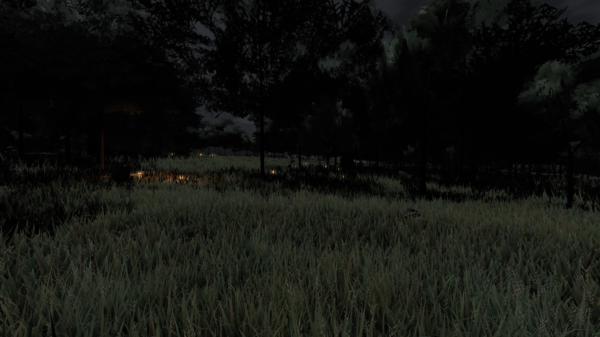

# GPU-PROBE 7ded0d46 — GRÜN

Zweig `w28-stern-bild` · Kopf 7ded0d468331f3f0ae1e3a129d0d514724f4825c · Läufer gtx1050-desktop · 20.11. 05:13 · Wanduhr ab Push 161 s · Lauf https://github.com/MiguellD/AnazhRealm/actions/runs/44672708605

Ruf: `bild:wiese@0.02`

## Läufer gtx1050-desktop — GRÜN

GPU NVIDIA GeForce GTX 1050 · node_modules bleiben (package-lock 20e3f8f6)
Schloss /c/Users/User/AppData/Local/Temp/claude/gpu-schloss hält „ci-runner 44672708605/1 probe“
- Hook 2026-11-20 05:11:40 start ci-runner 44672708605/1 probe: Schloss genommen (refs/heads/w28-stern-bild 7ded0d468331f3f0ae1e3a129d0d514724f4825c ws=C:\actions-runner\_work\AnazhRealm\AnazhRealm)

### bild:wiese@0.02 — GRÜN · 83 s · Läufer gtx1050-desktop

Adapter: [linse-gpu] nvidia/pascal

```text
Kamera des Spiels → Blick (10.0 m): -280.40 29.71 -1045.60 -289.61 29.71 -1049.50
 "abnahme": "ABNAHME GRÜN · beweis · Sicht 0.0 % · Ziel Blickziel im Bild frei 10 m · Luma 19.1 σ 18.1 schwarz 34.6 % weiß 0.0 % · Stand 18.546.346 · Bühne summer sunny 0.02 Tiere gehalten · Gerät WebGPU nvidia pascal · Inhalt nahWiese 48.2 % (≥ 15.0 %) (Nacht: Farbe ungefordert)",
```


