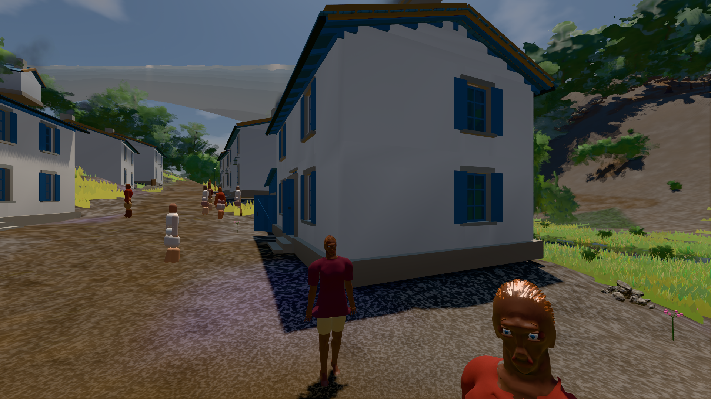

# GPU-PROBE b113d358 — GRÜN

Zweig `w28-stoff-fuge` · Kopf b113d35855f62b1ed3db480ef1c4c106e2484d73 · Läufer gtx1050-desktop · 14.11. 15:47 · Wanduhr ab Push 800 s · Lauf https://github.com/MiguellD/AnazhRealm/actions/runs/43605527374

Ruf: `bild:dorf@0.5 gate:haus-fern`

## Läufer gtx1050-desktop — GRÜN

GPU NVIDIA GeForce GTX 1050 · npm ci 33 s (package-lock 2fb635b1)
Schloss /c/Users/User/AppData/Local/Temp/claude/gpu-schloss hält „ci-runner 43605527374/1 probe“
- Hook 2026-11-14 15:34:18 start ci-runner 43605527374/1 probe: Schloss genommen (refs/heads/w28-stoff-fuge b113d35855f62b1ed3db480ef1c4c106e2484d73 ws=C:\actions-runner\_work\AnazhRealm\AnazhRealm)

### bild:dorf@0.5 — GRÜN · 153 s · Läufer gtx1050-desktop

Adapter: [linse-gpu] nvidia/pascal

```text
Kamera des Spiels → Blick (5.2 m): -704.22 39.69 -880.02 -703.05 39.69 -874.95
 "abnahme": "ABNAHME GRÜN · beweis · Sicht 0.0 % · Leib im Vordergrund 2.8 % (Leib bewohner 2.8 %) · Ziel Blickziel im Bild frei 5.2 m · Luma 74.6 σ 32.1 schwarz 0.4 % weiß 0.0 % · Stand 18.546.284 · Bühne summer sunny 0.50 Tiere gehalten · Gerät WebGPU nvidia pascal · Inhalt bauSatz 29.5 % (≥ 2.0 %) Luma 74",
```



### gate:haus-fern — GRÜN · 570 s · Läufer gtx1050-desktop

Adapter: ungenannt (die Probe nannte keinen Browser-Adapter)

```text
✅ GRÜN — jede Stufe wirft den grundriss-treuen Fernkörper, zeigt sich erst ≤ 1 px von der L0, kein Querfirst, der Körper liegt innen, jedes Türblatt sitzt an seinem Scharnier, jedes Fenster ist Glas in jeder Stufe.
```
