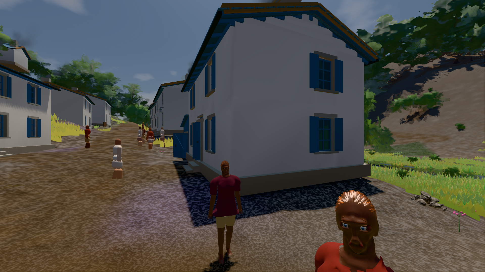

# GPU-PROBE e5e837fc — NACHGEGEBEN

Zweig `w28-stoff-fuge` · Kopf e5e837fc4a039e4ed91b8a9df95f3366e9ab71a4 · Läufer omen-gtx1060 · 14.11. 15:54 · Wanduhr ab Push 832 s · Lauf https://github.com/MiguellD/AnazhRealm/actions/runs/43606098271

Ruf: `bild:dorf@0.5 gate:haus-fern`

## Läufer omen-gtx1060 — NACHGEGEBEN

GPU NVIDIA GeForce GTX 1060 · npm ci 34 s (package-lock 2fb635b1)
Schloss /c/Users/micha/AppData/Local/Temp/claude/gpu-schloss hält „ci-runner 43606098271/1 probe“
- Hook 2026-11-14 15:47:44 start ci-runner 43606098271/1 probe: wartet auf Schloss von 'omen-sg-lmain'
- Hook 2026-11-14 15:48:59 start ci-runner 43606098271/1 probe: Schloss genommen (refs/heads/w28-stoff-fuge e5e837fc4a039e4ed91b8a9df95f3366e9ab71a4 ws=C:\actions-runner\_work\AnazhRealm\AnazhRealm)

### bild:dorf@0.5 — GRÜN · 75 s · Läufer omen-gtx1060

Adapter: [linse-gpu] nvidia/pascal

```text
Kamera des Spiels → Blick (5.2 m): -704.22 39.69 -880.02 -703.05 39.69 -874.95
 "abnahme": "ABNAHME GRÜN · beweis · Sicht 0.0 % · Leib im Vordergrund 2.8 % (Leib bewohner 2.8 %) · Ziel Blickziel im Bild frei 5.2 m · Luma 74.9 σ 32.3 schwarz 0.4 % weiß 0.0 % · Stand 18.546.284 · Bühne summer sunny 0.50 Tiere gehalten · Gerät WebGPU nvidia pascal · Inhalt bauSatz 29.5 % (≥ 2.0 %) Luma 74",
```



### gate:haus-fern — NACHGEGEBEN · 167 s · Läufer omen-gtx1060

Adapter: ungenannt (die Probe nannte keinen Browser-Adapter) · NACHGEGEBEN: Karten-Job „echt omen (GPU-Wände auf der Karte)“ (Lauf 43607204404) wartet auf diesen Läufer (omen-gpu)

```text

> anazhrealm@18.546.284 gate:haus-fern
> node scripts/diag-haus-fern.cjs

=== DIE LINSE DES HAUS-FERNKÖRPERS (gate:haus-fern) ===
  Häuser 64 (32 Kulturen × Samen 1/7): Wurf-IoU zu L0 Median 0.925 · min 0.879 · First quer 0/128 · Aufblähung Median -0.135 m · max -0.075 · Wand max -0.015 · Dach max -0.030 · Wurf-Kosten L2 Median 60
  Türblatt am Scharnier (T, Soll ≤ 0.05 m): L0 192 Blätter, Abstand Median 0.000 · max 0.000 m · L1 192 Blätter, Abstand Median 0.000 · max 0.000 m · L2 keine Blätter
  Glas je Stufe (G, Soll Glut 0.667–1.500, Tag 0.250–4, Farbe ≤ 0.15): L1/L0 Glut Median 0.955 [0.749, 1.006] · Tag Median 1.030 [0.493, 1.959] · Farbe max 0.140 · L2/L0 Glut Median 0.936 [0.725, 1.256] · Tag Median 1.056 [0.417, 2.017] · Farbe max 0.141
  Ausstattung 12: feuerstelle/s1 Wurf 1.000/0.873 (1410/24 Dreiecke) · feuerstelle/s2 Wurf 1.000/0.878 (1410/24 Dreiecke) · marktstand/s1 Wurf 1.000/0.867 (2236/40 Dreiecke) · marktstand/s2 Wurf 1.000/0.860 (1980/30 Dreiecke) · marktstand/s3 Wurf 1.000/0.860 (2000/30 Dreiecke) · brunnen/s1 Wurf 1.000/0.895 (3322/40 Dreiecke) · brunnen/s2 Wurf 1.000/0.894 (3322/40 Dreiecke) · laterne/s1 Wurf 1.000/0.862 (290/46 Dreiecke) · wandlaterne/s1 Wurf 1.000/0.872 (266/44 Dreiecke) · grabstein/s1 Wurf 1.000/0.884 (132/36 Dreiecke) · grabstein/s2 Wurf 1.000/0.884 (132/36 Dreiecke) · grabstein/s
```
