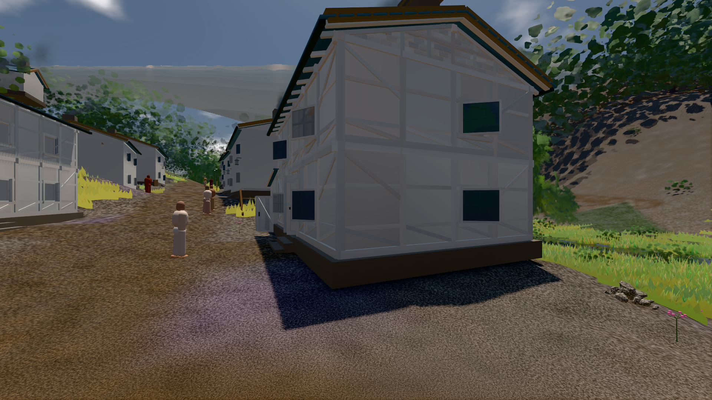

# GPU-PROBE 7e890b9d — GRÜN

Zweig `w28-stoff-gesetz` · Kopf 7e890b9d755e997108b776a44b12fa3ff459c8b5 · Läufer gtx1050-desktop · 11.11. 03:22 · Wanduhr ab Push 739 s · Lauf https://github.com/MiguellD/AnazhRealm/actions/runs/42944100686

Ruf: `gate:licht-weg:echt bild:dorf@0.5`

## Läufer gtx1050-desktop — GRÜN

GPU NVIDIA GeForce GTX 1050 · node_modules bleiben (package-lock df29564e)
Schloss /c/Users/User/AppData/Local/Temp/claude/gpu-schloss hält „ci-runner 42944100686/1 probe“
- Hook 2026-11-11 03:10:16 start ci-runner 42944100686/1 probe: wartet auf Schloss von 'hand lauf statik2 (Claude)'
- Hook 2026-11-11 03:15:47 start ci-runner 42944100686/1 probe: Schloss genommen (refs/heads/w28-stoff-gesetz 7e890b9d755e997108b776a44b12fa3ff459c8b5 ws=C:\actions-runner\_work\AnazhRealm\AnazhRealm)

### gate:licht-weg:echt — GRÜN · 178 s · Läufer gtx1050-desktop

Adapter: ungenannt (die Probe nannte keinen Browser-Adapter)

```text
LAUB-LICHT GRUEN
```

### bild:dorf@0.5 — GRÜN · 190 s · Läufer gtx1050-desktop

Adapter: [linse-gpu] nvidia/pascal

```text
Kamera des Spiels → Blick (5.2 m): -704.22 39.69 -880.02 -703.03 39.69 -874.96
 "abnahme": "ABNAHME GRÜN · beweis · Sicht 0.0 % · Ziel Blickziel im Bild frei 5.2 m · Luma 78.7 σ 30.5 schwarz 0.2 % weiß 0.0 % · Stand 18.546.249 · Bühne summer sunny 0.50 · Gerät WebGPU nvidia pascal",
```


