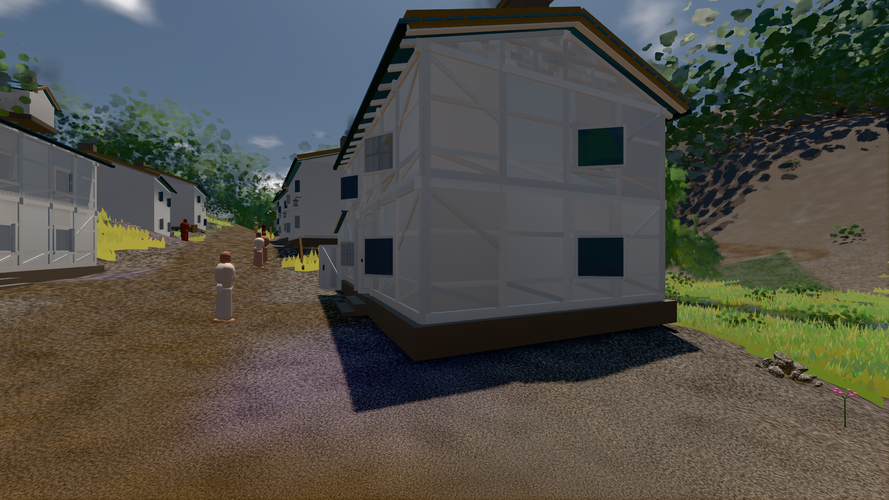

# GPU-PROBE 8ebc2d5c — ROT

Zweig `w28-stoff-gesetz` · Kopf 8ebc2d5c440acaa65bfd55b2119421cce006f597 · Läufer gtx1050-desktop · 11.11. 00:10 · Wanduhr ab Push 320 s · Lauf https://github.com/MiguellD/AnazhRealm/actions/runs/42920315515

Ruf: `bild:dorf@0.5 bild:buehne@0.5`

## Läufer gtx1050-desktop — ROT

GPU NVIDIA GeForce GTX 1050 · npm ci 40 s (package-lock df29564e)
Schloss /c/Users/User/AppData/Local/Temp/claude/gpu-schloss hält „ci-runner 42920315515/1 probe“
- Hook 2026-11-11 00:05:23 start ci-runner 42920315515/1 probe: Schloss genommen (refs/heads/w28-stoff-gesetz 8ebc2d5c440acaa65bfd55b2119421cce006f597 ws=C:\actions-runner\_work\AnazhRealm\AnazhRealm)

### bild:dorf@0.5 — GRÜN · 167 s · Läufer gtx1050-desktop

Adapter: [linse-gpu] nvidia/pascal

```text
Kamera des Spiels → Blick (5.2 m): -704.22 39.69 -880.02 -703.03 39.69 -874.96
 "abnahme": "ABNAHME GRÜN · beweis · Sicht 0.0 % · Ziel Blickziel im Bild frei 5.2 m · Luma 78.9 σ 30.7 schwarz 0.2 % weiß 0.0 % · Stand 18.546.249 · Bühne summer sunny 0.50 · Gerät WebGPU nvidia pascal",
```



### bild:buehne@0.5 — ROT · 69 s · Läufer gtx1050-desktop

Adapter: [linse-gpu] nvidia/pascal

```text
Kamera des Spiels → Blick (120.0 m): 300.00 11.46 0.00 420.00 11.46 0.00
```
