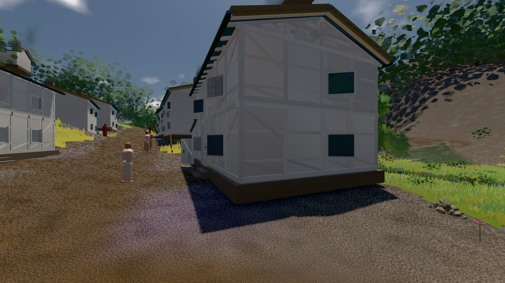
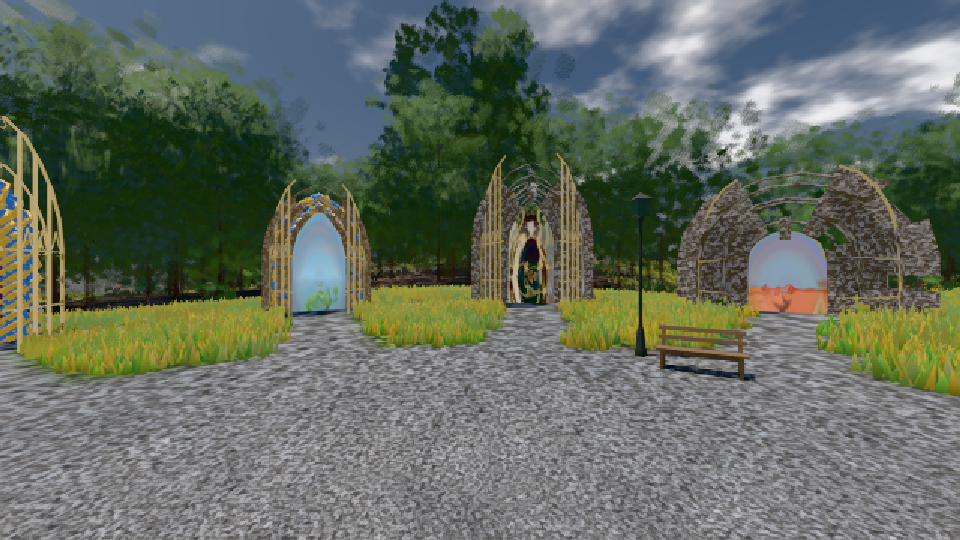

# GPU-PROBE ab6c476f — GRÜN

Zweig `w28-stoff-gesetz` · Kopf ab6c476fd6da48a2455999c41bedfca31059139a · Läufer radeon-890m · 11.11. 00:31 · Wanduhr ab Push 442 s · Lauf https://github.com/MiguellD/AnazhRealm/actions/runs/42923119666

Ruf: `bild:dorf@0.5 bild:genesis@0.5 gate:wasser-leben:bild`

## Läufer radeon-890m — GRÜN

GPU AMD Radeon(TM) 890M Graphics · npm ci 40 s (package-lock df29564e)
Schloss /c/Users/micha/AppData/Local/Temp/claude/gpu-schloss hält „ci-runner 42923119666/1 probe“
- Hook 2026-11-11 00:27:51 start ci-runner 42923119666/1 probe: Schloss genommen (refs/heads/w28-stoff-gesetz ab6c476fd6da48a2455999c41bedfca31059139a ws=C:\actions-runner\_work\AnazhRealm\AnazhRealm)

### bild:dorf@0.5 — GRÜN · 84 s · Läufer radeon-890m

Adapter: [linse-gpu] amd/rdna-3

```text
Kamera des Spiels → Blick (5.2 m): -704.22 39.69 -880.02 -703.03 39.69 -874.96
 "abnahme": "ABNAHME GRÜN · beweis · Sicht 0.0 % · Ziel Blickziel im Bild frei 5.2 m · Luma 79.1 σ 30.6 schwarz 0.2 % weiß 0.0 % · Stand 18.546.249 · Bühne summer sunny 0.50 · Gerät WebGPU amd rdna-3",
```



### bild:genesis@0.5 — GRÜN · 44 s · Läufer radeon-890m

Adapter: [linse-gpu] amd/rdna-3

```text
Kamera des Spiels → Blick (10.0 m): 0.00 92.40 0.00 -10.00 92.40 0.00
 "abnahme": "ABNAHME GRÜN · beweis · Sicht 0.0 % · Ziel Blickziel im Bild frei 10 m · Luma 105.2 σ 39.9 schwarz 0.0 % weiß 0.0 % · Stand 18.546.249 · Bühne summer sunny 0.50 · Gerät WebGPU amd rdna-3",
```



### gate:wasser-leben:bild — GRÜN · 22 s · Läufer radeon-890m

Adapter: [linse-gpu] amd/rdna-3

```text
WASSER-LEBEN GRÜN
```
