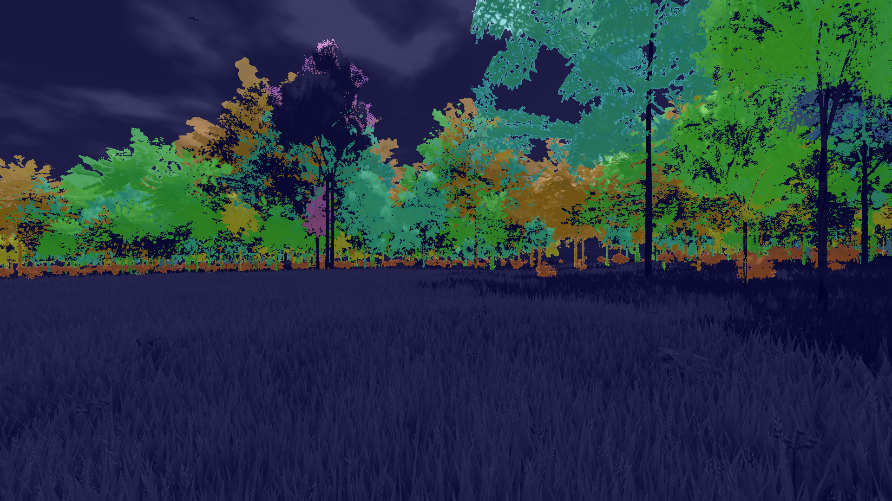
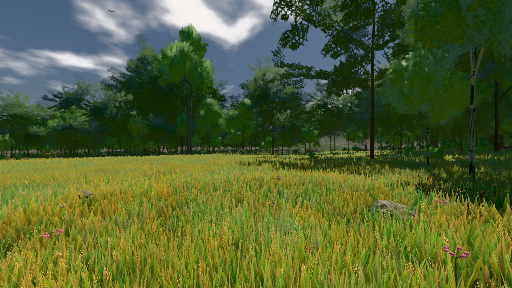
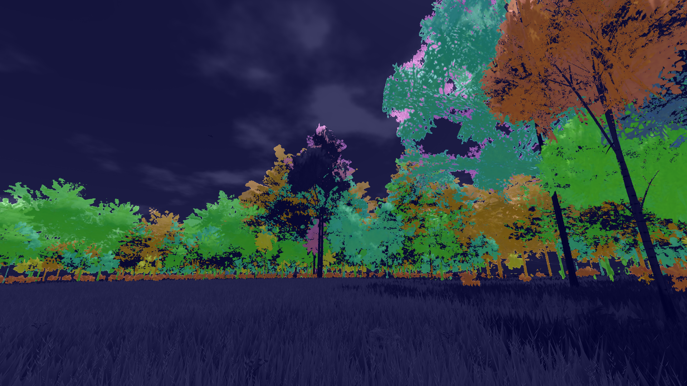
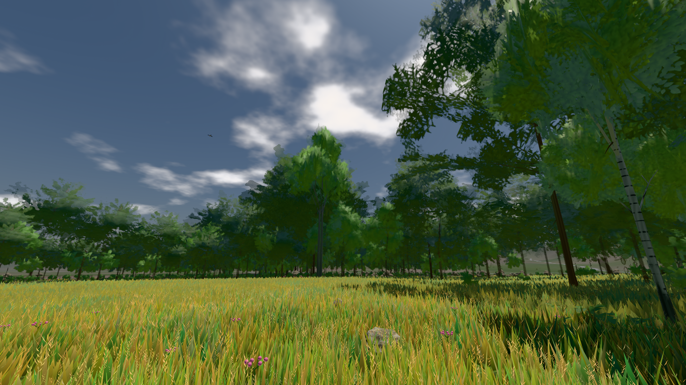
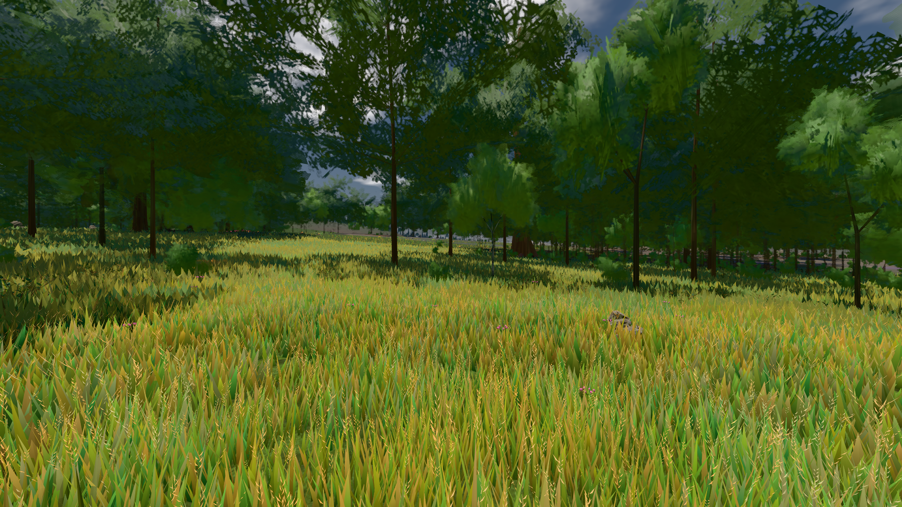
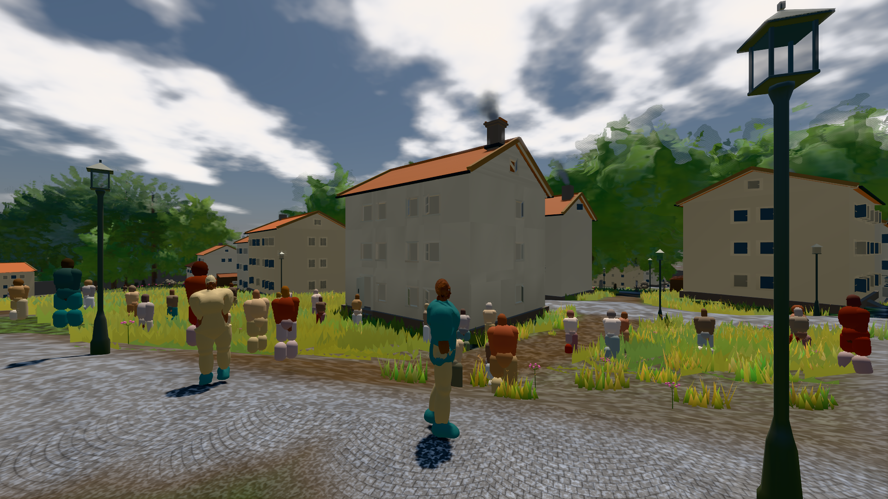

# GPU-PROBE 1c6a4116 — GRÜN · ROT wie an main (bekannt): gate:laub-kante: lod.K1#1 (main gtx: ungemessen) auf omen-gtx1060

Zweig `w28-strauch-gestalt` · Kopf 1c6a411606de7f0c5e0b9490af53f85a15bbfbf8 · Läufer omen-gtx1060 · 12.11. 13:07 · Wanduhr ab Push 468 s · Lauf https://github.com/MiguellD/AnazhRealm/actions/runs/43213902339

Ruf: `gate:laub-kante bild:wiese@0.5 bild:stadt-voll@0.5`

## Läufer omen-gtx1060 — GRÜN

GPU NVIDIA GeForce GTX 1060 · node_modules bleiben (package-lock b254a196)
Schloss /c/Users/micha/AppData/Local/Temp/claude/gpu-schloss hält „ci-runner 43213902339/1 probe“
- Hook 2026-11-12 13:00:03 start ci-runner 43213902339/1 probe: wartet auf Schloss von 'omen-punkte-gtx-sitzung'
- Hook 2026-11-12 13:00:18 start ci-runner 43213902339/1 probe: Schloss genommen (refs/heads/w28-strauch-gestalt 1c6a411606de7f0c5e0b9490af53f85a15bbfbf8 ws=C:\actions-runner\_work\AnazhRealm\AnazhRealm)

### gate:laub-kante — BEKANNT · 140 s · Läufer omen-gtx1060

Adapter: ungenannt (die Probe nannte keinen Browser-Adapter) · ROT wie an main (bekannt): lod.K1#1 (main gtx: ungemessen)

```text
lod.K1#1 Tafel-Pose ROT [["f:birke:L0",0.1952,140101,0,0,0],["f:birke:L1",0.2098,80901,0,0,0],["f:fichte:L0",0.1443,15877,0,0.0001,1],["f:fichte:L1",0.1845,136816,0,0,0],["f:tanne:L1",0.2119,16743,0,0,0],["fimp:birke:L2",0.1946,12754,0,0,0],["fimp:buche:L2",0.2256,6387,0,0.0005,3],["fimp:eiche:L2",0.1763,60029,0,0,0],["fimp:fichte:L2",0.1876,99063,0.0003,0.0001,2],["fimp:strauch:L2",0.2859,20151,0,0,0],["fimp:tanne:L2",0.1889,141218,0.0001,0.0003,11]]
lod.K1#1 Spielgang ROT [["f:birke:L1",0.1752,125442,0,0,0],["f:fichte:L1",0.1783,152668,0,0,1],["f:tanne:L1",0.1881,8184,0,0,0],["fimp:birke:L2",0.2075,22938,0,0,0],["fimp:buche:L2",0.1994,6879,0,0.0006,2],["fimp:eiche:L2",0.1675,58642,0,0,0],["fimp:fichte:L2",0.1863,100467,0,0.0004,5],["fimp:strauch:L2",0.2622,24104,0,0,0],["fimp:tanne:L2",0.1874,132883,0,0.0002,3]]
 "abnahme": "ABNAHME GRÜN · beweis · Sicht 0.0 % · Ziel Blickziel im Bild frei 12 m · Luma 91.8 σ 45.3 schwarz 0.0 % weiß 0.0 % · Stand 18.546.263 · Bühne summer sunny 0.50 Tiere gehalten · Gerät WebGPU nvidia pascal",
 "fehler": "lod.K1#1 ROT: Tafel-Pose fimp:buche:L2 0.2256, fimp:fichte:L2 0.1876, fimp:strauch:L2 0.2859, fimp:tanne:L2 0.1889 · Spielgang fimp:strauch:L2 0.2622 (Soll ≤ 0,22, zweiton 0)"
```









### bild:wiese@0.5 — GRÜN · 50 s · Läufer omen-gtx1060

Adapter: [linse-gpu] nvidia/pascal

```text
Kamera des Spiels → Blick (10.0 m): -280.40 29.71 -1045.60 -289.61 29.71 -1049.50
 "abnahme": "ABNAHME GRÜN · beweis · Sicht 0.0 % · Ziel Blickziel im Bild frei 10 m · Luma 82.6 σ 42.8 schwarz 0.0 % weiß 0.0 % · Stand 18.546.263 · Bühne summer sunny 0.50 Tiere gehalten · Gerät WebGPU nvidia pascal · Inhalt nahWiese 48.4 % (≥ 15.0 %) h 107° Luma 120",
```



### bild:stadt-voll@0.5 — GRÜN · 141 s · Läufer omen-gtx1060

Adapter: [linse-gpu] nvidia/pascal

```text
Kamera des Spiels → Blick (14.6 m): 837.84 58.51 445.42 842.31 58.51 459.32
 "abnahme": "ABNAHME GRÜN · bekannt stadt-voll.leib hält jetzt (der Eintrag fällt) · beweis · Sicht 1.6 % (Leib bewohner (≤ 7.3 m) 1.6 %) · Ziel Blickziel im Bild frei 14.6 m, verdeckt nur von Leibern: 1 Punkt, nächster 3.75 m (Leib bewohner) · Luma 114.1 σ 57.2 schwarz 0.0 % weiß 0.0 % · Stand 18.546.263 · Bühne summer sunny 0.50 Tiere gehalten · Gerät WebGPU nvidia pascal · Inhalt bauSatz 19.6 % (≥ 2.0 %) Luma 79, bewohner 1.7 % (≥ 1.0 %) Luma 78",
```


