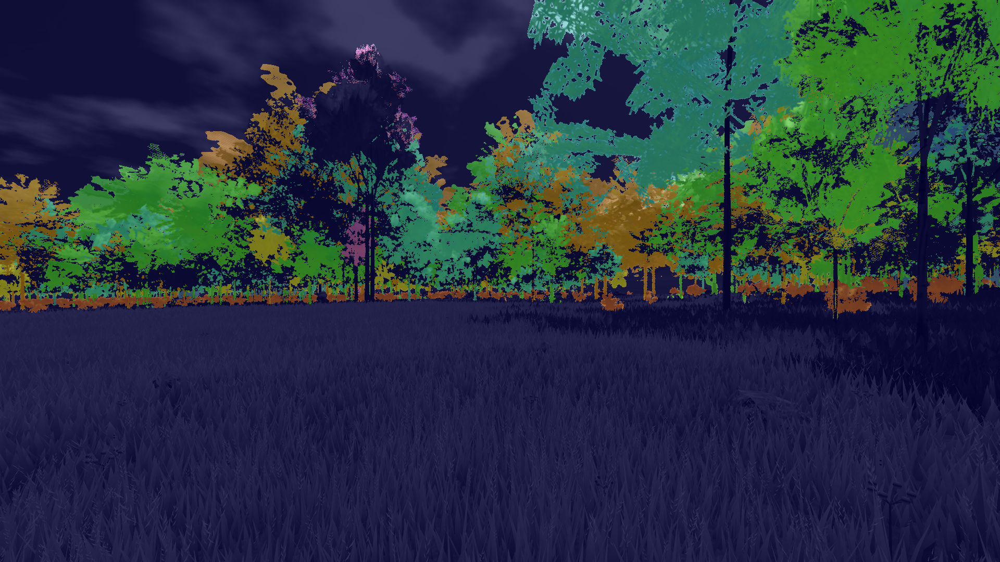
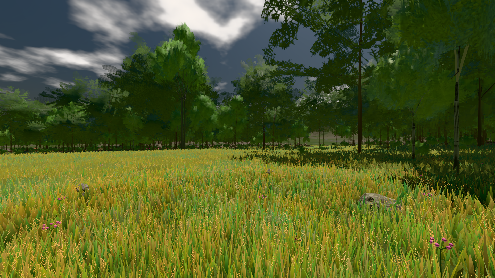
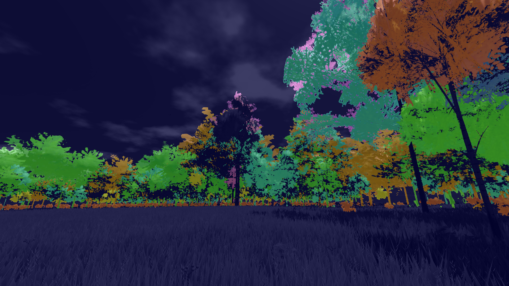
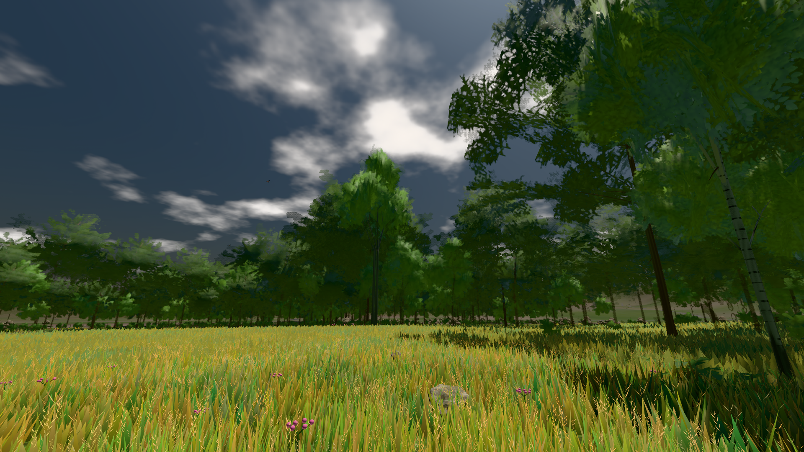
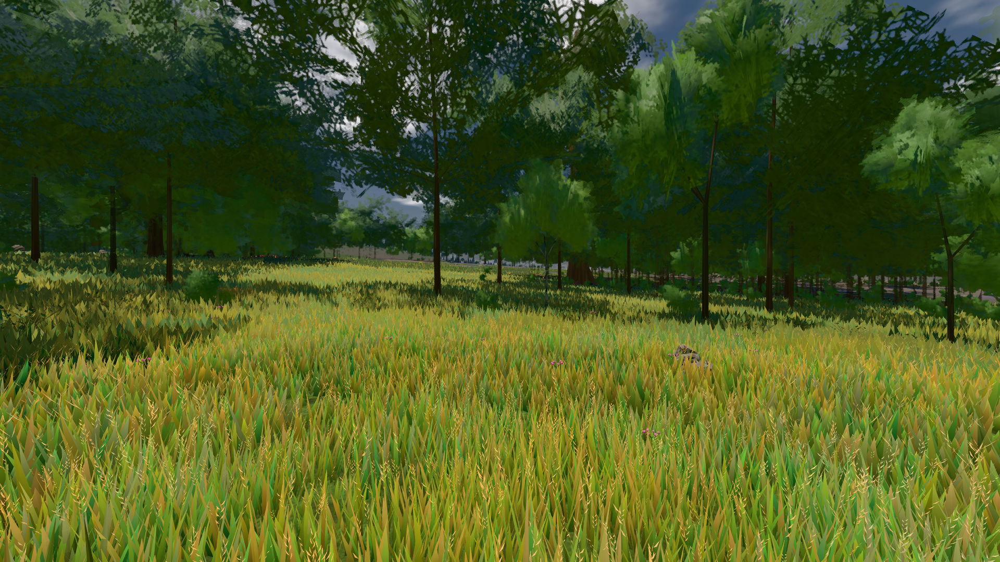
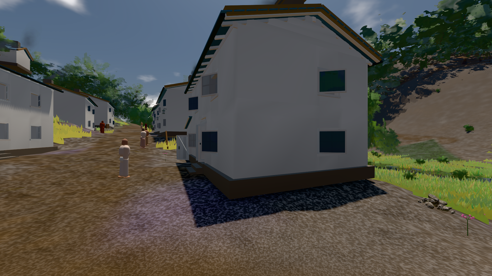

# GPU-PROBE 1cca15bc — GRÜN · ROT wie an main (bekannt): gate:laub-kante: lod.K1#1 Tafel-Pose schlechteste fimp:strauch:L2 0.2728 · Karte fimp: auf radeon-890m

Zweig `w28-strauch-gestalt` · Kopf 1cca15bc4c6483693e2ae86bc64b9eb281295809 · Läufer radeon-890m · 12.11. 10:42 · Wanduhr ab Push 724 s · Lauf https://github.com/MiguellD/AnazhRealm/actions/runs/43192069101

Ruf: `gate:laub-kante bild:wiese@0.5 bild:dorf@0.5`

## Läufer radeon-890m — GRÜN

GPU AMD Radeon(TM) 890M Graphics · node_modules bleiben (package-lock be69df15)
Schloss /c/Users/micha/AppData/Local/Temp/claude/gpu-schloss hält „ci-runner 43192069101/1 probe“
- Hook 2026-11-12 10:37:21 start ci-runner 43192069101/1 probe: Schloss genommen (refs/heads/w28-strauch-gestalt 1cca15bc4c6483693e2ae86bc64b9eb281295809 ws=C:\actions-runner\_work\AnazhRealm\AnazhRealm)

### gate:laub-kante — BEKANNT · 147 s · Läufer radeon-890m

Adapter: ungenannt (die Probe nannte keinen Browser-Adapter) · ROT wie an main (bekannt): lod.K1#1 Tafel-Pose schlechteste fimp:strauch:L2 0.2728 · Karte fimp:

```text
lod.K1#1 Tafel-Pose ROT [["f:birke:L0",0.1933,129343,0,0,0],["f:birke:L1",0.2158,79869,0,0,0],["f:fichte:L0",0.1423,16043,0,0.0001,1],["f:fichte:L1",0.1785,134040,0,0,0],["f:tanne:L1",0.2115,15252,0,0,0],["fimp:birke:L2",0.1646,11325,0,0,0],["fimp:buche:L2",0.1956,5183,0,0.0002,1],["fimp:eiche:L2",0.1498,51952,0,0,0],["fimp:fichte:L2",0.1937,86593,0,0.0001,3],["fimp:strauch:L2",0.2879,19749,0,0,0],["fimp:tanne:L2",0.1794,128555,0,0.0004,8]]
lod.K1#1 Spielgang ROT [["f:birke:L1",0.1789,112532,0,0,0],["f:fichte:L1",0.1772,147722,0,0,1],["f:tanne:L1",0.1685,6518,0,0,0],["fimp:birke:L2",0.191,19950,0,0,0],["fimp:buche:L2",0.1577,5315,0,0.0034,9],["fimp:eiche:L2",0.1581,48596,0,0,0],["fimp:fichte:L2",0.1939,87994,0,0.0002,3],["fimp:strauch:L2",0.2489,23343,0,0,0],["fimp:tanne:L2",0.1912,115742,0,0.0001,4]]
 "abnahme": "ABNAHME GRÜN · beweis · Sicht 0.0 % · Ziel Blickziel im Bild frei 12 m · Luma 87.6 σ 44.8 schwarz 0.0 % weiß 0.0 % · Stand 18.546.262 · Bühne summer sunny 0.50 Tiere gehalten · Gerät WebGPU amd rdna-3",
 "fehler": "lod.K1#1 ROT: Tafel-Pose fimp:strauch:L2 0.2879 · Spielgang fimp:strauch:L2 0.2489 (Soll ≤ 0,22, zweiton 0)"
```









### bild:wiese@0.5 — GRÜN · 48 s · Läufer radeon-890m

Adapter: [linse-gpu] amd/rdna-3

```text
Kamera des Spiels → Blick (10.0 m): -280.40 29.71 -1045.60 -289.61 29.71 -1049.50
 "abnahme": "ABNAHME GRÜN · beweis · Sicht 0.0 % · Ziel Blickziel im Bild frei 10 m · Luma 82.6 σ 42.8 schwarz 0.0 % weiß 0.0 % · Stand 18.546.262 · Bühne summer sunny 0.50 Tiere gehalten · Gerät WebGPU amd rdna-3 · Inhalt nahWiese 48.4 % (≥ 15.0 %) h 107° Luma 120",
```



### bild:dorf@0.5 — GRÜN · 76 s · Läufer radeon-890m

Adapter: [linse-gpu] amd/rdna-3

```text
Kamera des Spiels → Blick (5.2 m): -704.22 39.69 -880.02 -703.03 39.69 -874.96
 "abnahme": "ABNAHME GRÜN · beweis · Sicht 0.0 % · Ziel Blickziel im Bild frei 5.2 m · Luma 79.4 σ 30.8 schwarz 0.4 % weiß 0.0 % · Stand 18.546.262 · Bühne summer sunny 0.50 Tiere gehalten · Gerät WebGPU amd rdna-3 · Inhalt bauSatz 30.1 % (≥ 2.0 %) Luma 78",
```


