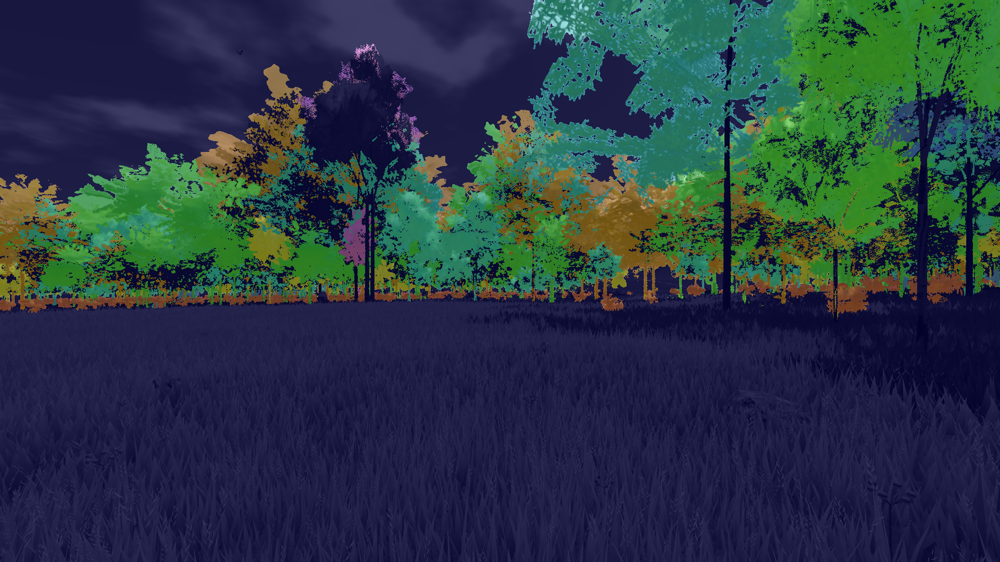
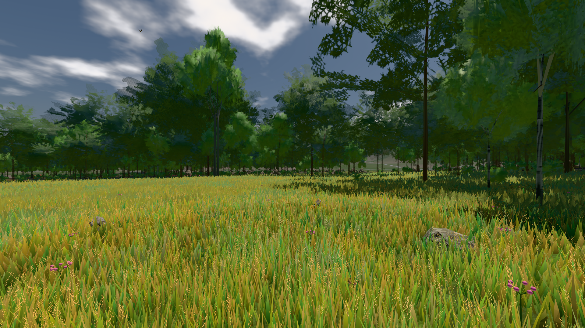
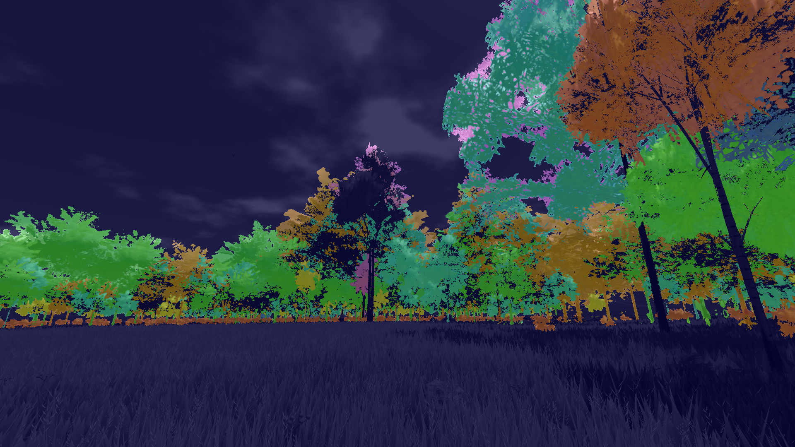
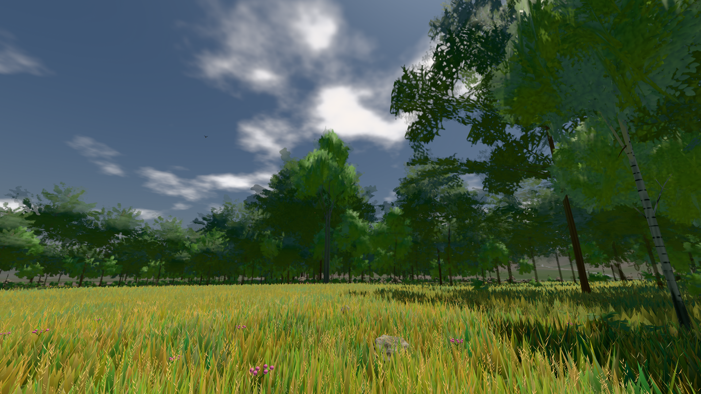
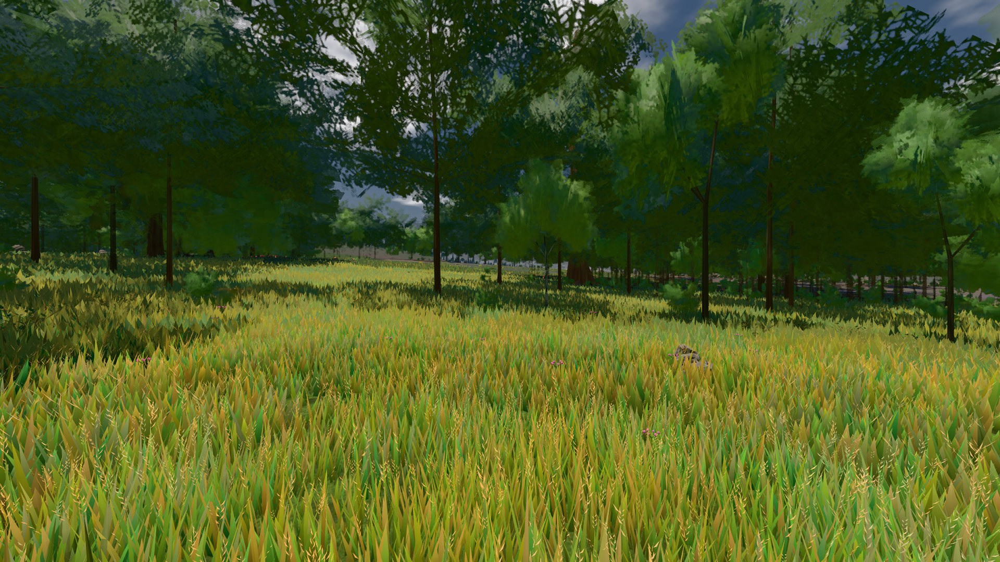
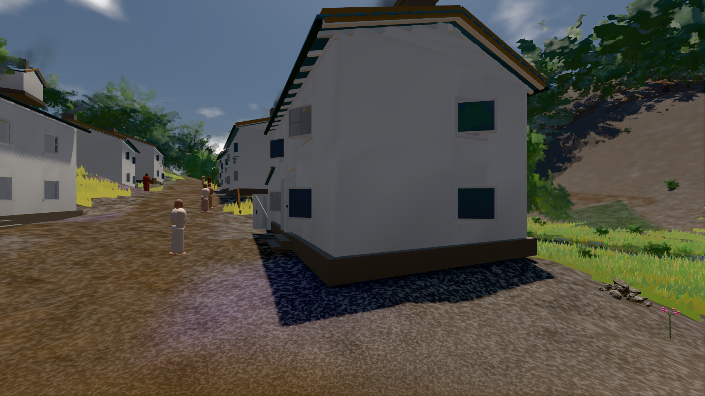

# GPU-PROBE 262acf1b — GRÜN · ROT wie an main (bekannt): gate:laub-kante: lod.K1#1 (main gtx: ungemessen) auf omen-gtx1060

Zweig `w28-strauch-gestalt` · Kopf 262acf1b67bcd8faad1970a54866980090403177 · Läufer omen-gtx1060 · 12.11. 10:00 · Wanduhr ab Push 381 s · Lauf https://github.com/MiguellD/AnazhRealm/actions/runs/43186767452

Ruf: `gate:laub-kante bild:wiese@0.5 bild:dorf@0.5`

## Läufer omen-gtx1060 — GRÜN

GPU NVIDIA GeForce GTX 1060 · node_modules bleiben (package-lock db0dbb29)
Schloss /c/Users/micha/AppData/Local/Temp/claude/gpu-schloss hält „ci-runner 43186767452/1 probe“
- Hook 2026-11-12 09:55:19 start ci-runner 43186767452/1 probe: Schloss genommen (refs/heads/w28-strauch-gestalt 262acf1b67bcd8faad1970a54866980090403177 ws=C:\actions-runner\_work\AnazhRealm\AnazhRealm)

### gate:laub-kante — BEKANNT · 135 s · Läufer omen-gtx1060

Adapter: ungenannt (die Probe nannte keinen Browser-Adapter) · ROT wie an main (bekannt): lod.K1#1 (main gtx: ungemessen)

```text
lod.K1#1 Tafel-Pose ROT [["f:birke:L0",0.1952,140101,0,0,0],["f:birke:L1",0.2102,80905,0,0,0],["f:fichte:L0",0.1441,15863,0,0.0001,1],["f:fichte:L1",0.1832,137306,0,0,0],["f:tanne:L1",0.2126,16740,0,0,0],["fimp:birke:L2",0.1926,12872,0,0,0],["fimp:buche:L2",0.2282,6420,0,0.0003,2],["fimp:eiche:L2",0.1802,58219,0,0,0],["fimp:fichte:L2",0.1887,99354,0,0.0001,2],["fimp:strauch:L2",0.2914,19927,0,0,0],["fimp:tanne:L2",0.188,142100,0,0.0003,10]]
lod.K1#1 Spielgang ROT [["f:birke:L1",0.1747,125435,0,0,0],["f:fichte:L1",0.1796,153282,0,0,1],["f:tanne:L1",0.1849,8189,0,0,0],["fimp:birke:L2",0.2048,22959,0,0,0],["fimp:buche:L2",0.1988,6881,0,0.0006,2],["fimp:eiche:L2",0.1709,56654,0,0,0],["fimp:fichte:L2",0.186,100739,0,0.0004,4],["fimp:strauch:L2",0.2517,23903,0,0,0],["fimp:tanne:L2",0.1871,133855,0,0.0002,3]]
 "abnahme": "ABNAHME GRÜN · beweis · Sicht 0.0 % · Ziel Blickziel im Bild frei 12 m · Luma 91.8 σ 45.3 schwarz 0.0 % weiß 0.0 % · Stand 18.546.261 · Bühne summer sunny 0.50 Tiere gehalten · Gerät WebGPU nvidia pascal",
 "fehler": "lod.K1#1 ROT: Tafel-Pose fimp:buche:L2 0.2282, fimp:strauch:L2 0.2914 · Spielgang fimp:strauch:L2 0.2517 (Soll ≤ 0,22, zweiton 0)"
```









### bild:wiese@0.5 — GRÜN · 50 s · Läufer omen-gtx1060

Adapter: [linse-gpu] nvidia/pascal

```text
Kamera des Spiels → Blick (10.0 m): -280.40 29.71 -1045.60 -289.61 29.71 -1049.50
 "abnahme": "ABNAHME GRÜN · beweis · Sicht 0.0 % · Ziel Blickziel im Bild frei 10 m · Luma 82.6 σ 42.8 schwarz 0.0 % weiß 0.0 % · Stand 18.546.261 · Bühne summer sunny 0.50 Tiere gehalten · Gerät WebGPU nvidia pascal · Inhalt nahWiese 48.4 % (≥ 15.0 %) h 107° Luma 120",
```



### bild:dorf@0.5 — GRÜN · 84 s · Läufer omen-gtx1060

Adapter: [linse-gpu] nvidia/pascal

```text
Kamera des Spiels → Blick (5.2 m): -704.22 39.69 -880.02 -703.03 39.69 -874.96
 "abnahme": "ABNAHME GRÜN · beweis · Sicht 0.0 % · Ziel Blickziel im Bild frei 5.2 m · Luma 79.2 σ 30.9 schwarz 0.3 % weiß 0.0 % · Stand 18.546.261 · Bühne summer sunny 0.50 Tiere gehalten · Gerät WebGPU nvidia pascal · Inhalt bauSatz 30.1 % (≥ 2.0 %) Luma 78",
```


